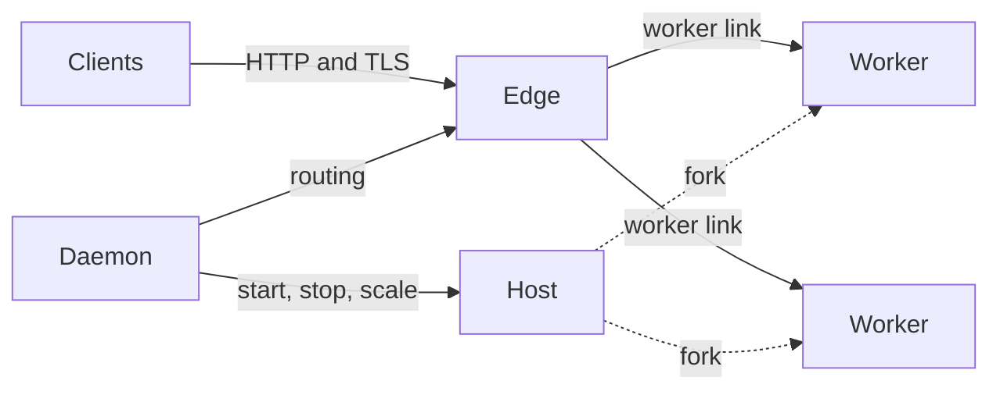

# Architecture

```{admonition} Status
:class: warning

This page describes the design Muru is being built to, so that the shape of
the system can be understood before it ships. Today a single edge process
and a host with forked workers serve WSGI applications in development mode,
over the worker link described here. The daemon, releases and traffic
policies do not exist yet. The [roadmap](../project/roadmap.md) says what
comes when.
```

Muru splits serving a Python web application into three kinds of process
with different jobs:

- **The edge** accepts client connections. It terminates TLS, speaks HTTP/1.1
  and HTTP/2 to clients, decides where each request goes, and forwards it to
  a worker. It is written in Rust and never runs Python.

- **Workers** run your application. Each worker is a process with a Python
  interpreter, your code imported into it, and a small Rust layer that talks
  to the edge. Workers are forked from a **host** process that imported the
  application once.

- **The daemon** decides what should be running and keeps it running: which
  releases exist, how many workers each needs, when to replace one, and how
  traffic is divided between releases. It is never on the path a request
  takes.



## The path a request takes

1. The edge accepts the connection, completes the TLS handshake and reads the
   request. Client-facing concerns end here: HTTP syntax, keep-alive,
   HTTP/2 multiplexing, request limits, trusted proxy headers.

2. The edge matches the request to a virtual host and a route. A route can
   be served by the edge itself (static files, redirects, error pages,
   another HTTP upstream) or by an application.

3. For an application, the edge picks a release according to the traffic
   policy, a worker group by path, and then the worker in that group with the
   fewest requests in flight. If every worker is busy the request waits in a
   bounded queue.

4. The request crosses the worker link as a small typed message: method,
   path, headers and connection details already parsed, followed by the body
   as it arrives. No HTTP is re-serialised on this hop. [The worker
   protocol](worker-protocol.md) describes it.

5. In the worker, the Rust layer hands the request to an application thread
   (WSGI) or the event loop (ASGI). The application runs exactly as it would
   under any other server: it sees a normal environ or scope, reads the body
   on demand, and produces a response.

6. The response head and body flow back the same way, with small chunks
   coalesced so that an application yielding many tiny pieces does not pay
   for each one. The edge writes to the client at the client's pace, and
   files handed over by the application are sent by the edge directly from
   the file rather than copied through the worker.

Request bodies flow the same way, on demand. The edge reads from the
client as the application reads from wsgi.input or receive(), so an
application that never reads the body does not cause it to be read, and an
application that answers before the body has arrived stops the upload at
the edge. Small remainders are discarded so the client's connection can be
kept alive; large ones close it after the response, which is what RFC 9110
asks a server to do.

The daemon takes no part in any of this. If it is restarted or upgraded,
traffic keeps flowing on the edge's last known routing. If the edge is
replaced, the new process takes over the listening sockets without refusing
connections. If a worker crashes, its in-flight requests fail and the host
forks a replacement.

## What each process is responsible for

| Process | Owns | Does not do |
| --- | --- | --- |
| Edge | Listeners, TLS, HTTP, routing, load balancing, queues and limits, static files, compression, access logs | Run Python, hold state that cannot be rebuilt from routing |
| Host | Importing the application once, forking workers, replacing workers that die | Serve requests |
| Worker | Running the application, the WSGI and ASGI bridges, per-request threads or the event loop | Talk to clients, manage other workers |
| Daemon | Releases, scaling, supervision, the admin API and dashboard | Carry traffic |

A release is an immutable combination of application code, Python version
and settings. Several can run side by side, each with its own host and
workers, and traffic moves between them by policy. That is what makes
zero-downtime deploys, canaries and instant rollback routing changes rather
than restarts. The [releases page](../project/design/09-releases-and-traffic-management.md)
of the design covers them.

## What the extra hop costs, and why it rarely matters

A server that runs the application inside the process that talks to clients
avoids one hop. Muru's edge and worker model pays for that hop with one more
copy of every byte and some tens of microseconds of work per request,
measured on the worker link with both processes on the same machine.

In practice that cost disappears behind two larger numbers:

- **Application time.** A Python view that touches a database or renders a
  template costs milliseconds. The hop is a small fraction of a percent of
  that. Only an application that does almost nothing per request can see the
  difference, and such applications are rare outside benchmarks.

- **Network capacity.** The link between edge and worker moves several
  gigabytes per second on a single core. A large response is limited by the
  network between the server and its clients long before it is limited by
  the hop, and large responses that are files bypass the worker entirely
  because the edge sends them from the file.

What the hop buys is everything the process boundary makes possible: an
edge that keeps serving while the application is replaced, several versions
of an application running at once, workers that can be recycled, limited and
restarted without touching the edge, a different Python version per
release, and a client-facing process that cannot be stalled by a slow
request in Python.

## Further reading

- [The worker protocol](worker-protocol.md): how the edge and workers talk.
- [Process models, threads and the GIL](process-models.md): what runs your
  code and how to size it.
- The design specification's [architecture](../project/design/02-architecture.md),
  [edge](../project/design/04-edge.md) and
  [process management](../project/design/07-process-management.md) pages for
  the detail.
