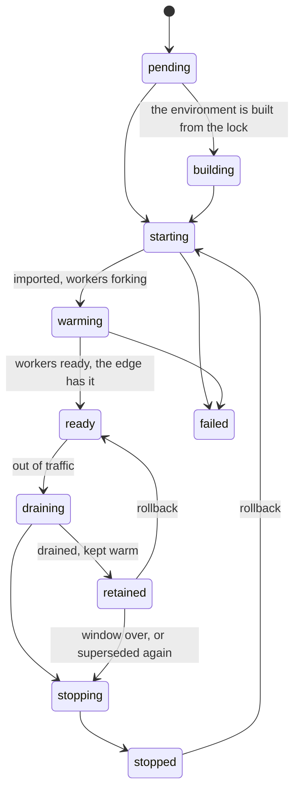

# Releases and traffic policies

```{admonition} Status
:class: note

Everything on this page is implemented under the daemon, on one node.
Mirroring requests to a candidate as shadow traffic, and overlays that
activate on conditions, are still to come.
```

Under the daemon an application is never changed in place. Each deploy
creates a release, the new release runs beside the old, and the edge
decides for every request which of them answers it. This page explains
how those pieces fit together: what a release is, what keeps one
running, how the edge chooses a release for a request, and how rollouts
and overlays build on that choice. The how-to guides on
[the daemon](../howto/daemon.md), [traffic between
releases](../howto/traffic.md), [rollouts](../howto/rollouts.md) and
[overlays](../howto/overlays.md) cover the commands and settings.

## A release is fixed

A release is a source directory and the settings fixed when it was
created: the entrypoint, the interpreter, processes and threads,
timeouts, memory policy, environment, worker groups and the rest.
Nothing about a release changes after that. New code, a new setting or a
new interpreter is a new release, with the next id, `r1`, `r2` and so on.
A development run's reload on change works the same way: it starts a new
release from the same source, and never reloads a module inside a
running worker.

Each release has a host process of its own that imported the
application, and workers forked from that host. Two releases of one
application are two sets of processes, so they can run side by side
with different code, different settings or a different Python, and the
edge can send each request to either.

## The life of a release



A release is ready only when every worker group has its workers ready
and the edge has been given the release, so a release that `muructl
release wait` reports as ready can already take a request. A release
that fails to start leaves the release before it serving; nothing moves
until the new one is ready.

When a deploy replaces the serving release, the old one drains: the edge
gives it no new requests, the requests it has finish, and it is then
retained, kept warm with its host and one worker per group for a
retention window of 30 minutes. A rollback within the window moves
traffic back to it at once, and its groups grow back by forking from the
host. One release per application is retained; a release superseded a
second time, or one whose window ends, stops. A stopped release can
still be rolled back to, by starting it again first.

## What keeps a release running

A release runs while something needs it, and drains when nothing does.
What needs a release:

- being the application's serving release, which takes every request
  that nothing else claims;

- being held, started with `--hold` and waiting for a rollout or a
  promotion;

- being named in a route's traffic policy, even with a share of 0;

- being a rollout's candidate, or the baseline it is judged against;

- being the release a sticky client was given, for `sticky_grace` after
  it leaves the route;

- being retained, within its window.

So a deploy that would drain a release that a policy still names leaves
it running, and a policy that stops naming a release that is not the
serving one lets it drain and be retained, as a deploy would.

## How a request finds its release

The edge matches a request to a route by host and path, and the route
names an application. A route with no traffic policy sends the request
to the application's serving release. A route with one decides in this
order, and the first that applies wins:

1. **A preview.** A `Muru-Preview` header or `muru_preview` cookie
   naming a release the edge has for the application sends the request
   there. This is how a held release, or one with a share of 0, is
   checked before clients reach it.

2. **A client class.** When the request's [client
   class](../howto/client-classes.md) is given a release in the policy's
   `classes`, it goes there. A cohort of testers or a customer tier is a
   class.

3. **A sticky cookie.** With `sticky = true`, a `muru_release` cookie
   naming a release the route still has sends the client back to it.

4. **The split.** The client's key, the anonymous id cookie the edge
   issues unless the policy names a header, a cookie or the client's
   address, is hashed with the policy's salt to one of 10,000 buckets.
   Each release in `split` owns a contiguous range of buckets, the newest
   at the top, and the serving release takes the buckets left over.

5. **The serving release**, when nothing above applies.

The buckets are what make a split stable. A client's bucket depends only
on its key and the salt, so it is the same on every request, in every
edge process and after an edge is replaced. A release's range grows
downward from the top, so a client in a canary at 10% is still in it at
25% and at 50%, and a client outside it stays outside it until the share
reaches its bucket. Routes with different salts spread the same clients
differently, so two experiments do not pick the same people.

An overlay works before any of this, by changing the route itself while
it is active: its target, its traffic policy (a pin to one release, or
different shares), its mode or its methods.

## Strategies are policies over time

The ways of moving traffic between releases are all made of the same
parts: releases kept running, and route policies that change.

- **A deploy** moves all of the application's traffic to the new release
  as soon as it is ready and drains the old one. This is blue/green, done
  at once.

- **Hold and promote** starts the release with no traffic, leaves it for
  checking through previews, and moves everything with `muructl rollout
  bluegreen` when it is right.

- **A canary** is a rollout: the daemon gives the candidate a share on
  the application's routes, step by step, judges each step, and either
  promotes the candidate or takes it out of traffic.

- **An A/B test** is a client class given a release, for a cohort chosen
  by header or cookie, or a split with a salt of its own, for a share of
  all clients.

- **A dark launch** is a release with a share of 0, reached only by
  preview.

- **Routes on different releases** are routes whose policies give
  different releases 100%, such as a legacy path held on an older release
  while deploys move the rest of the site.

## How a rollout judges

A rollout's step is judged on the requests served while its share was in
force, and the candidate is compared with the baseline, the release that
serves the rest, over the same window. A gate fails only when the
candidate is both over its limit and worse than the baseline, so a fault
the two releases share, a database outage say, does not roll the
candidate back. Until the candidate has served `--min-requests` requests
in the step, the request-based gates do not judge; a step whose hold has
passed holds on until there are enough.

Two kinds of evidence decide at once, whatever the request count: a
worker of the candidate that crashes or is killed by a timeout, and a
probe URL that fails on the candidate more often than on the baseline.
A gate that fails rolls back immediately, without waiting for the hold
to end, and the candidate is kept warm with its logs and workers for
looking at.

While a rollout runs, its share is live state the daemon changes. It is
not part of the configuration `muructl config export` writes, and while
an overlay pins or splits the route's traffic, the rollout waits.

## How overlays layer

An overlay is a named piece of configuration laid over routes and
applications while it is active, by hand, by schedule or by a monitoring
system's webhook. The configuration underneath is never edited, so when
the overlay ends the routes are as they would have been without it,
including any change made to them in the meantime. Two overlays may not
set the same field unless they have different priorities, and then the
higher one's value stands while both are active; capacity is the
exception, where the highest floor and ceiling apply. `muructl config
show --effective` shows the configuration with the active overlays
applied and says which overlay set what.

A deploy freeze is an overlay too: while one is active for an
application, its deploys and rollouts are refused unless overridden, and
a rollout under way holds its step. Rolling back is never frozen.

## Declared and live state

What `muructl apply` reads and `muructl config export` writes is the
declared state: applications, their releases, routes with their traffic
policies, client classes and overlays. A rollout's current share, a pin
set with `muructl scale`, and a temporary floor from `scale --min` are
live state, kept by the daemon and left out of the export, so applying
a file does not undo a rollout in progress. `config export
--resolve-rollouts` writes a rollout as it stands, as a candidate
declared beside the serving release with the routes splitting between
them, for a file in version control.

## Two releases, one database

While two releases overlap, during a canary, a split, a sticky grace or
the moments of a blue/green switch, both serve requests against the same
databases, caches and queues. Muru cannot make that safe. A change to
shared state has to work with both releases: a database migration that
adds before it removes (expand, deploy, then contract in a later
release), and cache entries and message formats that both releases can
read.
