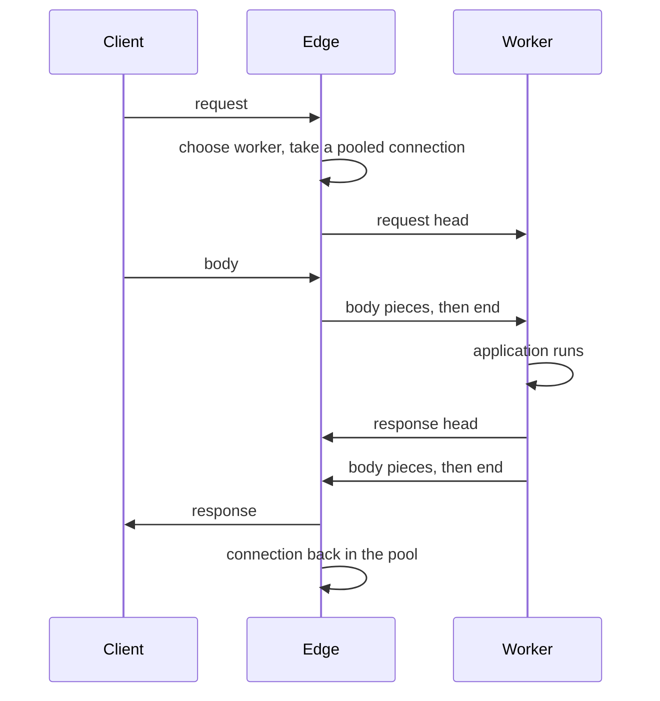

# The worker protocol

```{admonition} Status
:class: warning

This page describes the design Muru is being built to. Today the link
carries WSGI requests and responses between one edge and its workers,
including the abort described below. WebSockets, file passing and most of
the capability exchange are not implemented yet. The
[roadmap](../project/roadmap.md) says what comes when.
```

The edge and each worker talk over a private link: a Unix socket that the
worker listens on and the edge connects to. Nothing an application does
needs to know about it, but understanding it explains how threads,
connection limits and streaming behave.

## One connection per request in flight

The edge keeps a pool of connections to each worker. A connection carries
one request at a time, from the request head to the end of the response,
and is then idle and ready for the next. Connections are opened when they
are needed and kept open afterwards, so a steady load reuses the same ones.

The size of each pool is the number of requests the worker can run at once,
which the worker states when a connection is opened: the thread count for a
WSGI worker, the configured concurrency for an ASGI worker. The edge never
has more requests in flight at a worker than that. Requests beyond it wait
in the edge's queue for that worker group, with a timeout, rather than
piling up inside the worker.



## What crosses the link

Everything on the link is a frame: a few bytes of header giving its length
and kind, then its content. The kinds an application's traffic uses are:

- **Request head.** Method, path, query, headers, client and server
  addresses, scheme, HTTP version, request id and the mount the request
  matched. The edge has already parsed and validated the HTTP, so the
  worker never sees raw request text.

- **Body pieces** in both directions, each a run of bytes. A request body
  streams to the worker as it arrives from the client, and the application
  reads it on demand. A response body streams back as the application
  produces it.

- **Ends.** The last body piece of a request or response is marked, or an
  explicit end follows it. A response end can carry trailers, which is how
  gRPC status reaches a client of a gRPC mount.

- **Abort**, from the edge, when the client has gone away. An ASGI
  application receives its disconnect event. A WSGI application finds out
  when it next writes, and its iteration is stopped. The connection stays in
  the pool either way.

The two directions are independent. An application can start sending its
response before it has finished reading the request body, and a client can
still be uploading while the first bytes of the response go out. The edge
is always reading for the response while it sends the body, so an early
response needs no special handling to be noticed.

## Request bodies the application does not read

An application is free to answer without reading its request body, and
frameworks do this all the time: an authentication failure on an upload
endpoint, a 404, a redirect. Two things then have to be cleaned up.

On the link, the edge stops sending body pieces the moment the response has
ended and sends the abort instead. The worker discards whatever it had
queued, and the connection is back in the pool. A large upload answered at
once therefore never crosses the link.

On the client side, HTTP/2 simply resets the stream and the connection
carries on. For HTTP/1.1 the edge has to choose, before the response head
goes out, between reading and discarding the rest of the body so the
connection can be kept alive, and closing the connection after the
response. It discards when the remainder is small and arrives promptly, and
closes otherwise, telling the client so in the response. A client that sent
Expect: 100-continue and was never told to continue has sent nothing, so
there is nothing to discard. Because the edge buffers request bodies up to
the size limit before dispatching them by default, the question only arises
for bodies being streamed through.

The request head and the response head are protocol buffer messages, so
fields can be added without breaking older workers. Everything else is
plain bytes.

## Streaming and flushing

The worker coalesces small response pieces before sending them. An
application that yields a thousand short strings does not cause a thousand
writes. The first piece goes out immediately with the response head, and
after that pieces are held until a modest amount has accumulated or a few
milliseconds have passed, whichever comes first. A timer in the Rust layer
does the flushing, so buffering never waits for the application to produce
its next piece.

Responses that must not be buffered, such as server-sent events, are
recognised by their content type and flushed piece by piece. An
`X-Accel-Buffering: no` header does the same for any response.

A slow client applies back-pressure all the way to the application. The
edge stops reading from the link when it cannot write to the client, the
worker's send blocks with the interpreter released, and the application's
next yield or send() waits. Nothing is buffered without bound.

## WebSockets on the same link

A WebSocket uses one pooled connection for its whole life. The upgrade
request crosses as an ordinary request head marked as a WebSocket. The
application accepts by answering with a switching-protocols head, naming a
subprotocol if it chooses one, or declines with any other response, which
the edge sends to the client as the answer to the upgrade.

After an accept, text and binary messages cross the link as frames in both
directions, one frame per message, and either side ends the socket with a
close carrying a code and reason. The edge owns the wire protocol: the
handshake, masking, fragment reassembly, ping and pong. The worker only ever
sees whole messages.

Because a WebSocket holds its connection, WebSockets count against a
separate budget per worker, the capacity of its event loop rather than its
threads, so a room full of chat clients cannot stop ordinary requests from
being served. A request that a WSGI view hands to an ASGI application, or
that an ASGI application hands to a WSGI callable, tells the edge it has
moved so that it is counted against the right budget from then on.

## Capabilities, not worker kinds

When a connection is opened, the worker states what it is and what it can
do: how many requests it runs on threads at once, how many it holds on its
event loop, whether it accepts WebSockets, whether it takes files, what
message sizes it allows. The edge acts on those
statements and nothing else. It does not treat a WSGI worker differently
from an ASGI worker, and a worker that does not accept WebSockets simply
receives upgrade requests as ordinary requests for the application to
answer as it likes.

## Files

When an application responds with a file, through WSGI's file_wrapper or the
ASGI file extensions, the worker does not read the file. It passes the open
file descriptor to the edge over the link, with the offset and length to
send, and the edge sends the bytes to the client itself. The worker thread
is free as soon as the descriptor has been handed over, and no copy of the
file passes through Python.

## Versions

The protocol carries a version. A worker and an edge built from different
Muru releases can work together within a compatibility window, and a
mismatch outside it is reported when the worker starts, never discovered in
the middle of a request.

## What this means in practice

- Threads and concurrency settings on a worker are also the limits the edge
  enforces for it. There is nothing separate to tune on the edge side.

- Idle connections on the link cost nothing worth measuring. A worker
  serving little traffic has few open connections.

- Streaming responses, long polls and WebSockets each occupy one slot or
  socket for their duration, so size those budgets for how many you expect
  to hold open at once.

For the exact frame layout and the full list of fields, see the
[worker protocol](../project/design/05-worker-protocol.md) page of the
design specification.
