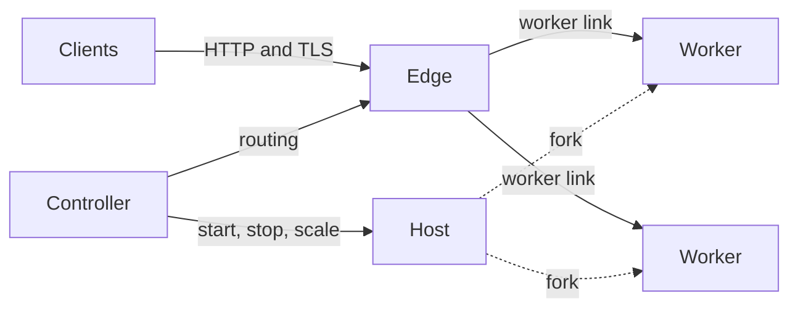

# Muru

Muru is a routing edge, control plane and Python runtime for serving WSGI and
ASGI applications, with zero-downtime releases, traffic management and
Python-aware process management.

A Rust edge accepts client connections and routes requests over a private link to
Python worker processes, which a Rust controller manages as immutable
releases that can run side by side. A new release, possibly on a different
Python version, starts beside the old one, and traffic moves when it is
ready: blue/green, weighted canaries, A/B splits, previews and instant
rollback are policy changes, not restarts.

```{admonition} Alpha
:class: warning

Muru is in alpha: the 0.1.0 pre-releases are on PyPI, and commands and
configuration may change between them.
```

## Why Muru

- **One way to serve, from laptop to production.** `muructl run` serves
  an application while you develop it, `muructl daemon start` starts the
  daemon that serves applications on a server, under systemd or by hand,
  and `muructl serve` runs one in a container under Docker, Compose or
  Kubernetes. The same process model and the same settings run in all
  three.

- **Deploys are traffic changes, not restarts.** Every deploy is a new
  release beside the running one. Traffic moves to it by a blue/green
  switch, by a canary judged by gates, or by a traffic policy with
  previews and sticky clients, and moves back in an instant. A release
  that fails to start never takes traffic.

- **Process management that understands Python.** The application is
  imported once and workers are forked from it, after an import check.
  Worker groups give each part of an application its own processes and
  threads. Memory limits, soft and hard timeouts, scaling on demand, and
  a diagnosis of each group from its workers' CPU, GIL waits and event
  loop lag deal with what Python applications actually do, on regular
  and free-threaded Python.

- **No web server to put in front.** The edge speaks HTTP/1.1, HTTP/2 and
  TLS, serves virtual hosts, static files and uploads, compresses
  responses and answers errors itself, so worker threads spend their time
  on Python.

- **WSGI and ASGI together.** One application can mount both, side by
  side in the same workers, and hand a request from one to the other in
  code, which is how a WSGI application takes WebSockets.

- **Made to work with AI coding agents.** `muructl mcp serve` gives an
  agent Muru's operations as tools over the Model Context Protocol, so in
  a coding session it can deploy each change as a release, test it, read
  the events, logs, tracebacks and worker stacks when something fails,
  and roll back. A skill the project carries teaches it how, and every
  command that reports something prints JSON for agents that work
  through a shell.

## How it works



The edge, written in Rust, accepts connections and decides where each
request goes. Workers run your application, forked from a host process
that imported it once. The controller, in the daemon or inside
`muructl run` and `muructl serve`, decides which releases run, how many
workers each has and where traffic goes, and is never on the path a
request takes. [Architecture](explanation/architecture.md) explains the
parts.

## Getting started

```
uv tool install muructl
muructl run app:application      # http://127.0.0.1:8080
```

`muructl` provides the `muru` runtime library to your application's
interpreter itself, so it is not a dependency of your project. Muru runs
on Linux and macOS with CPython 3.11 to 3.15, including the free-threaded
builds of 3.14 and 3.15.

- The [tutorials](tutorials/index.md) start from your first application
  and go on to the daemon, canaries, scaling and debugging.
- The [how-to guides](howto/index.md) cover each feature, from
  [Flask and Django](howto/flask-and-django.md) to
  [containers](howto/containers.md) and
  [coding agents](howto/coding-agents.md).
- The [reference](reference/index.md) lists the environ and scope keys,
  the error responses, the JSON output and the Python API.
- The [explanation](explanation/index.md) pages say why Muru works the way
  it does.

Muru is developed with extensive use of AI coding agents;
[About](project/about.md) says how, and who is behind it.

```{toctree}
:maxdepth: 2
:hidden:

tutorials/index
howto/index
reference/index
explanation/index
project/index
```
