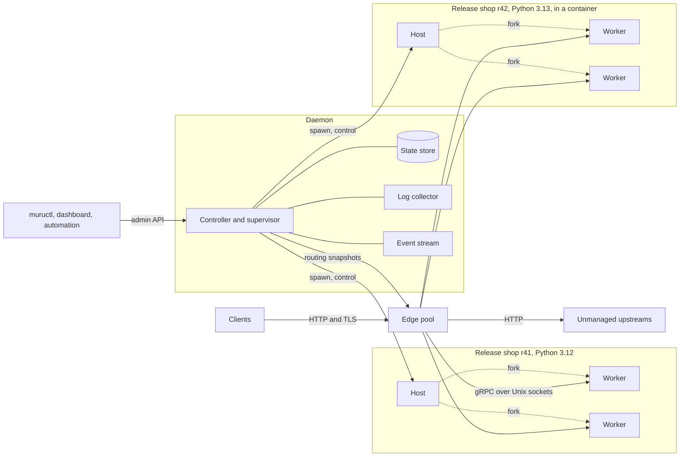
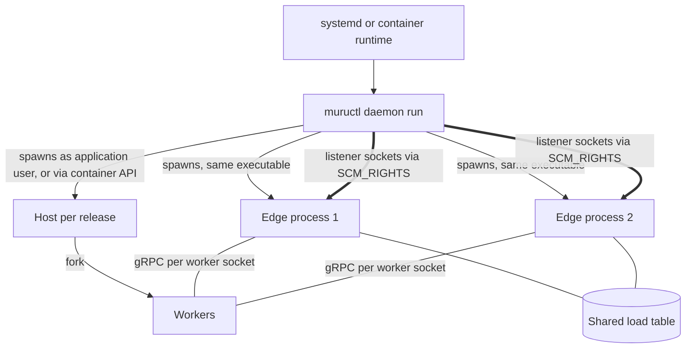

# 2. Architecture

```{admonition} Design specification
:class: note

This page is part of the Muru design specification and describes intended
design, for contributors. The user documentation is authoritative for released
behaviour. See the [specification index](index.md) for status and how the
specification is maintained.
```

Muru has three layers. The edge carries traffic, the daemon decides what should run and keeps it running, and the Python runtime executes application code. The daemon is never on the request path, so traffic keeps flowing while it restarts or upgrades.

## 2.1 Components



| Component | Implementation | Responsibility | Effect of a restart |
| --- | --- | --- | --- |
| Edge (process title muru-edge) | muructl edge run, Rust, tokio, hyper, rustls | Listeners, TLS, virtual hosts, routing, load balancing, limits, buffering, static files, internal redirects, uploads, error pages | Replaced with listener handoff, no refused connections |
| Daemon (process title murud) | muructl daemon run, Rust | Desired state, reconciler, supervision, admin API, dashboard, log collection, events, schedules | None on traffic. Hosts are re-adopted |
| Host process | python -m muru.host, Python with the runtime library | Preload the application, fork and supervise workers, act as PID 1 in containers | Affects only its release |
| Worker | Forked from the host | Serve requests through the WSGI, ASGI and gRPC bridges | One worker, replaced from the host |
| muructl client | Same binary | CLI over the admin API, development mode | None |

## 2.2 Data path and control path

- **Data path:** client, edge, worker, application. Requests travel as typed gRPC streams between edge and worker. No HTTP is re-serialised on this hop.
- **Control path:** operator or automation, admin API, controller, then routing snapshots to the edge and lifecycle commands to hosts.
- **Side channels:** per-worker Unix socket channels pass file descriptors (file hints, uploads), and per-worker pipes carry stdout and stderr to the log collector.

## 2.3 Process topology



- The daemon creates listening sockets and passes them to edge processes, so the edge can run unprivileged and be replaced without refusing connections.
- The daemon spawns edges from its own executable image (/proc/self/exe), so edge and controller always run the same version until an explicit upgrade.
- Hosts are spawned under per-application users, or inside containers through the Docker or Podman API.
- Each worker listens on its own Unix socket. The edge balances per request using exact in-flight counts held in a shared memory table when there are several edge processes.

## 2.4 Failure domains

| Failure | Effect | Recovery |
| --- | --- | --- |
| Daemon crash | Traffic unaffected. No deploys or scaling until it returns | Restarted by systemd, re-adopts hosts through the run directory and tokens |
| Edge crash | That edge's connections drop. Other edge processes continue | Daemon respawns it with the same listener sockets and last snapshot |
| Host crash | Its workers are fenced off and drained | Release restarted or marked failed |
| Worker crash | That worker's in-flight requests fail | Host forks a replacement with backoff. Edge retries only provably safe cases |
| Worker hang | Capacity loss | Soft and hard timeouts, stack capture, replacement |
| Node out of memory | Workers killed by cgroup or kernel | Memory policy, budgets and cgroup limits aim to prevent it |

Principles: fail static (the edge keeps its last good snapshot), small privileged core (only the daemon may need root), hosts own their workers, and every state change is an event.
