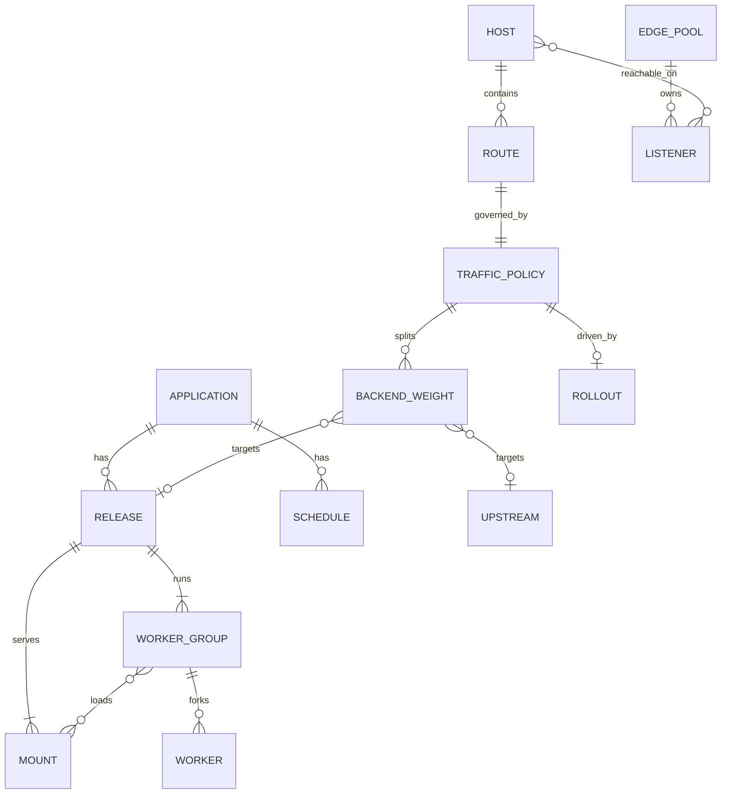

# 3. Data model

```{admonition} Design specification
:class: note

This page is part of the Muru design specification and describes intended
design, for contributors. The user documentation is authoritative for released
behaviour. See the [specification index](index.md) for status and how the
specification is maintained.
```

Everything the daemon manages is a named object in desired state. Releases are immutable, and traffic policy is the only thing that decides whether a release serves requests. Separating the two is what makes deploys, canaries and rollbacks simple policy changes.



## 3.1 Objects

| Object | Name form | Key fields | Mutable |
| --- | --- | --- | --- |
| Application | apps/shop | default interface and entrypoint, defaults for releases, reload policy, schedules, memory and timeout defaults | Yes |
| Release | apps/shop/releases/r42 | source (directory, or image digest), interpreter request and resolved interpreter, environment, mounts, worker groups, source fingerprint | No, except scale and limits applied live |
| Mount | part of a release | path, interface (wsgi, asgi or grpc), entrypoint, internal flag, thread pool, concurrency and connection limits | Paths and limits live, entrypoints fixed |
| Worker group | part of a release | paths or mounts, processes, threads, scaling, timeouts, memory policy | Sizes live, thread changes are rolling restarts |
| Worker | .../groups/default/workers/w3 | pid, state, slots, metrics | Observed only |
| Host (virtual) | hosts/shop | names and patterns, listeners, TLS, canonical name, host-level settings | Yes |
| Route | routes/shop-root | host, path and predicates, target, limits, buffering, error pages, upload and redirect settings | Yes |
| Traffic policy | routes/shop-root/traffic | backend weights, stickiness, hash key and salt, overrides, mirroring | Yes |
| Upstream | upstreams/legacy | addresses, protocol, TLS, health checks, header trust | Yes |
| Rollout | apps/shop/rollouts/... | strategy, steps, gates, state | Yes, while running |
| Schedule | apps/shop/schedules/... | cron or dated window, time zone, floor and ceiling, warm-up, freeze | Yes |
| Edge pool | edge/pools/public | listeners, processes, threads | Yes |
| Event sink | events/sinks/... | kind, endpoint, filters | Yes |
| Overlay | overlays/nightly-backup | partial configuration, trigger, preconditions, warm-up, latch, advisory, priority | Yes |
| Client class | client-classes/ai_crawler | ordered match rules, lists, verification | Yes |
| Rate limit | rate-limits/crawlers | match, key, rate, burst, action | Yes |
| Variant | part of a release | interpreter, environment build, environment variables, worker groups | No, as part of the release |

## 3.2 Identity and naming

- Names are lowercase letters, digits and hyphens, up to 63 characters per segment.
- Release ids are chosen by the user or generated (r1, r2, ... per application). A release is addressed as app@release in the CLI.
- Every object has a resource_version for optimistic concurrency and an audit trail of who changed it.

## 3.3 Inheritance and precedence

Settings resolve from the most general to the most specific, and each layer only states what differs:

1. Built-in defaults.
2. Daemon configuration (global settings).
3. The application's own [tool.muru] table, read from the release source (section 6.8).
4. Application settings in the controller.
5. Release settings, then worker group and mount settings.
6. For request handling: virtual host settings, then route settings.
7. Flags given at deploy time, and time-limited runtime overrides such as log levels or temporary scale floors.

muructl config show --effective prints the merged result with the layer each value came from.
