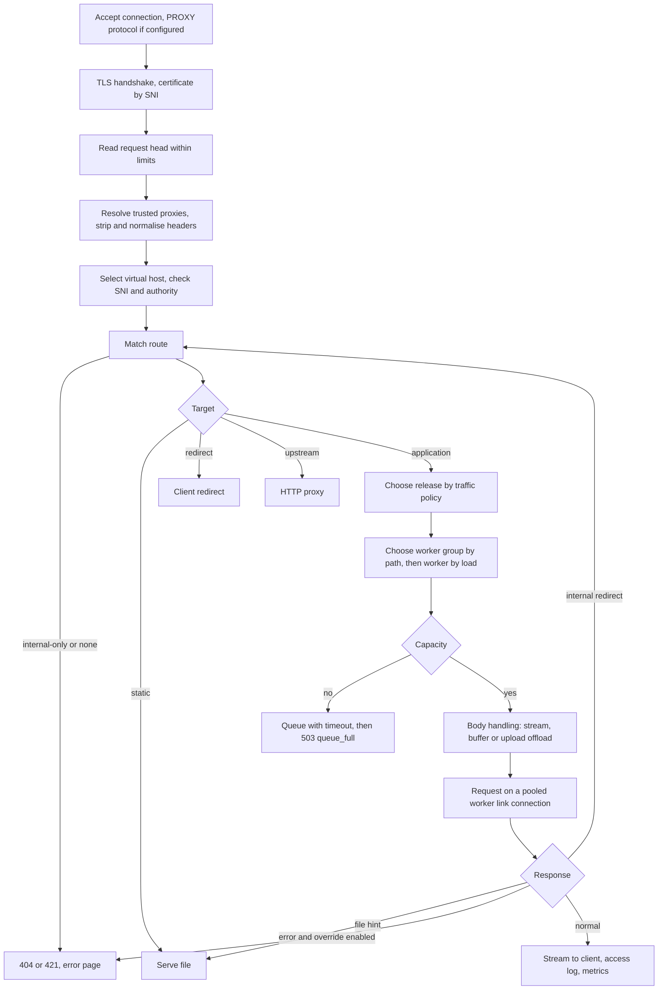
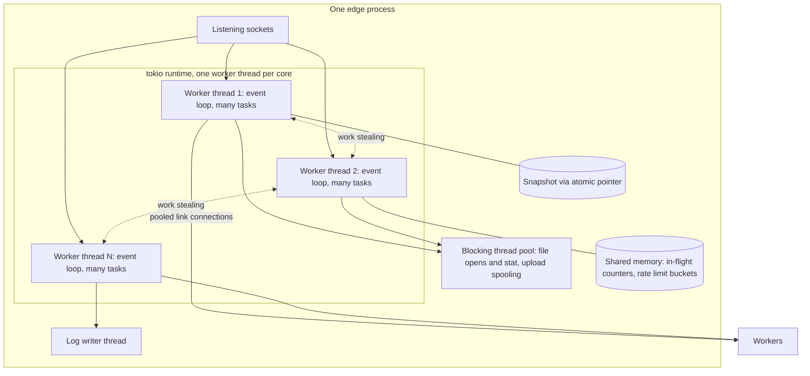
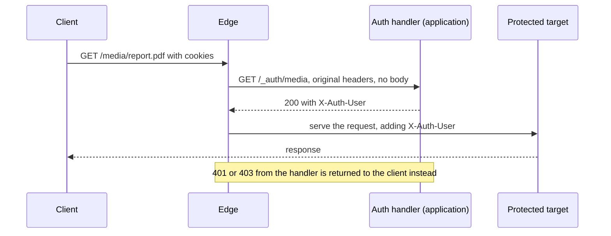

# 4. Edge

```{admonition} Design specification
:class: note

This page is part of the Muru design specification and describes intended
design, for contributors. The user documentation is authoritative for released
behaviour. See the [specification index](index.md) for status and how the
specification is maintained.
```

The edge terminates client connections and turns each request into a typed stream to a worker, or serves it itself (static files, redirects, error pages). It is built on tokio, hyper and rustls, holds no state that cannot be rebuilt from a snapshot, and never runs Python.

## 4.1 Request pipeline



## 4.2 Listeners and edge pools

- Listeners (address, protocols, TLS on or off, PROXY protocol) belong to edge pools. Without explicit pools there is one pool with one process that owns every listener.
- Each edge process runs a multi-threaded tokio runtime (threads default to the number of cores). One process is normally sufficient: per-request edge work costs microseconds against milliseconds in Python.
- Several processes per pool use SO_REUSEPORT. A shared memory table of atomic per-worker in-flight counters keeps least-outstanding balancing exact across processes. Queue and admission limits are divided between processes.
- Separate pools isolate traffic, for example a public pool and an admin pool, or tenants whose keys must not share a process.
- Protocols: HTTP/1.1 and HTTP/2 (h2 over TLS, h2c optional) from phase 1. HTTP/3 is deferred (phase 4).

**Concurrency model.** Each edge process is event-driven and asynchronous, running on a multi-threaded runtime. Python never runs in the edge, so nothing in it is allowed to block an event loop.



| Part | Design |
| --- | --- |
| Worker threads | A tokio multi-threaded runtime with edge.threads worker threads (default: one per available core, respecting CPU affinity and cgroup quotas). Each thread runs an event loop on epoll (kqueue on macOS) |
| Tasks | Each accepted connection is a task. HTTP/2 and HTTP/3 streams, forwarded requests, WebSockets, upstream health checks and DNS verifications are further tasks. An idle task holds no thread and only a few kilobytes of memory, so tens of thousands of keep-alive or WebSocket connections per process are expected |
| Scheduling | Work stealing: idle worker threads take queued tasks from busy ones, so load evens out across cores without balancing at the connection level. Tasks yield cooperatively, and long loops (for example parsing large multipart bodies) include explicit yield points |
| Blocking work | Operations that can block, mainly file opens, stat calls for static files and fallbacks, and writing upload spool files, run on tokio's blocking pool (edge.blocking_threads, default 64) so they never stall an event loop. sendfile on non-blocking sockets and DNS lookups through an asynchronous resolver stay on worker threads |
| CPU-bound work | TLS handshakes and response compression run on worker threads but are short. Compression of large responses is chunked to avoid monopolising a thread |
| Accepting connections | Every worker thread accepts from the shared listening sockets. With several edge processes, SO_REUSEPORT spreads connections across processes and the runtime spreads them across threads |
| Shared state | The routing snapshot is read through arc-swap, so configuration changes never block requests. In-flight counters and rate limit buckets are atomics in shared memory, also visible to other edge processes. Per-worker link connection pools are shared by all threads |
| Logging | Access log records go through a bounded channel to a dedicated writer thread, which drops and counts records rather than block requests (section 11.3) |
| Timers | Timeouts, idle detection and queue deadlines use the runtime's timer wheel, so millions of pending timeouts cost little |

This is closest to Apache's event MPM in a single process with a work-stealing scheduler, or to nginx's per-process event loops combined into one multi-threaded process. Edge pools (above) add process-level separation for isolation rather than throughput.

**Tuning and alternatives.** edge.threads and edge.blocking_threads are the main settings. Runtime metrics (worker thread busy ratio, task poll times, blocking pool queue length, scheduler delay) are exported, and the edge warns when any task polls for longer than a threshold, which indicates accidental blocking. A thread-per-core mode without work stealing, as offered by some Rust proxies for cache locality, is a possible later option (edge.runtime = 'per_core'), to be added only if benchmarks show a benefit.

## 4.3 Virtual hosts and TLS

- A virtual host has names (exact, single-label wildcard `*.example.com`, multi-label wildcard `**.example.com`, or a regular expression prefixed with ~ whose named groups are captured), listeners, TLS settings, a canonical name and host-level settings.
- Selection order: exact, then wildcard by longest fixed suffix, then regular expressions in order, then the listener's default host. Names are normalised (lowercase, no trailing dot, default port removed, IDNA to ASCII). Duplicate exact names are rejected.
- The default host answers 421 Misdirected Request unless a listener names a real default, so forged Host headers cannot reach an application.
- Certificates are chosen by SNI. For HTTP/2 connection reuse, a request whose host belongs to a virtual host the connection could not have been opened for receives 421. The validator warns when names are not covered by the certificate. Certificates are part of the snapshot and rotate live. ACME (HTTP-01 and TLS-ALPN-01) is phase 4.
- Host-level settings inherited by routes: trusted proxies, limits, error pages, added headers, access log destination and format, maintenance mode, canonical and HTTPS redirects.
- HTTP_HOST is the name the client used. SERVER_NAME is the matched name, or the canonical name when use_canonical_name is true. Regular expression captures are passed as muru.host_captures.

## 4.4 Routing snapshots

The controller compiles desired state into a complete, versioned, immutable snapshot: virtual hosts, compiled path matchers (radix trees), traffic policies, worker endpoints, upstreams, certificates, limits and error page tables. The edge builds the new tables aside, checks every endpoint and file reference, swaps an arc-swap pointer atomically and acknowledges. Each request holds the snapshot it started with until it finishes. A rejected snapshot is answered with a reason and the edge keeps the last good one. The snapshot version appears in every access log line.

## 4.5 Route matching and selection

- Within a virtual host: longest path prefix, then method and header predicates. Routes marked internal = true never match client requests.
- Release choice: override header or preview cookie, then a valid sticky cookie, then deterministic bucketing (section 9.4).
- Worker group choice: the most specific path match among the release's groups, default group otherwise.
- Worker choice: least outstanding requests (or power of two choices among them) within the group, per capacity pool (per-mount thread pools, ASGI concurrency, WebSocket connections).
- Admission: a bounded queue per pool with queue_timeout. Overflow returns 503 with reason queue_full and Retry-After.

## 4.6 Limits, buffering and request bodies

| Setting | Default | Notes |
| --- | --- | --- |
| max_header_bytes, max_headers | 64 KiB, 100 | 431 when exceeded |
| header_read_timeout | 30 s | 408 |
| body_idle_timeout, response_idle_timeout | 60 s |  |
| request_deadline | 300 s | Propagated to the worker in the request head |
| max_body_size | 10 MB | Equivalent of LimitRequestBody, with the same 10 MB default as mod_wsgi-express. Settable per host, route, mount and group, so upload routes raise it explicitly |
| buffer_body | off | off streams to the worker, memory, or disk above a threshold |
| chunked_body | buffer | For bodies without Content-Length: buffer (CONTENT_LENGTH is then set), stream, or reject with 411 |
| buffer_response | on | Responses are drained from workers at full speed and delivered to slow clients by the edge. Streaming routes opt out |

- The 413 error page names the limit in effect and the setting that changes it. A declared Content-Length over max_body_size is answered with 413 before reading, without sending 100 Continue. Undeclared bodies are counted as they arrive. When streaming to a worker the stream is cancelled; the client receives 413 if no response has started, otherwise a reset. HTTP/1.1 connections are closed after a 413, HTTP/2 and HTTP/3 reset only the stream.
- Expect: 100-continue is handled only by the edge. With buffered bodies it sends 100 once its own checks pass. With streamed bodies it sends 100 when the worker's CONTINUE frame says the application has started reading (section 5.5), so an application that rejects before reading never receives the body. Upload prechecks (section 4.11) make the decision explicit. On HTTP/2 the interim response is not sent until the edge can send 1xx responses at all (the INFORMATIONAL frame of phase 2); a client waiting for it proceeds after its own timeout, and the rest behaves the same.
- Slow clients never occupy Python threads: request heads are read in full before dispatch and responses are buffered at the edge.
- **Bodies the application does not read.** When a response ends before the request body has been read, the edge sends ABORT on the link so the rest never crosses it (section 5.5), and decides what to do with the client connection before the response head goes out. HTTP/2 and HTTP/3 reset the stream and the connection carries on. For HTTP/1.1, if the unread remainder is within discard_body_limit (default 1 MiB) and arrives within discard_body_timeout (default 2 s) it is read and discarded and the connection is kept alive; otherwise the response carries Connection: close and the connection is closed after it, as RFC 9110 section 10.1.1 asks. A client that sent Expect: 100-continue and has not been told to continue has nothing to discard, but may still send the body once it tires of waiting, so the connection is closed after the response, as Apache does. Error responses the edge generates for malformed requests (400, 408, 413, 414, 431) always close HTTP/1.1 connections, as Apache does, because the parse state is suspect.

## 4.7 Trusted proxies and header handling

```toml
[proxy]
trusted = ['10.0.0.0/8', 'loopback']      # addresses, CIDR, loopback, private, unix
headers = ['x-forwarded-for', 'x-forwarded-proto', 'x-forwarded-host']
recursive = true
forwarded_headers = 'keep'                # keep normalised, or consume
```

- Nothing is trusted by default. Settings can be overridden per listener and per host. Supported types: Forwarded, X-Forwarded-For, -Proto, -Host, -Port, -Prefix, X-Real-IP and client certificate headers. PROXY protocol v1 and v2 can be enabled per listener for listed sources.
- From untrusted peers, every forwarding header of every known type is removed. From trusted peers only configured types are applied and all equivalents are removed. Recursive resolution walks the chain right to left past trusted proxies.
- Request headers whose names contain underscores are dropped, so that X_Forwarded_For cannot reach an application as HTTP_X_FORWARDED_FOR. Malformed values are ignored and logged. Hop-by-hop headers and client-supplied X-Muru-* headers are always removed.
- Resolved values reach the application as REMOTE_ADDR, wsgi.url_scheme and HTTPS, HTTP_HOST, SERVER_NAME and SERVER_PORT, SCRIPT_NAME (ASGI: client, scheme, server, root_path), with the original peer in muru.proxy_addr. They travel to workers as typed fields, not headers.

## 4.8 Retries

The edge retries only when it is provably safe: a connection failure before any request byte was sent, or an idempotent method on a worker that died before sending a response head and whose body was fully buffered or empty. Retries go to a different worker and are counted in metrics.

## 4.9 Static files and file hints

- Static routes serve directories with ETag, Last-Modified, range requests, precompressed variants (.br, .zst, .gz) and configurable cache headers. A request for a directory without a trailing slash is redirected (301) to the slash form so relative links resolve, unless redirect_slash = false.
- File hints let an application hand the body of a response to the edge, which sends it with sendfile. There are two forms:

  | Form | How the application produces it | What the edge does |
  | --- | --- | --- |
  | By descriptor (preferred) | WSGI: returning the object from wsgi.file_wrapper. ASGI: the http.response.pathsend or http.response.zerocopysend extensions (section 6.6) | The worker passes a duplicate of the open descriptor on the link, attached to a FILE frame with an offset and length (section 5.7). The edge sends exactly that range with the status and headers the application chose. It needs no access to application files |
  | By path | The X-Muru-Sendfile response header (X-Sendfile in compatibility mode), for frameworks and middleware stacks where the file object is not visible to the server | The edge opens the path itself, which must lie inside the mount's sendfile_roots and be readable by the edge's user. Paths outside are refused and logged. The edge serves the file with full static-file behaviour: Range, conditional requests, ETag and Last-Modified |

  Range handling: for descriptor hints the application has already decided the status and headers, so the edge never applies the client's Range itself. Frameworks that support ranges (Django, Starlette) compute the range and the worker passes the matching offset and length. For path hints and internal redirects to static routes, the edge handles ranges and conditional requests, because it serves the file itself.

- **Details fixed by the implementation.** A descriptor hint is taken from a `wsgi.file_wrapper` object only when the application returns that object itself before any `write()` output, its `fileno()` is a regular file and the range is not empty; the position is the object's `tell()`, or the descriptor's offset without one, and the length is the declared Content-Length cut to the rest of the file. The duplicate is sent on the FILE frame with the END flag unless the ASGI message says `more_body`, after any buffered body chunks and the response head; the worker closes its copy once the frame is written. The edge reads the range from the descriptor in 64 KiB chunks on tokio's blocking pool, as it reads static files, rather than with the sendfile system call, which hyper's HTTP writer cannot use; a file shorter than the range is an error that truncates the response. A path hint is honoured from a worker always and from an upstream only with `trust_muru_headers`; `sendfile_roots` on a release (its default mount and the mounts that do not list their own), a mount or an upstream names the directories, compared by canonical path at the time of the hint, and without any every path hint is refused: a relative path or one outside the roots is 500 sendfile_refused and logged with the path, a path that names nothing or not a regular file is 404 sendfile_missing. The compatibility mode is `sendfile_header`, naming a second header such as X-Sendfile honoured exactly as X-Muru-Sendfile is; both are removed from the response. The file goes out with the response's status and headers, except Content-Length, Content-Range, Accept-Ranges, ETag, Last-Modified, Transfer-Encoding, Connection, Server and X-Muru-* headers, which the file decides; a Content-Type the application set replaces the guessed one; conditional and range handling apply to a 200 only, and any other status sends the whole file as it is. `muructl deploy --sendfile-root` and `--sendfile-header` set the keys, which `apply` and `config export` carry. The INFORMATIONAL and DETACH frames remain reserved.

**Mixing static and dynamic content.** Static files and applications combine through routes in a virtual host, matched by longest path prefix, plus a fallback option for when they share the same paths. Static files are always served by the edge and never reach Python.

*Static site with applications under it.* The application receives SCRIPT_NAME /app.

```toml
[[route]]
host = 'example'
path = '/'
static = '/srv/site/public'

[[route]]
host = 'example'
path = '/app/'
app = 'shop'
```

*Application at the root with a static prefix.*

```toml
[[route]]
host = 'example'
path = '/'
app = 'shop'

[[route]]
host = 'example'
path = '/static/'
static = '/srv/shop/collected-static'
cache = { max_age = '1y', immutable = true }
```

*File if it exists, otherwise the application.* The equivalent of nginx's try_files or Apache's -f rewrite condition, for sites where pre-rendered files and application URLs share paths:

```toml
[[route]]
host = 'example'
path = '/'
static = '/srv/site/public'
index = ['index.html']
fallback = { app = 'shop' }
```

- For GET and HEAD the edge serves the file when one exists, or the index file for a directory. Otherwise, and for every other method, the request goes to the fallback target, so a POST to a path that also has a file still reaches the application.
- The fallback target can be an application, an upstream, or a file.
- The application sees the route's prefix as SCRIPT_NAME (empty here), as if it were routed directly.
- Hidden files and directories (names starting with a dot) are never served and fall through. Paths are normalised before the file check, and symbolic links leaving the directory are refused unless follow_symlinks = 'any'.
- File checks use the file system directly, with a short metadata cache (stat_cache = '1s' by default) to avoid repeated lookups for hot paths.

*Single-page application with an API.* Unknown paths return the application shell, and the API is a more specific route, so it never falls back to the shell:

```toml
[[route]]
host = 'example'
path = '/'
static = '/srv/spa/dist'
fallback = { file = 'index.html' }
cache = { max_age = '1y', immutable = true, except = ['index.html'] }

[[route]]
host = 'example'
path = '/api/'
app = 'api'
```

*Static files that belong to a release.* When assets are built with the application (for example Django's collected static files with hashed names), serving them from a fixed directory would mix versions during a canary. A static route can instead name a directory inside the application's release, and the edge serves it from whichever release the traffic policy selects for that request, including bucketing and stickiness, so pages and their assets always come from the same release:

```toml
[[route]]
host = 'example'
path = '/static/'
static = { app = 'shop', release_path = 'staticfiles' }
```

For container releases the directory is copied out of the image when the release is created (section 8.5). Retained releases keep their static files until they are stopped, so cached pages that reference old assets keep working during the retention window.

*Protected files.* Files that need an application decision use an internal static route and an internal redirect (section 4.10), or upload offloading for the reverse direction (section 4.11).

*Directory listings.* A static route can generate a listing when a directory is requested and no index file exists, like Apache's mod_autoindex or nginx's autoindex:

```toml
[[route]]
host = 'files'
path = '/downloads/'
static = '/srv/downloads'
index = ['index.html']
listing = { enabled = true, sort = 'name', show_hidden = false, exclude = ['*.tmp'], max_entries = 5000, template = 'listing.html' }
```

- Off by default. The validator warns when listings are enabled on a public route that is not internal, since exposing directory contents is a common accidental leak.
- Generated by the edge, with directory reads on the blocking pool so large directories never stall an event loop. Python is not involved.
- Content negotiated: a sortable HTML table (name, size, modification time) for browsers, and a JSON array for clients that ask for JSON.
- The same rules as file serving apply: hidden files, exclude patterns, symbolic link limits and path normalisation.
- A custom template can be rendered by the edge, as for error pages, with optional header and readme files shown above the table. The built-in style matches the built-in error pages.
- max_entries caps very large directories, with pagination in both HTML and JSON. Listings carry short cache lifetimes, and ETag and Last-Modified come from the directory's modification time.
- Listings that need an application decision use an internal route and an internal redirect.

*Quick static serving in development.* muructl serve-static DIR serves a directory with no configuration, for checking a built front end or a documentation build. It accepts --listing, --index, --fallback FILE (for single-page applications), --https and the port options of muructl run, and uses the same edge code as static routes.

*Case and Unicode normalisation in file paths.* URL paths are case-sensitive, and Linux file systems are too, but macOS's default file system (APFS) is case-insensitive and also insensitive to Unicode normalisation, so Logo.PNG and logo.png, or two encodings of é, name the same file. Without care this makes development and production behave differently (an asset link with the wrong case works on a Mac and fails on Linux), splits caches across URL variants, and opens bypasses: routes, internal-only paths, hidden-file rules and exclude patterns are matched against the request path, while the file system resolves a differently cased path to the protected file. For example, with a public static route at / over /srv/site and an internal route at /protected/ over /srv/site/protected, a request for /PROTECTED/secret.pdf matches only the public route, and a case-insensitive file system would then serve the protected file. The same applies to /.GIT/config and similar.

- **Strict matching by default.** After resolving a static path, the edge checks that every component's name on disk matches the request exactly, in case and in Unicode normalisation, using the canonical name the file system reports. A mismatch is a 404. macOS therefore behaves like Linux, for both consistency and security. case = 'insensitive' on a static route is an explicit opt-out for sites that rely on case-insensitive lookups, and the validator warns when it is combined with internal routes or exclude rules.
- **Rules checked on disk names as well.** Hidden-file, exclude and listing rules are applied to resolved on-disk names as well as to the request path.
- **Containment by canonical path.** sendfile_roots and static directory containment compare canonical, resolved paths, never request strings.
- **Overlapping directories.** The validator warns when the directory of an internal or protected static route lies inside the directory of a public static route, since that layout is risky regardless of case handling.
- **Uploads.** upload.save() relies on exclusive creation and linkat, which fail correctly when a file exists under a different case, so overwrite=False holds on case-insensitive file systems.

## 4.10 Internal redirects and internal targets

- Forms: X-Muru-Redirect: /path (on by default), CGI local redirect (200 with a Location starting with / and no body, opt-in per mount with cgi_local_redirect), and X-Accel-Redirect (opt-in with accel_redirect).
- Routes and mounts marked internal = true answer 404 to clients and are reachable only through internal redirects.
- The edge resolves the redirect and routes it from scratch: same host by default, another configured host with X-Muru-Redirect-Host, and targets outside the issuing application only if they set accept_redirects_from.
- The sub-request uses GET (HEAD stays HEAD) unless X-Muru-Redirect-Method: preserve is set and the body was buffered. Client request headers are kept (Range, conditional and Accept-Encoding headers work against static files). Response headers from the redirecting application are merged by allowlist (Content-Disposition, Cache-Control, Expires, Set-Cookie, Vary, explicit Content-Type).
- The target sees REDIRECT_URL, REDIRECT_QUERY_STRING and REDIRECT_STATUS, and any trusted headers added with X-Muru-Redirect-Header-NAME. muru.is_internal() reports internal dispatch.
- A redirect back into the same application is pinned to the issuing release. Other applications use their own traffic policy. At most 5 hops, the client deadline covers the chain, and one access log entry records every hop.
- A route belongs to its application, or to its fallback application for a static route, and accepts that application's redirects without being asked; a static route with no fallback accepts only what accept_redirects_from names. A redirect a route does not accept is answered as no route, with the refusal in the edge's log. Content-Type is merged only when the redirecting response's is non-empty, so a framework default can be emptied to let the target's type apply. The default mount's cgi_local_redirect and accel_redirect are the release's own keys, which named mounts inherit unless they say otherwise.
- Upgrade requests (WebSockets) cannot be redirected after a WSGI decision. Authentication sub-requests (section 4.16) cover that case.

## 4.11 Upload offloading

- Routes with upload = 'multipart' or 'raw' make the edge receive and store the upload before dispatch. Multipart file fields are replaced by name, content_type, size, sha256 and ref fields, so normal form parsing works.
- Files are written as unnamed files (O_TMPFILE) and passed to the worker by descriptor. muru.uploads exposes them. upload.save(dest) links the file into place (copying across file systems). Unsaved files vanish when the request ends, including after a crash.
- precheck = true sends the application a headers-only request first (muru.precheck in the environ). A 2xx lets the edge send 100 Continue and read the body; anything else is the final response.
- Spool quotas per application and node (507 when full), max_file_size, max_files and hashing during receive. Progress reporting and resumable (tus) uploads are future ideas.

**What the application receives.** With upload = 'multipart', each file part of the form is replaced by text fields, and ordinary fields pass through unchanged. For a file field named avatar:

| Field | Value |
| --- | --- |
| avatar.name | client filename |
| avatar.content_type | declared content type |
| avatar.size | bytes received |
| avatar.sha256 | hash computed while receiving (and other algorithms listed in hash) |
| avatar.ref | opaque reference to the stored file, unique within the request |

The file contents are not in the body. Each stored file arrives at the worker as an open descriptor attached to the REQUEST frame (section 5.7), matched to its ref by order. With upload = 'raw', the body is empty, CONTENT_LENGTH is 0, and a single stored file stands for the whole original body.

**The uploads API.** muru.uploads connects refs to files for the current request:

| API | Purpose |
| --- | --- |
| muru.uploads.files(environ or scope) | All uploads of the current request, in form order. Empty when the route does not offload uploads |
| muru.uploads.get(environ or scope, ref) | The upload for a ref taken from parsed form data, or None |
| upload.field, name, content_type, size, sha256, ref | Metadata as in the form fields. field is None for raw uploads |
| upload.open() | A readable, seekable binary file object over the descriptor, for processing without keeping the file |
| upload.save(dest, overwrite=False) | Gives the file a permanent name: linkat through /proc/self/fd when dest is on the same file system as the spool, otherwise a copy. Returns the final path |
| upload.path | /proc/self/fd/N, for libraries that require a path. Valid only during the request |

Descriptors are closed when the request ends. Files that were not saved have no name and disappear, including when the worker crashes. Upload objects are tied to their request and must not be kept beyond it. Outside Muru, files() returns an empty list, so code using it still runs under other servers.

**Framework adapters.** Most applications expect their framework's own upload objects. Muru itself provides only the uploads API and documents the contract above; adapters that turn offloaded uploads back into framework objects can be written by framework maintainers or users, and the documentation includes recipes showing how:

- **Django:** an upload handler (or a small request middleware run before views) that reads the rewritten fields, calls muru.uploads.get for each ref, and builds UploadedFile objects whose file is upload.open(). request.FILES and forms with FileField then work unchanged. A custom storage backend can call upload.save() instead of copying, when the storage directory is on the spool's file system.
- **Starlette and FastAPI:** a helper or dependency that converts each ref in the parsed form into an UploadFile wrapping upload.open(), so endpoint signatures using UploadFile keep working.
- **Flask and Werkzeug:** a function that builds FileStorage objects into a MultiDict shaped like request.files.

Adapters should check muru.context() and fall back to the framework's normal parsing when the application is not running under Muru or the route does not offload uploads, so the same code works in every environment. The integration test fixtures include one adapter per framework (Django, Flask and Starlette) to keep the contract honest.

- **Details fixed by the implementation.** The route keys are `upload` (`multipart` or `raw`), `max_file_size` (no limit), `max_files` (100, at most 500 since each file is a descriptor), `hash` (`sha256`; `sha384`, `sha512` and `sha1` may be listed, an empty list computes none), `precheck` (false) and `spool_quota` (10GB), checked by `muructl apply`, which refuses them on a static or upstream route and refuses the others without `upload`; a route may also set `max_body_size`, which on an upload route bounds the body as received, files included. A route's `spool_quota` bounds what its application's stored files hold at once, across the requests in progress, when a request on the route arrives, and the daemon's `[limits] spool_quota` bounds every application's together (no limit by default); a full disk is 507 too. `multipart` applies to `multipart/form-data` bodies, others going through unchanged; a part with a `filename` parameter is a file, and its text fields (`FIELD.name`, `FIELD.content_type`, `FIELD.size`, a field per digest named for its algorithm, `FIELD.ref`) take its place in the form, which keeps the client's boundary and its ordinary parts, held in memory up to 10MB together. A raw upload's file is named by a Content-Disposition `filename` when the client sends one. Refs are 1, 2 and so on in arrival order. Refusals close the connection: 413 `upload_too_large` and `too_many_files`, 400 `upload_malformed`, 507 `upload_spool_full`, and 413 `body_too_large` and 408 `client_timeout` as for any body. The spool is `spool/` in the daemon's state directory, open to the edge's user alone, with a directory per application the edge creates; files are O_TMPFILE where the file system has it and otherwise named `PID-N`, removed when the request ends and swept by the next edge when their edge has gone, mode 0644 in either case so a worker running as another user can reopen one through `/proc/self/fd`. The request deadline starts once the upload has arrived, and a request that arrives by internal redirect takes no uploads. The precheck goes only for a request with a body, with its headers and declared length and the `precheck` flag in the head and no body; a 2xx answer is logged as a hop of the request and its body discarded, anything else (a redirect included) is the response. `muru.uploads.files()`, `get()` and `is_precheck()` read the environ's `muru.uploads` and `muru.precheck` or the scope's `extensions["muru"]` `uploads` and `precheck`; `upload.open()` reads the descriptor at a position of its own, `save()` links through the spool file's name or `/proc/self/fd` and copies when linking fails (another file system, or a worker user other than the edge's), and `path` is `/proc/self/fd/N` on Linux and `/dev/fd/N` elsewhere. muru_upload_spool_bytes reports each application's stored bytes, and `muructl route list` marks upload routes. `muructl run` has no routes, so offloading is the daemon's.

## 4.12 Error pages and maintenance

- Every response Muru generates has a status and a reason, for example 503 with queue_full, no_workers, cold_start_timeout, release_failed, draining or maintenance; 502 with worker_crashed or upstream_failed; 504 with deadline, soft_timeout or hard_timeout. The full list is in Appendix C.
- Built-in pages are content-negotiated: HTML, application/problem+json (RFC 9457) or plain text, with the request id and Retry-After. Development mode shows tracebacks for application errors.
- Custom pages by status or status:reason, configured globally, per host, application or route: static file, edge-rendered template ({status}, {reason}, {request_id}, {retry_after}, {host}, {path}), or an internal application path receiving REDIRECT_* variables and muru.error_reason.
- Safeguards: an application handler is skipped when it would run on the failing capacity pool, has a 2 s timeout, never recurses, keeps the original status and Retry-After, WWW-Authenticate and Allow headers, and pages default to Cache-Control: no-store.
- error_override (off by default) replaces application error responses for listed statuses, with when = all, empty_body, not_json or html_only, and a per-response opt-out header. It applies only before any body byte is sent.
- muructl maintenance on APP serves the maintenance page at the edge, with exemptions by path, address or bypass cookie.
- The application level is the release: `error_pages`, `error_override` and the `maintenance` exemptions are keys of the release table (and of `[tool.muru]`), so pages ship with the code and a file may be relative to the source. The node level is the daemon's own file, re-read on reload. For an error the levels are consulted route, release, host, node, and the first with any page for the status decides, a status:reason entry before the status's. Templates also know {title} and {description}. A replaced application response has the reason error_override, by which its page is looked up. An application handler is not asked when the failure was one of capacity and the handler would be that application; its response takes the error's status; any status of 400 or above from it, or a redirect, leaves the built-in page. Maintenance state is runtime state recorded in the store, not part of the applied configuration; static routes are unaffected by it.

## 4.13 Generic HTTP upstreams

- Routes can target unmanaged HTTP servers: [upstream.NAME] with addresses (TCP or Unix), protocol (http1, h2c, h2), upstream TLS and health checks (active, plus passive ejection with gradual reintroduction).
- All edge features that do not depend on workers apply, including traffic splitting between upstreams and Muru applications. X-Muru-Redirect and X-Muru-Sendfile are honoured only with trust_muru_headers.
- Because HTTP is re-serialised on this path, requests are strictly normalised: messages with both Content-Length and Transfer-Encoding, invalid Content-Length or obsolete line folding are rejected, bodies are always re-framed by the edge, and upstream connections are never reused after a framing error. h2c is preferred when available.
- Not available for upstreams: process management, preload, groups, mounts, scaling, memory and timeout policies, descriptor passing.
- **Details fixed by the implementation.** Addresses are `host:port` or `unix:/path`; `protocol` is http1 (the default), h2c (prior knowledge) or h2 (TLS with ALPN, which `tls` with `ca`, `server_name` and `verify` configures; `tls` alone keeps HTTP/1.1 over TLS). Requests take the addresses in turn from where the last left off; a connection failure or a request that was never sent moves to the next address with the body intact, and a request that went out in part is 502 upstream_failed, as is one no address takes. HTTP/1.1 connections are kept between requests, up to 16 idle per address for 60 s, and an h2 or h2c connection multiplexes an address's requests. The request is sent as the client's headers less hop-by-hop ones, names with underscores and X-Muru headers, with Host as the client sent it and X-Forwarded-For, X-Forwarded-Proto, X-Forwarded-Host, X-Real-IP and X-Request-ID added; the path keeps the route's prefix. A body without a declared length is buffered and sent with a Content-Length, a declared length is streamed; a message with both Content-Length and Transfer-Encoding is read by its Transfer-Encoding and re-framed rather than rejected (ADR 0027), since hyper settles it before the edge sees the request, and invalid Content-Length values and obsolete line folding are hyper's 400. The response head must arrive within the request deadline (504 deadline) and the body within the response idle timeout. A WebSocket upgrade is relayed as raw bytes to an http1 upstream once it answers 101, with no message limits; an h2 or h2c upstream answers it 502. Without trust_muru_headers every X-Muru-* response header is removed; with it X-Muru-Redirect is an internal redirect whose origin is the upstream's name, which a route accepts as it would an application's (accept_redirects_from may name an upstream). The error override applies to an upstream's responses. Passive ejection: `health.eject_after` failed requests in a row (3 by default, 0 never) eject an address for `eject_for` (30 s), after which one trial request is let through; success restores it and failure ejects it again for twice as long, up to ten times `eject_for`. Active probes run only with a `health` table: a GET of `path` (2xx or 3xx is healthy) or a bare connection, every `interval` (10 s) within `timeout` (2 s), with `unhealthy_after` (3) and `healthy_after` (2) thresholds; when every address is out, requests still try them all in turn. Probes and ejection are per edge process and start afresh with each snapshot. muru_upstream_health{upstream, address} is 1 for an address in service; a change is logged by the edge. An upstream is a traffic share as `upstream:NAME` in `split`, with buckets below the releases' and the same label in the sticky and preview cookies; a static route's fallback as `fallback = { upstream = NAME }`; and an authentication handler as `auth = { upstream = NAME, path }`. A request to an upstream is logged under the upstream's name as its application, `upstream` as its group and the address as its mount, and counts in muru_requests_total the same way. `muructl upstream list` shows what is applied, `muructl apply` checks the tables and that routes, fallbacks, shares and handlers name upstreams that exist, and a CA file the daemon cannot read is the event upstream.unusable, with the upstream left out of the snapshot. A trusted upstream's X-Muru-Sendfile, or its `sendfile_header`, is served within its own `sendfile_roots` as an application's is (section 4.9); managed HTTP server releases, which the edge reaches the same way, are section 9.9, and their release's `sendfile_roots` and `sendfile_header` apply to the server's responses.

## 4.14 Client classification

The edge can assign each request a client class, which routes, traffic policies, rate limits, overlay conditions, logs and metrics can use. Classification is meant for routing and protecting capacity, not as a web application firewall. Deployments that need serious bot defence should put a CDN or WAF in front and feed its verdict headers in as classification inputs through the trusted proxy settings.

```toml
[[client_class]]
name = 'search_bot_verified'
user_agent = ['Googlebot', 'bingbot', 'DuckDuckBot', 'Applebot']
verify = 'dns'                         # reverse then forward DNS against the crawler's published domains
verify_domains = ['googlebot.com', 'google.com', 'search.msn.com', 'duckduckgo.com', 'applebot.apple.com']

[[client_class]]
name = 'ai_crawler'
user_agent_list = 'lists/ai-crawlers.txt'   # relative to the config directory, reloaded on change

[[client_class]]
name = 'unverified_bot'
user_agent = ['bot', 'crawler', 'spider', 'Googlebot']   # bot-like names that failed verification

[[client_class]]
name = 'partner'
addresses = ['203.0.113.0/24']
```

- Rules are evaluated in order and the first match wins. Requests matching no rule are class default.
- Inputs: user-agent substrings or regular expressions, user-agent lists loaded from files, client addresses and CIDR lists from files, any request header or cookie, and headers from trusted proxies (for example a CDN's bot score). TLS fingerprints (such as JA4) are a possible later input.
- verify = 'dns' confirms a claimed crawler by reverse DNS lookup of the client address, checks the name against verify_domains, then forward-resolves it to confirm the address. Results are cached (default 24 hours, negative results 1 hour) and lookups are asynchronous with a short timeout. A pending or failed verification falls through to later rules.
- Lists are plain files, one entry per line, so they can be maintained from community lists of AI crawler user-agents or provider IP ranges without code changes.
- The class appears in the access log, in metrics as a client_class label, and to applications as muru.client_class.

**What classes are used for**

- **Routing:** a route or traffic policy can match on client_class, for example sending crawlers to their own worker group so they never take interactive capacity, or to a static snapshot or cheaper release.
- **Rate limits and blocking:** per class (section 4.15), with custom 429 or 403 pages.
- **Overlay conditions:** for example activating an overlay when ai_crawler traffic exceeds a share of all requests (section 9.10).

- **Details fixed by the implementation.** A rule's inputs are `user_agent` (substrings, without regard to case), `user_agent_regex`, `user_agent_list`, `addresses` (addresses, networks, `loopback` and `private`), `address_list`, `headers` and `cookies` (each a name and a regular expression its value must match); every input a rule names must match, an input matching when any of its entries does, and the three user-agent keys together are one input. Class names are lower case letters, digits, `_` and `-`, and not `default`. The rules live in the daemon's own file and are read at start and on reload; list files are relative to that file's directory, one entry a line with blank lines and `#` lines ignored, checked every second by modification time and read again when one changes (the event client_class.list_reloaded), a list that cannot be read leaving the edge with the last one read. Verification runs only for a rule whose other inputs matched; the edge resolves the address with the system resolver (getnameinfo, NI_NAMEREQD) and the name with a forward lookup, 2 s each, and caches the confirmed name per address for 24 hours or its absence for an hour, at most 100,000 addresses. The class reaches the access log as `class=` in the compact line (not for `default`) and `client_class` in JSON, muru_requests_total as its last label, and the application as `muru.client_class` in the environ and `client_class` in the scope's `extensions["muru"]`. A route's `match = { client_class = [...] }` makes it a route for those classes (`default` among them if wanted), identified by its host, path and classes, so several routes may share a path as long as no class is in two of them; routing takes the longest prefix among the routes that take the request's class, and at the same path a route for the class before one for every class. A traffic policy's `classes` maps a class to a release of the route's application, or `upstream:NAME`, which takes every request of the class after a preview and before a sticky cookie and the split, kept running as a share's release is; a class whose release the snapshot does not carry is served as the policy's other requests are. A worker group's `match` makes it a group for those classes, which takes their requests for its `paths`, or for every path without them, ahead of the groups for every class, the most specific path winning within each kind. `muructl apply` refuses classes the daemon's file does not define, and `muructl route list` shows a route's classes and its policy's. Definitions in applied files are still to come.

## 4.15 Rate limits, method restrictions and site modes

**Rate limits.** Token buckets keyed by client address (with an optional prefix length, such as /64 for IPv6), client class, a header, a cookie, or a combination, applied per route or per host.

```toml
[rate_limit.crawlers]
match = { client_class = ['ai_crawler', 'unverified_bot'] }
key = 'address'
rate = '2/s'
burst = 10
action = 'reject'          # reject with 429, delay up to max_delay, or log only

[[route]]
host = 'shop'
path = '/'
app = 'shop'
rate_limits = ['crawlers']
```

- Buckets live in the edge's shared memory, so limits hold across several edge processes on a node. Idle buckets expire.
- 429 responses carry Retry-After and the RateLimit header fields where configured. Rejections are counted per limit and class, and log-only mode allows tuning before enforcing.

**Method restrictions.** A route can restrict methods, for example deny = ['POST', 'PUT', 'PATCH', 'DELETE'], answered with 503 and reason read_only, or 405, using the error page rules of section 4.12.

**Site modes.** A route or application can carry a mode string (for example read-only or limited), passed to the application as muru.mode in the environ and scope, so the application can hide or disable features. Modes and method restrictions are normally set by overlays rather than permanently (section 9.10).

- **Details fixed by the implementation.** `[rate_limit.NAME]` takes `match = { client_class = [...] }` (every class without it), `key` (`address`, the default, `client_class`, `header:NAME`, `cookie:NAME`, or a list combining them), `rate` (`N/s`, `N/m` or `N/h`), `burst` (the rate's count), `action` (`reject`, `delay` or `log`), `max_delay` (1 s, with `delay` only), `ipv4_prefix` (32) and `ipv6_prefix` (64), and `headers` (false), which adds `RateLimit-Policy: "NAME";q=BURST;w=SECONDS` and `RateLimit: "NAME";r=0;t=RETRY` to a 429. Limits live in the daemon's file beside the classes; a host's and a route's `rate_limits` name them, and `muructl apply` refuses names the daemon's file does not define, while a snapshot naming a missing one leaves it out with a warning. A client's own request draws from the host's limits and then the route's, before the authentication sub-request and maintenance mode; a sub-request or redirect hop draws nothing. A bucket starts full, a request takes a token, and a request finding none is refused with Retry-After (the seconds until a token, at least 1), held for the wait when the limit delays and the wait is within max_delay (taking the token in advance, so those behind it wait longer), or only counted when it logs. Buckets belong to the edge process, since one edge serves a node until multiple edge processes arrive, and idle full ones are dropped each minute. muru_rate_limited_total counts refusals, holds and logged requests by limit, client class and action, and the daemon's event ratelimit.enforcing records a limit that begins refusing or holding requests after a quiet minute. A route's `methods = { deny = [...], answer = ... }` answers 503 read_only by default, or 405 method_not_allowed with Allow naming GET, HEAD, POST, PUT, PATCH, DELETE and OPTIONS less those denied; its `mode` is any short word, reaching the application as `muru.mode` or the scope's `mode`. The application-level mode comes with overlays (section 9.10).

## 4.16 Authentication sub-requests

A route can require an authorisation decision before the edge serves it, in the way nginx's auth_request works. The edge sends a short, bodiless sub-request to an application path and proceeds only if that answers 2xx. This protects targets that cannot decide for themselves, such as static directories, HTTP upstreams and WebSocket upgrades, without the protected request's body passing through Python, and lets one application act as the gatekeeper for others.

```toml
[[route]]
host = 'shop'
path = '/media/'
static = '/srv/shop/media'
auth = { app = 'shop', path = '/_auth/media', timeout = '2s', copy_headers = ['X-Auth-User', 'X-Auth-Groups'], cache = { ttl = '30s', key = ['cookie:sessionid', 'header:authorization'] } }

[[route]]
host = 'shop'
path = '/ws/'
app = 'shop'                      # ASGI WebSocket mount
auth = { app = 'shop', path = '/_auth/ws' }
```



- **The sub-request** is a GET with no body to an application path, usually an internal mount or route. It carries the client's headers, and the original request is described in muru.original_method, muru.original_uri and muru.original_host (also as X-Original-Method, X-Original-URI and X-Original-Host headers for HTTP upstream handlers), with muru.auth_request set. The handler can be any application, including another release or an HTTP upstream.
- **Outcomes:** 2xx allows the request, and the headers listed in copy_headers are added to it as trusted headers for the target (client-supplied copies are always stripped). 401 and 403 are returned to the client with the handler's body and headers such as WWW-Authenticate and Set-Cookie, or a configured error page. A 3xx from the handler is returned to the client, which supports redirects to a login page. Anything else, a timeout or an unreachable handler gives 503 with reason auth_unavailable: the check always fails closed.
- **WebSockets:** the check runs before the upgrade is accepted, which closes the gap that internal redirects cannot cover (section 4.10).
- **Caching:** decisions can be cached for a short time, keyed by the listed cookies and headers, to avoid one Python call per request for busy static paths. Only 2xx decisions are cached, the cache is per edge process and bounded, and caching is off by default. Logging out cannot revoke a cached decision before its ttl expires, which the documentation states.
- **Capacity:** auth handlers should run in their own worker group, so a flood of protected requests cannot starve the application, and so the check is not routed through the capacity pool it protects. Sub-requests have their own short timeout and are counted separately in metrics (muru_auth_requests_total by result).
- **Bodies:** the protected request's body is not read until the check passes. With Expect: 100-continue, the 100 response is sent only after the check, as with upload prechecks (section 4.11).
- **Details fixed by the implementation.** The sub-request is routed with the privileges of an error page sub-request (section 4.12): internal mounts and routes of the handler's application are open to it, the application's serving release answers (or the one the client's preview or sticky cookie picks), and it is not checked again by any route's own auth. A HEAD stays HEAD. The sub-request carries the client's headers less the body-describing ones and the WebSocket upgrade headers; the client's own X-Original-* and copy_headers values are removed from both the sub-request and the protected request before anything is added. REDIRECT_URL and its companions are not set on the sub-request; muru.internal is. A refusal is logged with the reason auth_denied and the handler's status, and a page configured for `401:auth_denied` or `403:auth_denied` replaces the handler's body, keeping WWW-Authenticate, Set-Cookie, Location and Retry-After; a page for the plain status does not. A redirect from the handler is passed through whole, like 401 and 403, with its body capped at 1 MiB. The timeout is 2 s by default, counted from when the check starts and never past the client's deadline. Cache entries are keyed by the values of the listed cookies and headers in order; a request carrying none of them is never served from the cache; the cache holds at most 10,000 decisions per route per edge process and starts empty with each snapshot. The check runs for client requests only: an internal redirect or error page sub-request that lands on a guarded route is not checked, since an application already decided. The sub-request counts in the access log as a hop of the protected request, in the metrics of the handler's application, and in muru_auth_requests_total by result (allowed, cached, denied, unavailable).

## 4.17 Response compression

The edge compresses responses on behalf of applications, so Python never spends time on it and precompressed static variants are used where they exist.

```toml
[compression]
enabled = true
encodings = ['br', 'zstd', 'gzip']        # offered in this preference order, chosen against Accept-Encoding
min_size = '1KB'
types = ['text/*', 'application/json', 'application/javascript', 'application/xml', 'image/svg+xml']
level = 'default'                          # fast, default or best
```

- Compression applies per host or route, and only to responses whose Content-Type matches types, that are at least min_size bytes (or of unknown length), and that are not already encoded. Vary: Accept-Encoding is added, and Content-Length is removed for streamed output.
- Static files prefer precompressed .br, .zst and .gz variants next to the file (section 4.9) over on-the-fly compression.
- Streaming responses are compressed chunk by chunk with periodic flushes, so event streams keep flowing. Applications can opt a response out with Cache-Control: no-transform or X-Muru-Compress: off (stripped before sending).
- Compressing responses that mix secrets with attacker-controlled input exposes the BREACH class of attacks. Applications that return such content should disable compression for those routes; the documentation explains the trade-off, and routes can set compression = false.
- Request bodies with Content-Encoding (gzip or br) are passed through to the application unchanged unless a route sets decompress_requests = true, in which case the edge decompresses them with the body limits (section 4.6) applied to the decompressed size.

## 4.18 Connections and keep-alive

| Setting | Scope | Default | Meaning |
| --- | --- | --- | --- |
| max_connections | listener | 65536 | Open connections per listener per edge process. Idle connections are reclaimed before this is reached, so only active work can fill it (see Connection pressure below) |
| max_connections_per_client | listener | 256 | Per client address (IPv6 grouped by /64), applied before global limits so one client cannot push others out. Trusted proxies are exempt. 0 disables it |
| keep_alive_timeout | listener | 20 s, 75 s for trusted proxies | Idle time before an HTTP/1.1 keep-alive connection is closed. Peers listed in [proxy] trusted get the longer value (keep_alive_timeout_proxy), so it exceeds common load balancer idle timeouts such as 60 s |
| max_requests_per_connection | listener | 0 (unlimited) | Close a keep-alive connection after this many requests |
| http2.max_concurrent_streams | listener | 128 | Concurrent streams per HTTP/2 connection |
| http2.idle_timeout | listener | 20 s, 75 s for trusted proxies | Idle HTTP/2 connections are closed with GOAWAY |
| websocket.max_message_size | mount | 1 MiB | Larger messages close the connection with 1009 |
| websocket.ping_interval, websocket.idle_timeout | mount | 30 s, 5 min | Keepalive pings and idle closure for WebSockets |

**Connection pressure.** Idle keep-alive connections must never lock out new clients, and one client must never crowd out others. The edge responds to rising connection counts in stages:

| Stage | Trigger | Behaviour |
| --- | --- | --- |
| Normal | below the high-water mark | Idle timeouts as configured |
| Pressure | above high_water (default 80% of max_connections) | Idle timeouts shrink in proportion to how close the count is to the limit, down to min_idle_timeout (default 2 s), so idle connections age out faster |
| At the limit | max_connections reached | Each new connection evicts the longest-idle connection that has no request in progress. HTTP/1.1 idle connections are closed (clients retry on a fresh connection, which standard HTTP clients and browsers do when a reused idle connection turns out to be closed); HTTP/2 connections get GOAWAY, finishing in-flight streams. Trusted proxy connections are evicted last |
| Overloaded | every connection has active work | New connections are still accepted up to overload_reserve (default 1% of max_connections) and answered immediately with 503, reason edge_overloaded, Retry-After and Connection: close, so clients get a fast, explicit refusal instead of hanging in the kernel backlog. Beyond the reserve, accepting pauses |

What counts as active: a connection with a request in progress, a streaming response, or an open WebSocket (WebSockets have their own idle rules). Evictions, shrunken timeouts, overload responses and paused accepting are counted in metrics (muru_connections_evicted_total, muru_edge_overload_total) and raise a warning event when they persist, so operators can raise limits or add capacity.

Per-client limits apply first, so a single client opening many connections hits its own limit (new connections from it get 429 or are closed) long before it can trigger eviction for everyone else. Slow requests that hold a connection active without progress are bounded by header_read_timeout and body_idle_timeout (section 4.6), so they cannot pin connections indefinitely.

Listeners may also be Unix sockets (address = 'unix:/run/muru/http.sock', with a mode), for a front proxy on the same host. During edge replacement (section 13.4), idle keep-alive connections on the old edge are closed and busy ones finish with Connection: close or GOAWAY.

## 4.19 Request identifiers

Every request has an identifier, used in access logs, error pages, events, muru.request_id and tracing. The edge generates it (a time-ordered unique id) unless a trusted proxy (section 4.7) supplied one in X-Request-ID, in which case that value is used if it is well formed and no longer than 200 characters. The identifier is returned to the client in X-Request-ID on every response, including errors generated by the edge, so support requests can quote it. Sub-requests (internal redirects, authentication checks, probes) carry the originating request's identifier with a suffix.
