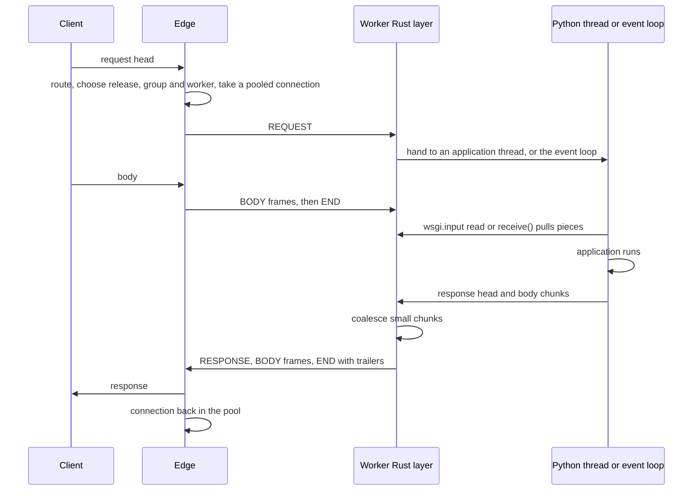

# 5. Worker protocol

```{admonition} Design specification
:class: note

This page is part of the Muru design specification and describes intended
design, for contributors. The user documentation is authoritative for released
behaviour. See the [specification index](index.md) for status and how the
specification is maintained.
```

The edge talks to each worker over a private link: a Unix socket the worker listens on and the edge connects to, carrying a small framed protocol whose structured payloads are protobuf messages. The edge parses HTTP once and sends typed frames, so no HTTP is re-serialised between edge and application, which removes request smuggling and desync risks on this hop. The protocol is internal (package muru.worker.v1) and versioned so that the daemon and runtime library can be upgraded independently within a compatibility window. The control plane between daemon and worker is separate and uses gRPC (section 5.9).

[ADR 0021](../adr/0021-framed-worker-link.md) records the choice of this link over gRPC, with the phase 0 measurements.

## 5.1 Transport and connection model

- **One request per connection.** A connection carries one request at a time, from its REQUEST frame to the end of its response, and is then idle and ready for the next. There is no multiplexing, so there is no head-of-line blocking between requests and no flow control to build: a slow consumer in one direction stalls only that connection, and the socket's own buffering is the credit.

- **Persistent, pooled.** The edge keeps a pool of connections per worker. A connection is opened when a request needs one and none is idle, kept open afterwards, and may be closed after an idle timeout. The two directions are independent tasks on both sides, so a response can start before the request body has been sent, and the request body keeps flowing while the response streams back.

- **Bounded by what the worker declares.** The worker's HELLO states how many requests it runs at once on threads (its slots) and how many it holds on its event loop (its async slots: WebSockets and requests handed to ASGI). The edge never has more requests in flight at a worker than those bounds, and queues beyond them per worker group with queue_timeout (section 4.5). The worker enforces the same bounds by refusing extra connections. For a WSGI worker the slots are its application threads; for an ASGI worker the async slots are its configured concurrency and the slots its sync thread pool. A DETACH frame moves a connection between the two counts when a request is handed from one side to the other (section 6.14).

- **Capabilities, not kinds.** The edge acts only on what HELLO declares: slots, async_slots, websockets, files, max_message_size. It does not treat WSGI and ASGI workers differently. A worker that does not accept websocket scopes receives upgrade requests as ordinary http scopes.

- **Unix sockets only** in production, one listener per worker in the release's run directory. A loopback TCP form exists for experiments. Descriptors pass over the same socket with SCM_RIGHTS (section 5.7).

- **Both ends in Rust.** The worker side is in the Rust extension, started after fork. Nothing on the link involves Python until a request is handed to an application thread or the event loop.

## 5.2 Frames and messages

Every frame is a six byte header followed by its payload: a 32 bit little-endian payload length, a kind byte and a flags byte. Payloads are at most 16 MiB. Structured payloads are protobuf messages from muru.worker.v1; BODY and MESSAGE payloads are raw bytes.

| Kind | Number | Direction | Payload | Meaning |
| --- | --- | --- | --- | --- |
| HELLO | 1 | both | Hello | Version and capabilities, once per connection in each direction, worker second |
| REQUEST | 2 | edge to worker | RequestHead | Opens a request. END flag when there is no body |
| BODY | 3 | both | bytes | One piece of a request or response body. END flag on the last piece |
| RESPONSE | 4 | worker to edge | ResponseHead | The final response head. END flag when there is no body. Status 101 accepts a WebSocket |
| END | 5 | both | End | Ends a body when no BODY frame carried the END flag. Carries trailers, or an error when the body is incomplete. Sent in place of RESPONSE when the application failed before producing a head, with the reason and detail the edge's error page shows (section 4.12) |
| ABORT | 6 | edge to worker | Abort | The edge has no more use for the request: the client has gone, or the response ended before the request body did (section 5.5) |
| CONTINUE | 7 | worker to edge | empty | The application has started reading the request body, so the edge may send 100 Continue (section 4.6). Sent only when the request head says the client is waiting for it |
| MESSAGE | 8 | both | bytes | One WebSocket message. TEXT flag for text, otherwise binary (section 5.6). Phase 2 |
| CLOSE | 9 | both | Close | Closes a WebSocket with a code and reason. Phase 2 |
| INFORMATIONAL | 10 | worker to edge | ResponseHead | A 1xx response before the final head, for example 103 Early Hints. Phase 2 |
| FILE | 11 | worker to edge | FileHint | The response body is a range of the file whose descriptor is attached to the frame (section 5.7). Phase 2 |
| DETACH | 12 | worker to edge | Detach | The request moved from an application thread to the event loop, or back, so the edge counts the connection against async slots or slots accordingly (section 6.14). Phase 2 |

Flags: END (0x01) on the last frame of a direction; TEXT (0x02) on a text MESSAGE; MORE (0x04) reserved for message fragments if max_message_size ever needs to be exceeded.

The messages, with the exact definitions in proto/muru/worker/v1/worker.proto:

- **Hello:** protocol_version, worker_type (wsgi or asgi, informational), slots, async_slots, websockets, files, max_message_size. The edge sends only its version.

- **RequestHead:** protocol version, request id, method, scheme, raw path and query as bytes, ordered raw header pairs, resolved client, server and original proxy peers, TLS details, mount, script name, route, release, deadline, content length when declared, whether the body was buffered, the body size limit in effect, the internal redirect context, host captures, upload references, the precheck flag, the client's HTTP version, and the scope (http or websocket).

- **ResponseHead:** status, ordered headers, flush policy override.

- **End:** trailers, and an error string when the body is incomplete. In place of a response head: the Appendix C.3 reason (app_error) and a detail string, the traceback, which the edge shows only in development mode.

- **Abort:** a reason, for logs.

- **Close:** a WebSocket close code and reason. **FileHint:** offset and length within the attached descriptor. **Detach:** which side the request moved to. All three are defined when their frames are implemented.

Phase 0 implements HELLO, REQUEST, BODY, RESPONSE, END and ABORT. The others are reserved so that kind numbers are fixed now.

## 5.3 Request flow



A connection is idle again when both directions have ended: the request direction with END, the END flag or ABORT, and the response direction with END or the END flag. Either side closing the connection abandons the request on it; the edge answers the client with 502 if no response head has been sent, and the worker stops the application's iteration.

## 5.4 Streaming and flush policy

Each yielded WSGI block or ASGI body message becomes a BODY frame unless it is coalesced. There is no per-chunk acknowledgement; the socket buffer is the only credit. Small chunks are coalesced in the worker before framing, because per-frame CPU and syscalls dominate for tiny yields:

| Setting | Default | Meaning |
| --- | --- | --- |
| flush | coalesce | immediate sends every block as a frame |
| coalesce_min_bytes | 16 KiB | flush when this much is buffered |
| coalesce_max_delay | 10 ms | flush this long after the first buffered byte |
| first_block | immediate | head and first block go out at once, in one write |

A Rust timer flushes independently of the Python thread, which satisfies PEP 3333's requirement that buffering never stops transmission while the application computes its next block. text/event-stream responses and responses marked with X-Accel-Buffering: no always flush immediately. The edge writes frames to clients without delay, merging queued frames into vectored writes when the client is slow.

When the application declares a Content-Length, the worker sets the END flag on the BODY frame that completes it and discards anything the application produces beyond it. Without a declared length, a bare END frame follows the last piece.

## 5.5 Cancellation, aborts, deadlines and backpressure

- **Client disconnect.** The edge sends ABORT on the request direction and keeps the connection. ASGI applications receive http.disconnect. WSGI applications see an empty read on wsgi.input, an error on the next response write, and their iteration is stopped after the current block. The worker finishes its response direction with END as usual, which the edge reads and discards, and the connection is idle again.

- **Response before the body has been sent.** As soon as the response has ended, the edge stops sending BODY frames and sends ABORT instead, so a large upload answered immediately does not cross the link. What the worker had already accepted is discarded. Whether the client connection can be kept alive is decided by the edge (section 4.6).

- **Request body on demand.** The worker reads BODY frames into a bounded queue that wsgi.input and receive() pull from. When the application does not read, the queue fills, the worker stops reading the socket, and the edge stops reading from the client. The response direction is unaffected, so an application that writes before it reads cannot deadlock against a client that is still uploading.

- **CONTINUE** lets the worker say that the application has started reading (its first read of wsgi.input, or its first receive() call), so the edge can hold 100 Continue until then for streamed bodies and never send the body at all when the application rejects first. The request head's expect_continue field tells the worker the client is waiting, so no frame is spent otherwise.

- **Deadlines.** The deadline in the head bounds queue wait, and timeouts in section 7.6 handle stuck requests. The edge's backstop on dispatch age closes the connection, which is the hard cancellation.

- **Response backpressure.** Response writes from Python block on a bounded channel with the interpreter released; the channel drains into the socket, the socket into the edge, and the edge into the client at the client's speed. Nothing is buffered without bound on either side.

## 5.6 WebSockets

Upgrades are accepted at the edge (HTTP/1.1 Upgrade and HTTP/2 extended CONNECT) when the worker declares websockets in HELLO; otherwise the request is sent as an http scope and the application answers it as it likes. A WebSocket uses one pooled connection for its whole life.

- The REQUEST carries scope websocket. The application accepts with a RESPONSE of status 101, naming a subprotocol in the usual header, or declines with any other RESPONSE and body, which the edge sends to the client as the answer to the upgrade (the ASGI websocket.http.response extension).

- After the accept, each MESSAGE frame is one whole message, text or binary by the TEXT flag, in either direction. Messages larger than max_message_size are rejected at the edge with close code 1009. Either side ends the socket with CLOSE carrying a code and reason; each side sends exactly one, and the connection is idle again once both have. Edge to worker, CLOSE is websocket.disconnect; worker to edge, it is the application closing. The edge sends 1001 on drain.

- The edge owns the wire protocol: handshake, masking, fragment reassembly, ping and pong (section 4.18). The worker sees only whole messages.

- A WebSocket counts against async_slots, not request slots, so held sockets cannot stop ordinary requests. In a WSGI worker a WebSocket is always a request handed to ASGI (section 6.14), and the DETACH frame moves its connection to the async count.

- Back-pressure is per socket: a slow client stops the edge reading that connection, which blocks the application's send() for that socket and nothing else.

## 5.7 Descriptor passing

File descriptors travel on the link itself, attached with SCM_RIGHTS to the frame that refers to them, so no correlation is needed: the descriptor arrives with the first byte of that frame. Both sides read the socket with recvmsg and a control buffer, since a plain read would discard an attached descriptor.

- **Worker to edge:** FILE frames for wsgi.file_wrapper and the ASGI pathsend and zerocopysend extensions (sections 4.9 and 6.5). The worker sends a duplicate of the open descriptor with an offset and length, closes its own copy, and the application thread is free. The edge sends the range to the client itself.

- **Edge to worker:** offloaded upload files (section 4.11) attached to the REQUEST frame, matched to the upload references in the head by order.

The channel works across container boundaries because both sides share the kernel. Log pipes are passed by the daemon when it spawns the host, not on the link.

## 5.8 Versioning

The protocol has a major and minor version, announced in HELLO by both sides and repeated in every request head. A HELLO whose major version differs is refused and the connection closed; the daemon supports the current and previous minor versions of the current major version. New fields and new frame kinds are additive within a major version, and a receiver ignores frame kinds it does not know only where the specification says it may. A mismatch outside the window fails the release at start-up with a clear message, never at request time.

## 5.9 Control plane

Status, drain, log reopening, log levels, stack capture and precheck mode use the Worker gRPC service (Status and Control) on a second Unix socket per worker, served from phase 2 when the daemon exists. gRPC suits this side: few calls, typed, self-describing, with deadlines and status codes, and no per-request cost. The request link never carries control traffic, and the control plane never carries requests. A worker that is told to drain stops accepting link connections and finishes the requests it holds.
