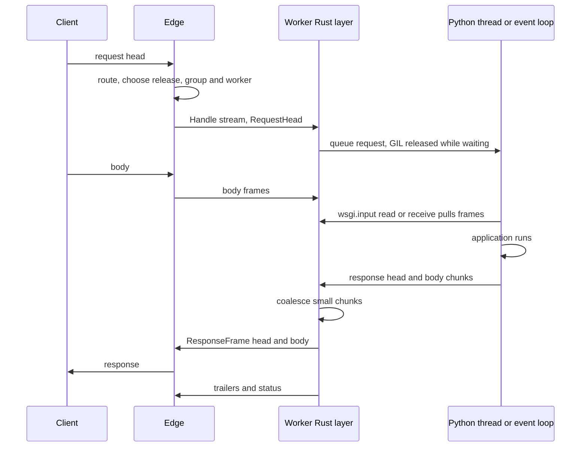

# 5. Worker protocol

```{admonition} Design specification
:class: note

This page is part of the Muru design specification and describes intended
design, for contributors. The user documentation is authoritative for released
behaviour. See the [specification index](index.md) for status and how the
specification is maintained.
```

The edge talks to each worker over gRPC on that worker's Unix socket. The edge parses HTTP once and sends typed frames, so no HTTP is re-serialised between edge and application, which removes request smuggling and desync risks on this hop. The protocol is internal (package muru.worker.v1) and versioned so that the daemon and runtime library can be upgraded independently within a compatibility window.

## 5.1 Why gRPC

| Option | Strengths | Weaknesses |
| --- | --- | --- |
| HTTP/1.1 over Unix socket | Simple, universal | No multiplexing, re-serialisation risk, no typed control channel |
| Custom framed protocol | Smallest overhead | Flow control, cancellation, versioning and tooling all custom |
| gRPC with tonic and prost (chosen) | Bidirectional streaming, flow control, cancellation, deadlines, trailers, status codes, health checking, mature Rust stack | HTTP/2 framing and protobuf costs, needs tuning |

The worker side is a tonic server inside the Rust extension, started after fork. grpcio is never used for the internal link, because its C core threads conflict with preload and fork. Both ends sit behind a transport trait, so a framed protocol can replace gRPC if the phase 0 benchmarks require it. Tuning: Unix sockets only, connection and stream windows of about 1 MiB, body frames of 64 to 256 KiB, protobuf bytes fields mapped to zero-copy Bytes, and a small pool of connections per worker.

## 5.2 Services and messages

```proto
syntax = "proto3";
package muru.worker.v1;

service Worker {
  rpc Handle(stream RequestFrame) returns (stream ResponseFrame);   // one HTTP request
  rpc Socket(stream SocketFrame) returns (stream SocketFrame);      // one WebSocket
  rpc Status(StatusRequest) returns (StatusReply);                  // load, memory, GIL and loop signals
  rpc Control(ControlRequest) returns (ControlReply);               // drain, reopen logs, log levels, stacks, precheck mode
}

message RequestFrame { oneof frame { RequestHead head = 1; bytes body = 2; Trailers trailers = 3; Cancel cancel = 4; } }
message ResponseFrame { oneof frame { ResponseHead head = 1; bytes body = 2; FileHint file = 3; Trailers trailers = 4; InternalRedirect redirect = 5; } }

message RequestHead {
  string protocol_version = 1;      // for example 1.0
  string request_id = 2;
  string method = 3;
  string scheme = 4;
  bytes raw_path = 5;
  bytes query = 6;
  repeated Header headers = 7;      // ordered raw byte pairs
  Peer client = 8;                  // resolved client
  Peer server = 9;
  Peer proxy = 10;                  // original peer when behind trusted proxies
  TlsInfo tls = 11;
  string mount = 12;
  string script_name = 13;
  string route = 14;
  string release = 15;
  uint64 deadline_unix_ms = 16;
  optional uint64 content_length = 17;
  bool body_buffered = 18;
  uint64 max_body_size = 19;
  InternalContext internal = 20;    // REDIRECT_* values, trusted redirect headers, error reason
  map<string, string> host_captures = 21;
  repeated UploadRef uploads = 22;  // descriptors delivered on the side channel
  bool precheck = 23;
}
```

ResponseHead carries status, ordered headers and the flush policy override. FileHint refers to a descriptor sent on the side channel, or a path. InternalRedirect carries the target path, host, method mode and headers to add. The exact .proto files are part of phase 0 deliverables.

## 5.3 Request flow



## 5.4 Streaming and flush policy

Each yielded WSGI block or ASGI body message becomes a one-way frame. There is no per-chunk acknowledgement, only HTTP/2 credit-based flow control. Small chunks are coalesced in the worker before framing, because per-message CPU and syscalls dominate for tiny yields:

| Setting | Default | Meaning |
| --- | --- | --- |
| flush | coalesce | immediate sends every block as a frame |
| coalesce_min_bytes | 16 KiB | flush when this much is buffered |
| coalesce_max_delay | 10 ms | flush this long after the first buffered byte |
| first_block | immediate | head and first block go out at once |

A Rust timer flushes independently of the Python thread, which satisfies PEP 3333's requirement that buffering never stops transmission while the application computes its next block. text/event-stream responses and responses marked with X-Accel-Buffering: no style headers always flush immediately. The edge writes frames to clients without delay, merging queued frames into vectored writes when the client is slow.

## 5.5 Cancellation, deadlines and backpressure

- Client disconnect cancels the stream. ASGI applications receive http.disconnect. WSGI applications see an I/O error on the next wsgi.input read or response write.
- The deadline in the head bounds queue wait, and timeouts in section 7.6 handle stuck requests.
- Response writes from Python block on a bounded channel with the GIL released, which maps onto HTTP/2 flow control and in turn onto the client's speed.

## 5.6 WebSockets

Upgrades are accepted at the edge (HTTP/1.1 Upgrade and HTTP/2 extended CONNECT) and only for ASGI mounts; WSGI paths get 426. A WebSocket is one Socket stream of text, binary, ping and close frames, mapped onto ASGI websocket events. Connections count against the mount's max_connections, not request slots, and are closed with 1001 on drain.

## 5.7 Descriptor side channel

Each worker has a second Unix socket used only for passing file descriptors with SCM_RIGHTS: file hints, upload files, and log pipes registered at fork. Messages on it carry a correlation id matching a request id, so the edge pairs descriptors with the right stream. The channel works across container boundaries because both sides share the kernel.

## 5.8 Versioning

The protocol has a major and minor version. Workers announce the versions they support in Status. The daemon supports the current and previous minor versions of the current major version. New fields are additive within a major version. A mismatch outside the window fails the release at start-up with a clear message, never at request time.
