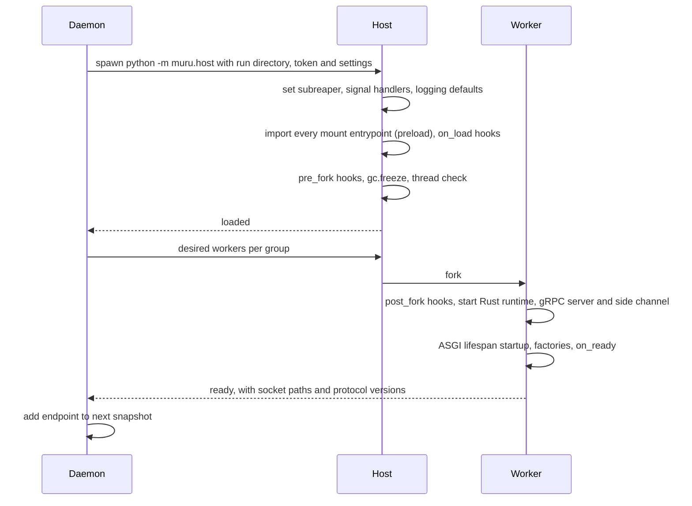

# 6. Python runtime

```{admonition} Design specification
:class: note

This page is part of the Muru design specification and describes intended
design, for contributors. The user documentation is authoritative for released
behaviour. See the [specification index](index.md) for status and how the
specification is maintained.
```

The runtime library (the muru package) runs inside every host and worker. Its Rust extension (PyO3) contains the gRPC server, the WSGI and ASGI bridges, the descriptor side channel and the native watchdog. The Python part contains the host control loop, hooks, configuration loading and the public Python API.

## 6.1 Host and worker lifecycle



The host never serves requests, so its memory stays clean and shared copy-on-write. It forks replacements for crashes, recycling and scaling, so a new worker costs a fork rather than an import.

**Preload modes.** preload has three values, and auto is the default in the daemon and in development mode alike, so an application behaves the same way on a laptop as in production:

| Value | Behaviour |
| --- | --- |
| auto (default) | The host imports the application, then runs the import check of section 6.2. If the import left nothing behind that cannot be shared across fork, workers are forked from the host. Otherwise the host logs a warning naming what it found, raises a preload.fell_back event, and runs the release with per-worker imports instead. The release still works, with slower worker replacement and no shared memory, and the warning says what to fix or what a post_fork hook must reopen |
| true | Preload, and treat any finding of the import check as a release failure during warm-up. For applications whose imports are known to be fork-safe, so that a regression is caught instead of silently costing the preload benefits |
| false | Import in each worker. The check is skipped |

Per-worker imports keep everything else the same: worker groups, mounts, variants, hooks (on_load and pre_fork then run in each worker before its post_fork), readiness and timeouts.

## 6.2 Fork safety

- The host is single-threaded: no threads, event loop or Rust runtime exist before fork. Its control loop is plain Python using selectors and waitpid.
- **The import check.** After preload and the on_load hooks, and before the first fork, the host compares the process with its state before the import and reports anything that would be shared or lost across fork: connected sockets and pipes (new descriptors whose getpeername succeeds, or that lead to a child process), threads, including native threads that the threading module cannot see (counted from /proc/self/task on Linux and from the Mach task on macOS, which catches librdkafka, grpcio and similar C libraries), child processes, and running event loops. Each finding names the descriptor or thread and, where it can be determined, the module whose import created it. Descriptors that are safe to share are not reported: regular files, unconnected UDP sockets and the host's own control channel. The findings decide what preload = 'auto' does (section 6.1), and are raised as a preload.unsafe_import event either way.
- os.register_at_fork callbacks are honoured, and workers inherit only the descriptors they need.
- A failing import fails the release during warm-up, never during live traffic.

**Garbage collection and copy-on-write.** After fork, worker and host share memory pages until one of them writes to a page. CPython's cyclic garbage collector writes into the header of every object it examines, so a full collection in a worker would touch every long-lived container object inherited from preload and force private copies of those pages. The host follows the sequence recommended in the Python documentation:

1. gc.disable() at host start-up, before importing the application, so no collections free objects during preload and leave scattered holes that workers would later fill (writing to shared pages).
2. Optionally one explicit gc.collect() after preload (preload_gc_collect = true) for applications whose imports create a lot of cyclic garbage. Off by default.
3. gc.freeze() immediately before each fork, which moves every tracked object into a permanent generation the collector ignores.
4. gc.enable() in each worker immediately after fork, before post_fork hooks run, so objects the worker creates are collected normally.

Limits: reference count updates still write to objects that are used, so frequently used objects still diverge (immortal objects in Python 3.12 and later cover only some core objects). Objects not tracked by the collector, such as strings and numbers, are unaffected. Frozen garbage is never collected, which costs only shared memory. Behaviour on free-threaded builds, whose collector works differently, is to be verified in the phase 0 spike. Shared and private memory per worker (PSS and USS) are reported so the effect can be measured.

## 6.3 Hooks

Hooks live in a module named by the hooks setting. Each receives a context object with app, release, group, worker_id, interface and process_model.

| Hook | Runs in | Typical use |
| --- | --- | --- |
| on_load | host, after import | validate configuration, warm fork-safe caches |
| pre_fork | host | close sockets and files that must not be shared |
| post_fork | worker | reopen database connections, reseed, start background threads |
| on_ready | worker | final warm-up |
| on_drain | worker | stop background work, flush |
| on_exit | worker | clean up |
| on_reopen_logs | worker | reopen application-owned log files |

## 6.4 Process and threading models

| Model | Settings | Comparable to |
| --- | --- | --- |
| Threaded WSGI | processes = 4, threads = 15 | mod_wsgi daemon mode, gunicorn gthread |
| Process per request | processes = 16, threads = 1 | gunicorn sync |
| Async ASGI | processes = 4 | uvicorn workers |
| ASGI with sync pool | processes = 4, sync_threads = 8 | Django ASGI with sync views |
| Free-threaded | processes = 1, threads = 32, free-threaded interpreter | none, Python 3.14t and later |

Processes belong to worker groups (section 7.1). Threads belong to WSGI thread pools, shared by default or per mount.

## 6.5 WSGI bridge

- A bounded request queue in Rust. Python threads call next_request(), which blocks with the GIL released.
- The environ is built in Rust (Appendix D lists every key). wsgi.input is Rust-backed: read, readline and iteration pull body frames with the GIL released, and always return an empty value at the end of the body.
- wsgi.input_terminated is always True. With chunked_body = 'buffer' (the default) CONTENT_LENGTH is also set, so frameworks that only read CONTENT_LENGTH work. With 'stream' it is absent.
- wsgi.multiprocess is True for any daemon-managed release, because releases overlap during deploys, recycles and scaling. It is False only for single-process development runs. wsgi.multithread is True when the pool serving the mount has more than one thread. Both can be forced per release. wsgi.run_once is False.
- Response iteration pushes chunks into a bounded channel. wsgi.file_wrapper(filelike, block_size) returns a Muru wrapper that is also an ordinary iterable. When the application returns that wrapper itself as the response iterable and filelike.fileno() is a regular file, the bridge passes a duplicate descriptor to the edge as a file hint, starting at the file's current position and covering Content-Length bytes if that header is set, otherwise to the end of the file. If there is no fileno(), the file is not a regular file, or middleware has wrapped the iterable so the bridge cannot see the wrapper, it falls back to iterating read(block_size) chunks, as PEP 3333 requires. The worker closes its own descriptor once it is passed. close() is always called on the iterable, including after client disconnects.
- The edge, not the application, handles 100 Continue (section 4.6).

## 6.6 ASGI bridge

- One event loop thread per worker (uvloop when installed and enabled), started after fork. Rust delivers events with call_soon_threadsafe, batched where possible. receive() and send() are awaitables completed from Rust.
- Supported: ASGI 3.0 HTTP and WebSocket, lifespan per worker (startup must succeed before readiness), the HTTP trailers extension, and the file extensions http.response.pathsend and http.response.zerocopysend, advertised in scope['extensions']. For pathsend the worker opens the path with the application's permissions; for zerocopysend it uses the given file, offset and count. Either way a duplicate descriptor goes to the edge as a file hint, so frameworks such as Starlette (whose FileResponse uses pathsend when the server supports it) get zero-copy file serving without Muru-specific code. Scope extensions are listed in Appendix D.
- A bounded thread pool, separate from WSGI threads, serves sync_to_async and asyncio.to_thread.

## 6.7 Mounts

A release can serve several mounts, each a path with an interface and an entrypoint, in the same worker processes and from one preload. The top-level entrypoint is the default mount at /. Mounts can be any mix of WSGI and ASGI (and gRPC services, section 6.13).

```toml
[app.chat.release.r7]
entrypoint = 'chat.wsgi:application'
threads = 16

[app.chat.release.r7.mounts.ws]
path = '/ws'
interface = 'asgi'
entrypoint = 'chat.asgi:websocket_app'
max_connections = 2000
concurrency = 500

[app.chat.release.r7.mounts.reports]
path = '/reports'
interface = 'wsgi'
entrypoint = 'chat.reports:application'
threads = { reserved = 2, max = 6 }
internal = false
```

- WSGI mounts share the worker's thread pool unless given their own pool (fixed, or a reserved minimum that borrows from the shared pool). The edge tracks slots and queues per pool.
- All ASGI mounts share the worker's event loop. WSGI code reaches it with muru.loop() and call_soon_threadsafe or run_coroutine_threadsafe.
- Each mount receives SCRIPT_NAME or root_path for its prefix. Mount paths follow the matching rules of worker groups (prefix, most specific wins, duplicates rejected).
- Mounts share one interpreter. Two independent applications relying on process-wide globals need separate releases. Isolated sub-interpreter mounts are a future idea.
- CPU-heavy WSGI requests can delay the event loop on GIL builds. Loop lag is measured, and the remedy is moving the mount to its own worker group.

## 6.8 Application configuration conventions

The daemon starts hosts itself and imports applications as modules, so applications have no command line and are never run as `__main__`. Configuration reaches them through these channels:

| Channel | Used for |
| --- | --- |
| Entrypoint | module:callable, or a factory called per worker after post_fork (factory_phase = 'host' to call it during preload) |
| Environment variables | Primary application settings, layered system, application, release and secrets (including NAME_FILE secrets) |
| Files | Files in the release, or files supplied by the release spec and snapshotted read-only into the run directory |
| `[tool.muru]` in pyproject.toml, or muru.toml | Application-shipped defaults: entrypoint, interface, python requirement, process model, mounts, groups, hooks, readiness and liveness probes, release checks, static directories |
| Hooks module | Lifecycle hooks (section 6.3) |
| MURU_* variables | Read-only runtime context (Appendix D) |

- Configuration changes are releases, so they get the same audit trail, canary and rollback as code. There is no in-process reload.
- sys.argv is a single element. One-off commands run with muructl exec RELEASE -- COMMAND, using the release's interpreter, environment, user and working directory.
- Applications run unchanged under other servers, because environment variables are the primary interface and the muru module is optional.

## 6.9 Python API

| API | Purpose |
| --- | --- |
| muru.context() | Current app, release, group, worker id, interface, process model. Returns development defaults outside Muru |
| muru.loop() | The worker's event loop, for WSGI code handing work to ASGI mounts |
| muru.is_internal(environ or scope) | Whether the request arrived by internal redirect |
| muru.uploads.files(environ or scope) | Offloaded uploads for the current request, with muru.uploads.get(environ or scope, ref) for a single ref (section 4.11) |
| muru.logging.default_config() | dictConfig dictionary matching the platform logging defaults |
| muru.request_id() | Current request id, from a context variable |
| muru.RequestTimeout | BaseException subclass raised by the soft timeout |
| muru.host | Host entry point module (python -m muru.host). Internal |

The API is typed (shipped with stub files) and every function is safe to call outside Muru.

## 6.10 Host as PID 1

In containers the host is PID 1 and needs no separate init. It sets PR_SET_CHILD_SUBREAPER (inside or outside containers), reaps orphaned descendants, terminates a dead worker's leftover descendants after a grace period, and installs handlers for SIGTERM (drain), SIGINT and SIGHUP (stop) and SIGQUIT (stack dump). It tracks its own workers and uses waitid with WNOWAIT before reaping, and warns if preload left child processes running.

## 6.11 Free-threaded Python

Free-threaded CPython builds (3.14t and later) are supported from phase 1, together with the WSGI bridge, and the runtime library is designed for them from the outset rather than adapted later.

**Design rules for the extension**

- The extension declares that it does not require the GIL (PyO3's free-threaded module support), so importing it never re-enables the GIL.
- The GIL is never used as a lock for internal state. All shared state in the extension lives in Rust (tokio, channels, atomics, mutexes), which is already safe across threads on both build types.
- Python objects shared between threads (the request queue's handles, the event loop reference, upload references, configuration) are either immutable after creation or guarded by Rust-side synchronisation, never by assumptions that only one thread runs Python at a time.
- Every place where a regular build releases the GIL while blocking (waiting for the next request, reading the body, writing the response) uses PyO3's detach mechanism, which on free-threaded builds lets the thread stop holding its interpreter state so other threads and the garbage collector are not held up. The call sites are identical on both build types.
- Per-thread state uses thread-local storage or context variables, never module globals.
- Only the safe PyO3 APIs suitable for free-threaded builds are used, which excludes borrowed references into mutable containers.

**Runtime checks**

- After preload, the host checks sys._is_gil_enabled(). Importing any extension module that does not declare free-threaded support makes the interpreter re-enable the GIL unless it is forced off (PYTHON_GIL=0). The result is shown in status, the dashboard and an event, and the host warns when a release uses a free-threaded process model but the GIL is enabled, naming the modules imported when it was turned back on where that can be determined.
- A release can require the GIL to stay off (require_free_threading = true), failing at preload instead of running degraded.

**Process models and scaling**

- A free-threaded release can run fewer processes with more threads (for example processes = 1, threads = 32), because threads run Python in parallel. The default model for free-threaded interpreters is the same as for regular builds until benchmarks support different defaults.
- worker_cpu is normalised by the number of cores a worker may use. gil_wait is not reported on free-threaded builds. Lock contention measured in the bridge, scheduler latency and queue wait replace it as saturation signals.
- Preload and fork work the same way. The garbage collection sequence of section 6.2 is verified on free-threaded builds in the phase 0 spike.

**Testing:** the WSGI bridge, conformance suites and integration tests run on 3.14t from phase 1, including a stress test with many threads in one process, and ThreadSanitizer builds of the extension run nightly.

Running free-threaded and regular builds for the same application at once uses release variants (section 7.1): one variant per interpreter build, each with its own groups and paths.

## 6.12 Interpreters within a worker

Each worker initially runs one Python interpreter. To keep sub-interpreters possible later (section 20.3) without a rewrite, the extension must not assume one interpreter per worker: request queues, thread pools, the event loop, per-mount state, hooks and the descriptor side channel's dispatch are all keyed by an interpreter handle, and the main interpreter is simply the first. Configuration already separates the levels involved: variants choose the interpreter build and environment, groups choose the process model, and mounts can later request isolation.

## 6.13 gRPC service mounts

A mount can serve application gRPC services from the same workers as the release's WSGI and ASGI mounts, or a release can be gRPC only. Existing servicer code generated by grpcio-tools runs unchanged.

```python
# svc/grpc_app.py
from svc.proto import greeter_pb2, greeter_pb2_grpc

class Greeter(greeter_pb2_grpc.GreeterServicer):
    def SayHello(self, request, context):              # sync: runs on a thread
        return greeter_pb2.HelloReply(message=f'Hello {request.name}')

    async def StreamUpdates(self, request, context):   # async: runs on the event loop
        async for update in feed(request.topic):
            yield update

def register(server):
    greeter_pb2_grpc.add_GreeterServicer_to_server(Greeter(), server)
```

```toml
[app.svc.release.r3]
interface = 'grpc'                 # a gRPC-only release; or declare it as a mount beside WSGI or ASGI mounts
entrypoint = 'svc.grpc_app:register'
processes = 2
threads = 8
reflection = true
```

**Application side**

- The entrypoint is a registration function. It receives a Muru object that implements the registration methods generated code calls on a grpcio server (add_generic_rpc_handlers and add_registered_method_handlers), and collects each method's handler and serializers. grpcio stays installed because generated code imports it for types and status codes, but its C core never creates a server or channel in the worker, so its fork-safety problems do not arise.
- Synchronous handlers run on the mount's thread pool, asynchronous handlers on the worker's event loop. All four call types are supported: unary, server streaming, client streaming and bidirectional streaming.
- The context object implements the commonly used parts of grpc.ServicerContext: abort, set_code, set_details, invocation_metadata, send_initial_metadata, set_trailing_metadata, time_remaining, is_active, add_callback, and peer (which returns the resolved client from trusted proxy handling, section 4.7).
- Message framing, compression (grpc-encoding), deadlines (grpc-timeout) and cancellation are handled in the Rust layer. Python only runs serializers and handlers. Soft and hard timeouts apply per call (section 7.6), and streaming calls use the idle timeout.

**Edge side**

- A request is matched to a gRPC mount by content type application/grpc and the registered /package.Service/ names, so gRPC and HTTP share listeners and virtual hosts. A gRPC mount needs no path.
- Clients connect with HTTP/2 over TLS (h2) or cleartext (h2c, which can be limited to trusted networks). Status and messages travel in trailers, which map onto the trailers frame of the worker protocol (section 5.2).
- Calls are balanced individually across workers, removing the usual problem of a client pinning its long-lived connection to one backend.
- Muru provides the standard grpc.health.v1 health service (driven by readiness, section 9.11) and, when reflection = true, server reflection built from the registered services.
- gRPC-Web (application/grpc-web and grpc-web-text) is translated at the edge, so browsers can call the same services without a separate proxy.
- Unregistered methods return UNIMPLEMENTED. In a gRPC-only release, plain HTTP requests receive 404.
- Authentication sub-requests (section 4.16), rate limits and client classes apply to gRPC routes as to any other.

**Scope limits:** servicers written for grpclib or betterproto are not supported initially. grpcio availability for free-threaded builds is to be confirmed; on builds where it cannot be installed, gRPC mounts are unavailable.
