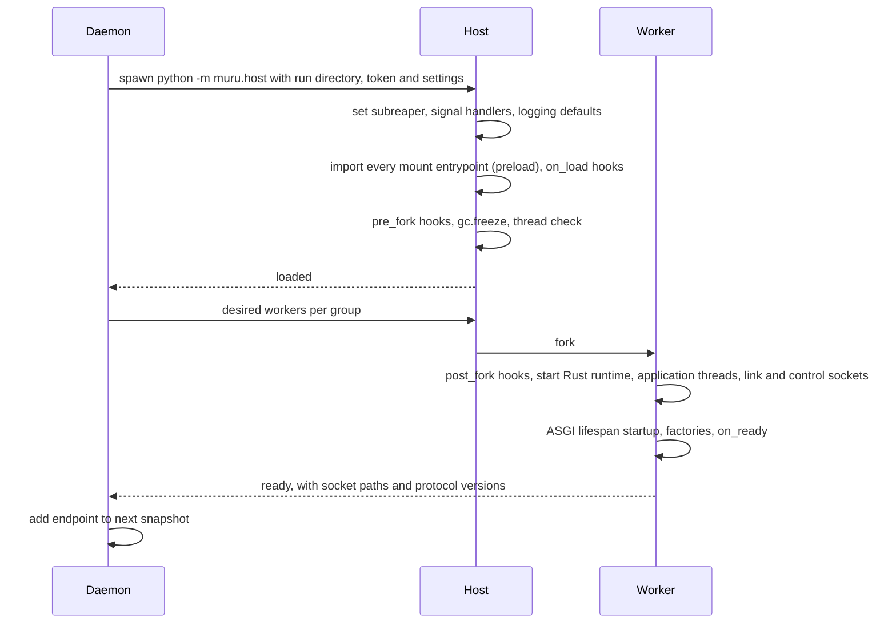

# 6. Python runtime

```{admonition} Design specification
:class: note

This page is part of the Muru design specification and describes intended
design, for contributors. The user documentation is authoritative for released
behaviour. See the [specification index](index.md) for status and how the
specification is maintained.
```

The runtime library (the muru package) runs inside every host and worker. Its Rust extension (PyO3) contains the worker side of the link (section 5), the application thread pool, the WSGI and ASGI bridges, the control plane server and the native watchdog. The Python part contains the host control loop, hooks, configuration loading and the public Python API.

## 6.1 Host and worker lifecycle



The host never serves requests, so its memory stays clean and shared copy-on-write. It forks replacements for crashes, recycling and scaling, so a new worker costs a fork rather than an import.

**Preload modes.** preload has three values, and auto is the default in the daemon and in development mode alike, so an application behaves the same way on a laptop as in production:

| Value | Behaviour |
| --- | --- |
| auto (default) | The host imports the application, then runs the import check of section 6.2. If the import left nothing behind that cannot be shared across fork, workers are forked from the host. Otherwise the host logs a warning naming what it found, raises a preload.fell_back event, and runs the release with per-worker imports instead: it re-executes itself without preload, so nothing the import left behind reaches a worker. The release still works, with slower worker replacement and no shared memory, and the warning says what to fix or what a post_fork hook must reopen. The on_load hook has run once in the host by then, and runs again in each worker |
| true | Preload, and treat any finding of the import check as a release failure during warm-up. For applications whose imports are known to be fork-safe, so that a regression is caught instead of silently costing the preload benefits |
| false | Import in each worker. The check is skipped |

Per-worker imports keep everything else the same: worker groups, mounts, variants, hooks (on_load and pre_fork then run in each worker before its post_fork), readiness and timeouts.

## 6.2 Fork safety

- The host is single-threaded: no threads, event loop or Rust runtime exist before fork. Its control loop is plain Python using selectors and waitpid.
- **The import check.** After preload and the on_load hooks, and before the first fork, the host compares the process with its state before the import and reports anything that would be shared or lost across fork: connected sockets and pipes (new descriptors whose getpeername succeeds, or that lead to a child process), threads, including native threads that the threading module cannot see (counted from /proc/self/task on Linux and from the Mach task on macOS, which catches librdkafka, grpcio and similar C libraries), child processes, and running event loops. Each finding names the descriptor or thread and, where it can be determined, the module whose import created it. Descriptors that are safe to share are not reported: regular files, unconnected UDP sockets and the host's own control channel. The findings decide what preload = 'auto' does (section 6.1), and are raised as a preload.unsafe_import event either way.
- os.register_at_fork callbacks are honoured, and workers inherit only the descriptors they need.
- A failing import fails the release during warm-up, never during live traffic.

**Garbage collection and copy-on-write.** After fork, worker and host share memory pages until one of them writes to a page. CPython's cyclic garbage collector writes into the header of every object it examines, so a full collection in a worker would touch every long-lived container object inherited from preload and force private copies of those pages. The host follows the sequence recommended in the Python documentation:

1. gc.disable() at host start-up, before importing the application, so no collections free objects during preload and leave scattered holes that workers would later fill (writing to shared pages).
2. Optionally one explicit gc.collect() after preload (preload_gc_collect = true) for applications whose imports create a lot of cyclic garbage. Off by default.
3. gc.freeze() immediately before each fork, which moves every tracked object into a permanent generation the collector ignores.
4. gc.enable() in each worker immediately after fork, before post_fork hooks run, so objects the worker creates are collected normally.

Limits: reference count updates still write to objects that are used, so frequently used objects still diverge (immortal objects in Python 3.12 and later cover only some core objects). Objects not tracked by the collector, such as strings and numbers, are unaffected. Frozen garbage is never collected, which costs only shared memory. Behaviour on free-threaded builds, whose collector works differently, is to be verified in the phase 0 spike. Shared and private memory per worker (PSS and USS) are reported so the effect can be measured.

## 6.3 Hooks

Hooks live in a module named by the hooks setting. Each receives a context object with app, release, group, worker_id, interface and process_model.

| Hook | Runs in | Typical use |
| --- | --- | --- |
| on_load | host, after import | validate configuration, warm fork-safe caches |
| pre_fork | host, once before the first fork | close sockets and files that must not be shared |
| post_fork | worker, after fork | reopen database connections, reseed, start background threads |
| on_ready | worker, before its sockets are announced | final warm-up |
| on_drain | worker, when told to stop, before requests in flight finish | stop background work, flush |
| on_exit | worker, after the application threads have stopped | clean up |
| on_reopen_logs | worker, on SIGUSR1 | reopen application-owned log files |

An exception from on_load, pre_fork, post_fork or on_ready fails the host or the worker it runs in; one from on_drain, on_exit or on_reopen_logs is logged. Before every fork the host checks that it is still single-threaded and logs a warning naming the thread count otherwise, since threads do not exist in the child.

## 6.4 Process and threading models

| Model | Settings | Comparable to |
| --- | --- | --- |
| Threaded WSGI | processes = 4, threads = 15 | mod_wsgi daemon mode, gunicorn gthread |
| Process per request | processes = 16, threads = 1 | gunicorn sync |
| Async ASGI | processes = 4 | uvicorn workers |
| ASGI with sync pool | processes = 4, sync_threads = 8 | Django ASGI with sync views |
| Free-threaded | processes = 1, threads = 32, free-threaded interpreter | none, Python 3.14t and later |

Processes belong to worker groups (section 7.1). Threads belong to WSGI thread pools, shared by default or per mount.

## 6.5 WSGI bridge

- **A fixed pool of long-lived application threads** ([ADR 0022](../adr/0022-fixed-application-thread-pool.md)). The threads are created when the worker starts, kept for its whole life, and each attaches to the interpreter once, so it has a stable Python thread state: threading.local values set by one request are there for later requests on the same thread, as under mod_wsgi, and per-thread resources such as database connections are reused. Requests are handed to idle threads from a queue in Rust; a thread waiting for work is detached from the interpreter. Threads are never created per request and never retired while the worker runs.
- **A fresh context per request.** Each request runs inside a copy of the thread's contextvars context (PyContext_CopyCurrent, entered before the application is called and exited after close()), so a context variable set during one request is not visible to the next request on the same thread. Thread-locals persist across requests; context variables do not.
- The environ is built in Rust (Appendix D lists every key). wsgi.input is Rust-backed: read, readline and iteration pull body frames with the GIL released, and always return an empty value at the end of the body.
- wsgi.input_terminated is always True. With chunked_body = 'buffer' (the default) CONTENT_LENGTH is also set, so frameworks that only read CONTENT_LENGTH work. With 'stream' it is absent.
- wsgi.multiprocess is True for any daemon-managed release, because releases overlap during deploys, recycles and scaling. It is False only for single-process development runs. wsgi.multithread is True when the pool serving the mount has more than one thread. Both can be forced per release. wsgi.run_once is False.
- Response iteration pushes chunks into a bounded channel. wsgi.file_wrapper(filelike, block_size) returns a Muru wrapper that is also an ordinary iterable. When the application returns that wrapper itself as the response iterable and filelike.fileno() is a regular file, the bridge passes a duplicate descriptor to the edge on a FILE frame (section 5.7), starting at the file's current position and covering Content-Length bytes if that header is set, otherwise to the end of the file. If there is no fileno(), the file is not a regular file, or middleware has wrapped the iterable so the bridge cannot see the wrapper, it falls back to iterating read(block_size) chunks, as PEP 3333 requires. The worker closes its own descriptor once it is passed. close() is always called on the iterable, including after client disconnects.
- The edge, not the application, handles 100 Continue (section 4.6).
- **start_response validation**, following mod_wsgi. The status must be three digits, a space and a reason phrase without control characters (ValueError otherwise, TypeError when not a str); the reason phrase reaches HTTP/1.1 clients. Headers must be a list (TypeError) of (str, str) tuples (TypeError for other items or types, ValueError for a tuple of the wrong length); names must be non-empty tokens without spaces or control characters and values must not contain CR or LF (ValueError); both are latin-1 encoded, so other characters raise UnicodeEncodeError; a Content-Length that is not a non-negative integer is a ValueError. exc_info must be None or a 3-tuple (TypeError). A second call before any output has been sent replaces the first, with or without exc_info, as mod_wsgi allows; after output has started, exc_info is re-raised and a call without it is a RuntimeError.
- **End of output.** The bridge tells the link explicitly when a request is over, after close() has run, rather than inferring it from the lifetime of the start_response object: frameworks keep exceptions, and so the frames that reference that object, alive in reference cycles until a later collection, which would otherwise hold the worker connection open.
- **Response iteration rules.** Items must be bytes (TypeError, which is a 500 before output and a truncated response after). A declared Content-Length is enforced: output beyond it is dropped, and a body that ends short of it fails the response with the connection closed and a line in the log. close() is always called; an exception from close() is logged and does not fail a response that was fully produced. SystemExit and KeyboardInterrupt from the application are a 500 and a logged traceback like any other exception, never the end of the worker.
- **Conformance suite.** tests/conformance/wsgi pins each of these rules, one test module per area, with cases taken from the mod_wsgi integration tests (section 15.1).

## 6.6 ASGI bridge

- One event loop thread per worker (uvloop when installed and enabled), started after fork. Rust delivers events with call_soon_threadsafe, batched where possible. receive() and send() are awaitables completed from Rust. Each connection's coroutine runs in its own context, as asyncio tasks do.
- Supported: ASGI 3.0 HTTP and WebSocket, lifespan per worker (startup must succeed before readiness; the same mechanism serves applications registered with muru.asgi.register, section 6.14), the HTTP trailers extension, and the file extensions http.response.pathsend and http.response.zerocopysend, advertised in scope['extensions']. For pathsend the worker opens the path with the application's permissions; for zerocopysend it uses the given file, offset and count. Either way a duplicate descriptor goes to the edge on a FILE frame (section 5.7), so frameworks such as Starlette (whose FileResponse uses pathsend when the server supports it) get zero-copy file serving without Muru-specific code. Scope extensions are listed in Appendix D.
- A bounded thread pool, separate from WSGI threads, serves sync_to_async and asyncio.to_thread.

## 6.7 Mounts

A release can serve several mounts, each a path with an interface and an entrypoint, in the same worker processes and from one preload. The top-level entrypoint is the default mount at /. Mounts can be any mix of WSGI and ASGI (and gRPC services, section 6.13).

```toml
[app.chat.release.r7]
entrypoint = 'chat.wsgi:application'
threads = 16

[app.chat.release.r7.mounts.ws]
path = '/ws'
interface = 'asgi'
entrypoint = 'chat.asgi:websocket_app'
max_connections = 2000
concurrency = 500

[app.chat.release.r7.mounts.reports]
path = '/reports'
interface = 'wsgi'
entrypoint = 'chat.reports:application'
threads = { reserved = 2, max = 6 }
internal = false
```

- WSGI mounts share the worker's thread pool unless given their own pool (fixed, or a reserved minimum that borrows from the shared pool). The edge tracks slots and queues per pool.
- **Details fixed by the implementation.** A mount's `threads` is a number, a pool of that many threads only it uses, or `{ reserved, max }`: `reserved` threads only it uses (none is allowed) and up to `max` requests at once, those beyond its reserved threads running on threads of the shared pool. It is accepted on WSGI mounts and, as a number, on gRPC mounts (section 6.13); an ASGI mount is refused it, and a mount detected as ASGI with it fails its worker's start. The worker declares each mount's reserved threads and maximum in HELLO. An ASGI mount declared `interface = 'asgi'` may set `concurrency`, requests it runs at once as slots of its own at the edge (declared in HELLO as reserved and maximum both), and `max_connections`, the open WebSockets it holds apart from them: a handshake takes one of each, and an accepted socket gives its request slot back and keeps its connection for its life. Either alone is allowed, both are per worker, and requests or handshakes beyond them wait at the edge until the queue timeout. The edge holds slots for each worker per pool: a request to a mount takes one of its reserved slots when one is free, else a slot of the shared pool within its allowance, `max` less `reserved`, whichever comes first, and the request head says when it borrowed, so the worker runs it on the shared pool. A worker's slot count and busy slots in the metrics and the dashboard are the shared pool's and the mounts' reserved ones together. wsgi.multithread is True for a mount whose `max` is more than one. The shared pool has the worker's `threads` whenever a WSGI application uses it, the default mount's or a mount's without threads of its own or that borrows, and one thread otherwise.
- All ASGI mounts share the worker's event loop. WSGI code reaches it with muru.loop() and call_soon_threadsafe or run_coroutine_threadsafe. Mounts are the static way to mix the two interfaces; when the choice is made in code per request, section 6.14 hands a request across in either direction.
- Each mount receives SCRIPT_NAME or root_path for its prefix. Mount paths follow the matching rules of worker groups (prefix, most specific wins, duplicates rejected).
- Mounts share one interpreter. Two independent applications relying on process-wide globals need separate releases. Isolated sub-interpreter mounts are a future idea.
- CPU-heavy WSGI requests can delay the event loop on GIL builds. Loop lag is measured, and the remedy is moving the mount to its own worker group.

## 6.8 Application configuration conventions

The daemon starts hosts itself and imports applications as modules, so applications have no command line and are never run as `__main__`. Configuration reaches them through these channels:

| Channel | Used for |
| --- | --- |
| Entrypoint | module:callable, or a factory called per worker after post_fork (factory_phase = 'host' to call it during preload) |
| Environment variables | Primary application settings, layered system, application, release and secrets (including NAME_FILE secrets) |
| Files | Files in the release, or files supplied by the release spec and snapshotted read-only into the run directory |
| `[tool.muru]` in pyproject.toml, or muru.toml | Application-shipped defaults: entrypoint, interface, python requirement, process model, mounts, groups, hooks, readiness and liveness probes, release checks, static directories |
| Hooks module | Lifecycle hooks (section 6.3) |
| MURU_* variables | Read-only runtime context (Appendix D) |

- Configuration changes are releases, so they get the same audit trail, canary and rollback as code. There is no in-process reload.
- sys.argv is a single element. One-off commands run with muructl exec RELEASE -- COMMAND, using the release's interpreter, environment, user and working directory.
- Applications run unchanged under other servers, because environment variables are the primary interface and the muru module is optional.

## 6.9 Python API

| API | Purpose |
| --- | --- |
| muru.context() | Current app, release, group, worker id, interface, process model. Returns development defaults outside Muru |
| muru.loop() | The worker's event loop, for WSGI code handing work to ASGI mounts |
| muru.asgi.register(app) | Run an ASGI application's lifespan in this worker, from a post_fork hook (section 6.14) |
| muru.asgi.websocket | Handler, Socket and ConnectionClosed: the WebSocket adapter, an ordinary ASGI application (section 6.14) |
| muru.is_internal(environ or scope) | Whether the request arrived by internal redirect |
| muru.uploads.files(environ or scope) | Offloaded uploads for the current request, with muru.uploads.get(environ or scope, ref) for a single ref (section 4.11) |
| muru.logging.default_config() | dictConfig dictionary matching the platform logging defaults |
| muru.request_id() | Current request id, from a context variable |
| muru.RequestTimeout | BaseException subclass raised by the soft timeout |
| breakpoint() | The runtime library's breakpoint hook waits for muructl debug attach (section 11.7); outside Muru it is the ordinary pdb |
| muru.host | Host entry point module (python -m muru.host). Internal |

The API is typed (shipped with stub files) and every function is safe to call outside Muru.

## 6.10 Host as PID 1

In containers the host is PID 1 and needs no separate init. It sets PR_SET_CHILD_SUBREAPER (inside or outside containers), reaps orphaned descendants, terminates a dead worker's leftover descendants after a grace period, and installs handlers for SIGTERM (drain), SIGINT and SIGHUP (stop) and SIGQUIT (stack dump). It tracks its own workers and uses waitid with WNOWAIT before reaping, and warns if preload left child processes running.

## 6.11 Free-threaded Python

Free-threaded CPython builds (3.14t and later) are supported from phase 1, together with the WSGI bridge, and the runtime library is designed for them from the outset rather than adapted later.

**Design rules for the extension**

- The extension declares that it does not require the GIL (PyO3's free-threaded module support), so importing it never re-enables the GIL.
- The GIL is never used as a lock for internal state. All shared state in the extension lives in Rust (tokio, channels, atomics, mutexes), which is already safe across threads on both build types.
- Python objects shared between threads (the request queue's handles, the event loop reference, upload references, configuration) are either immutable after creation or guarded by Rust-side synchronisation, never by assumptions that only one thread runs Python at a time.
- Every place where a regular build releases the GIL while blocking (waiting for the next request, reading the body, writing the response) uses PyO3's detach mechanism, which on free-threaded builds lets the thread stop holding its interpreter state so other threads and the garbage collector are not held up. The call sites are identical on both build types.
- Per-thread state uses thread-local storage or context variables, never module globals.
- Only the safe PyO3 APIs suitable for free-threaded builds are used, which excludes borrowed references into mutable containers.

**Runtime checks**

- After preload, the host checks sys._is_gil_enabled(). Importing any extension module that does not declare free-threaded support makes the interpreter re-enable the GIL unless it is forced off (PYTHON_GIL=0). The result is shown in status, the dashboard and an event, and the host warns when a release uses a free-threaded process model but the GIL is enabled, naming the modules imported when it was turned back on where that can be determined.
- A release can require the GIL to stay off (require_free_threading = true), failing at preload instead of running degraded.

**Process models and scaling**

- A free-threaded release can run fewer processes with more threads (for example processes = 1, threads = 32), because threads run Python in parallel. The default model for free-threaded interpreters is the same as for regular builds until benchmarks support different defaults.
- worker_cpu is normalised by the number of cores a worker may use. gil_wait is not reported on free-threaded builds. Lock contention measured in the bridge, scheduler latency and queue wait replace it as saturation signals.
- Preload and fork work the same way. The garbage collection sequence of section 6.2 is verified on free-threaded builds in the phase 0 spike.

**Testing:** the WSGI bridge, conformance suites and integration tests run on 3.14t from phase 1, including a stress test with many threads in one process. Sanitizer builds of the extension are a future idea (section 20.10).

Running free-threaded and regular builds for the same application at once uses release variants (section 7.1): one variant per interpreter build, each with its own groups and paths.

## 6.12 Interpreters within a worker

Each worker initially runs one Python interpreter. To keep sub-interpreters possible later (section 20.3) without a rewrite, the extension must not assume one interpreter per worker: request queues, thread pools, the event loop, per-mount state, hooks and descriptor dispatch are all keyed by an interpreter handle, and the main interpreter is simply the first. Configuration already separates the levels involved: variants choose the interpreter build and environment, groups choose the process model, and mounts can later request isolation.

## 6.13 gRPC service mounts

A mount can serve application gRPC services from the same workers as the release's WSGI and ASGI mounts, or a release can be gRPC only. Existing servicer code generated by grpcio-tools runs unchanged.

```python
# svc/grpc_app.py
from svc.proto import greeter_pb2, greeter_pb2_grpc

class Greeter(greeter_pb2_grpc.GreeterServicer):
    def SayHello(self, request, context):              # sync: runs on a thread
        return greeter_pb2.HelloReply(message=f'Hello {request.name}')

    async def StreamUpdates(self, request, context):   # async: runs on the event loop
        async for update in feed(request.topic):
            yield update

def register(server):
    greeter_pb2_grpc.add_GreeterServicer_to_server(Greeter(), server)
```

```toml
[app.svc.release.r3]
interface = 'grpc'                 # a gRPC-only release; or declare it as a mount beside WSGI or ASGI mounts
entrypoint = 'svc.grpc_app:register'
processes = 2
threads = 8
reflection = true
```

**Application side**

- The entrypoint is a registration function. It receives a Muru object that implements the registration methods generated code calls on a grpcio server (add_generic_rpc_handlers and add_registered_method_handlers), and collects each method's handler and serializers. grpcio stays installed because generated code imports it for types and status codes, but its C core never creates a server or channel in the worker, so its fork-safety problems do not arise.
- Synchronous handlers run on the mount's thread pool, asynchronous handlers on the worker's event loop. All four call types are supported: unary, server streaming, client streaming and bidirectional streaming.
- The context object implements the commonly used parts of grpc.ServicerContext: abort, set_code, set_details, invocation_metadata, send_initial_metadata, set_trailing_metadata, time_remaining, is_active, add_callback, and peer (which returns the resolved client from trusted proxy handling, section 4.7).
- Message framing, compression (grpc-encoding), deadlines (grpc-timeout) and cancellation are handled in the Rust layer. Python only runs serializers and handlers. Soft and hard timeouts apply per call (section 7.6), and streaming calls use the idle timeout.

**Edge side**

- A request is matched to a gRPC mount by content type application/grpc and the registered /package.Service/ names, so gRPC and HTTP share listeners and virtual hosts. A gRPC mount needs no path.
- Clients connect with HTTP/2 over TLS (h2) or cleartext (h2c, which can be limited to trusted networks). Status and messages travel in trailers, which map onto the trailers frame of the worker protocol (section 5.2).
- Calls are balanced individually across workers, removing the usual problem of a client pinning its long-lived connection to one backend.
- Muru provides the standard grpc.health.v1 health service (driven by readiness, section 9.11) and, when reflection = true, server reflection built from the registered services.
- gRPC-Web (application/grpc-web and grpc-web-text) is translated at the edge, so browsers can call the same services without a separate proxy.
- Unregistered methods return UNIMPLEMENTED. In a gRPC-only release, plain HTTP requests receive 404.
- Authentication sub-requests (section 4.16), rate limits and client classes apply to gRPC routes as to any other.

**Scope limits:** servicers written for grpclib or betterproto are not supported initially. grpcio availability for free-threaded builds is to be confirmed; on builds where it cannot be installed, gRPC mounts are unavailable.

- **Details fixed by the implementation.** A gRPC mount is `interface = 'grpc'` with an entrypoint and no `path`; a release's own `interface = 'grpc'` makes it gRPC only, and `reflection = true` on the release or its `[tool.muru]` table serves reflection for every service its gRPC mounts register. The registration function is called once the entrypoint is imported, in the host when the release preloads, with a server that takes `add_generic_rpc_handlers` and `add_registered_method_handlers`; registering nothing fails the worker. The worker declares the registered methods in HELLO, a generic handler whose methods cannot be listed standing for its whole service, and the edge sends a call to the mount that registered its method. The edge unframes the request, decompresses gzip and deflate messages (another grpc-encoding is UNIMPLEMENTED), and passes each message whole in a MESSAGE frame of a `grpc` scope; the worker sends the initial metadata as the response head, each response message in a MESSAGE frame, and the status and trailing metadata as END's trailers. Responses are not compressed. A message over max_body_size is RESOURCE_EXHAUSTED. A unary call is bounded by its grpc-timeout and the request deadline, a streaming call by its grpc-timeout alone and by the response idle timeout between messages, and either ends as DEADLINE_EXCEEDED, the worker learning by ABORT; the soft timeout applies to unary calls, and its expiry is DEADLINE_EXCEEDED too. A call the worker cannot take within the queue timeout is UNAVAILABLE, a failure before the response head UNKNOWN, a handler's exception UNKNOWN with "Exception calling application" as grpcio has it, and a client that goes away cancels an asynchronous handler's task and makes `is_active()` false for a synchronous one. Synchronous handlers run on a pool of the worker's `threads` for each gRPC mount, asynchronous ones as tasks on the worker's event loop, and the loop's concurrency is the worker's capacity. `invocation_metadata()` leaves out content-type, te, grpc-* and the like and decodes -bin values; `peer()` is ipv4:ADDRESS:PORT or ipv6:[ADDRESS]:PORT; `set_compression` and `disable_next_message_compression` are accepted and ignored. Health is answered by the edge for the release (the empty name) and each registered service: SERVING while the release has workers, NOT_FOUND from Check for an unknown service; Watch sends the status and stays open. Reflection is grpcio-reflection's v1alpha servicer, which must be installed. gRPC-Web (binary and text) is translated for HTTP/1.1 and HTTP/2 clients, its trailers in a frame at the end of the body; a call that ends before its head is a trailers-only response. A plain HTTP request to a gRPC-only release is 404. grpcio has no free-threaded wheels, so gRPC mounts are unavailable on those builds. A listener's `h2c` in the daemon's file (addresses, ranges, `loopback` or `private`, as `[proxy]` trusted takes them; every client without it, none when empty) names the clients a listener without TLS serves HTTP/2 in cleartext, carried to the edge in the snapshot (which the daemon pushes at start, before any release runs); another client that opens with the HTTP/2 preface, looked at before the connection is served, is answered 505 in HTTP/1.1 and closed, and its HTTP/1.1 is served as ever. The key is refused on a TLS listener. A release's `grpc_web_origins` (its table or `[tool.muru]`, `*` or `http(s)://HOST[:PORT]`) turns on CORS for gRPC-Web: an OPTIONS with an Origin and Access-Control-Request-Method to a release that registered gRPC methods is answered by the edge, 204 to an allowed origin with Access-Control-Allow-Origin naming it, Allow-Methods POST, Allow-Headers echoing the request's (or the gRPC-Web client's own when it names none) and Max-Age 86400, and 403 to another, each with Vary: Origin; a gRPC-Web answer to an allowed origin carries Access-Control-Allow-Origin and exposes grpc-status, grpc-message and grpc-status-details-bin. Without the key the edge adds nothing and a preflight reaches the application. A gRPC mount's `threads`, a number, sizes the pool its synchronous handlers run on, and the edge holds that many of its calls at once on each worker.

## 6.14 Handing requests between WSGI and ASGI

A worker that serves both interfaces has application threads and an event loop. Mounts (section 6.7) choose between them by path at the edge. When the choice is made in code, per request, the bridge can hand a request from one side to the other, in either direction, with the link unchanged ([ADR 0023](../adr/0023-wsgi-asgi-handoff.md)). This is how a WSGI application takes WebSockets: the edge owns the wire protocol and the link carries whole messages (section 5.6), so a WSGI view hands the upgrade to an ASGI application, and the worker provides one for the common case.

**WSGI to ASGI: the `muru.wsgi_to_asgi` environ key.** Present only when the worker has an event loop to hand to; its absence is the feature test. The object has:

- `scope`: the ASGI scope the application will receive, built from the request head and mutable until handoff. `scope["state"]` is where the WSGI code puts values for the application, as ASGI servers and middleware do.
- `is_websocket`: whether the request is a WebSocket upgrade, which is `scope["type"] == "websocket"`.
- `handoff(app)`: continue this request as `app` on the event loop. Allowed until a response head has left the worker, which only a prior write() can cause; raises afterwards. Returns at once with an empty response iterable, so a WSGI callable hands off and returns in one statement: `return bridge.handoff(app)`. The object is also a WSGI callable that returns itself, which lets a Flask view return it as well; a Django view returns an empty HttpResponse instead.
- `handed_off`: whether handoff() succeeded, for middleware.

After a handoff the bridge ignores the status, headers and write() output the WSGI code goes on to produce, closes the returned iterable without consuming it, and continues the request on the loop; a debug log line notes a non-empty iterable discarded this way. A view in Flask or Django can therefore hand off and return an empty response with no framework support. start_response called with exc_info after a handoff, or an exception leaving the application after one, is logged and the request is failed as an ASGI error would be. The request's contextvars context is copied into the task. Whatever the WSGI code has not read of the request body is what the application receives. Declining a WebSocket is ordinary WSGI: respond with any status and the edge sends it as the answer to the upgrade. The thread returns to the pool when the WSGI callable returns.

```python
from muru.asgi import websocket

def application(environ, start_response):
    bridge = environ.get("muru.wsgi_to_asgi")
    if bridge is None or not bridge.is_websocket:
        start_response("426 Upgrade Required", [("Content-Type", "text/plain")])
        return [b"websocket required\n"]

    bridge.scope["state"]["user"] = current_user(environ)
    return bridge.handoff(websocket.Handler(Chat(), subprotocol="chat"))
```

**ASGI to WSGI: `scope["extensions"]["muru"]["asgi_to_wsgi"]`.** Present on http scopes only, since WSGI has nothing to receive a WebSocket. `handoff(app)` is allowed until the coroutine has sent anything; it returns None, so `return bridge.handoff(app)` is the whole statement, and the coroutine must not touch receive or send again. The bridge builds the native environ from the request head, streams what the coroutine has not consumed of the body through wsgi.input, runs the callable on the application thread pool inside a copy of the coroutine's context, and exposes `scope["state"]` as `environ["muru.state"]`. `handed_off` reports whether it happened.

```python
async def app(scope, receive, send):
    if scope["type"] == "http" and scope["path"].startswith("/legacy/"):
        return scope["extensions"]["muru"]["asgi_to_wsgi"].handoff(legacy_wsgi_app)
    ...
```

**Accounting.** A request arrives counted against the worker's slots (threads) or async slots (loop) according to where the edge dispatched it. When it is handed across, the worker sends DETACH on the link (section 5.2) and the edge moves the connection to the other count. In the ASGI to WSGI direction no thread was reserved, so if every thread is busy the request waits in a bounded queue inside the worker, limited by its deadline, and is answered 503 with reason queue_full on expiry. The edge's thread count for that worker may then be over by one, and it dispatches no new thread-bound requests there until a thread frees, so the queue never grows past the number of such handoffs made while every thread was busy. Queue waits inside the worker are a metric (section 11.1) and a scaling signal (section 7.3); when the routing is static, a mount is cheaper than a handoff, because the edge dispatches straight to the right side.

**Lifespan.** ASGI applications reached only by handoff never receive a lifespan scope on their own. An application that needs startup and shutdown is registered from a post_fork hook with `muru.asgi.register(app)`, which runs its lifespan on the worker's loop, blocks the hook with the interpreter released until startup completes, fails the worker during warm-up on `lifespan.startup.failed`, sends shutdown on drain after in-flight requests finish, and copies the lifespan state into the scope of every request handed to it. The same implementation runs the lifespan of ASGI mounts (section 6.6). Handing off to an unregistered application that implements lifespan logs one warning naming it; nothing is started lazily. The WebSocket adapter, Channels consumers and plain ASGI callables have no lifespan and need no registration. Lifespan is not run in the host: it is one call that lives for the process and must not cross a fork.

**The WebSocket adapter.** `muru.asgi.websocket.Handler(handler, subprotocol=None, headers=None, executor=None)` is an ordinary ASGI application. It accepts the socket and calls `handler.on_connect(ws)`, `handler.on_receive(ws, message)` for each message (str for text, bytes for binary) and `handler.on_disconnect(ws, code, reason)`, each on an application thread, one at a time per socket and in order, every call inside one contextvars context created at accept, so values set in on_connect are visible in later calls whichever thread runs them. Different sockets run concurrently. The `Socket` passed to the callbacks has `send(data)`, usable from any thread and blocking with the interpreter released only when the client is slow, `close(code=1000, reason="")`, and `subprotocol`; `send` raises `ConnectionClosed` once the peer has gone. An exception from a callback closes the socket with 1011. A handler must not block waiting for a message on its own socket, since the next message is not delivered until the current call returns. Under Muru the executor defaults to the worker's thread pool; under any other ASGI server it defaults to a thread pool of its own, and the adapter runs unchanged, so it can also be mounted directly from Starlette or called from a Channels router. Applications that already have a Channels consumer or a Starlette endpoint hand those off instead and never see the adapter. Broadcast is the application's concern: it keeps its own registry of sockets and calls send() on them. On worker drain every socket is closed with 1001.

**What is not provided.** A form that holds the WSGI thread for the life of a socket was considered and not offered (ADR 0023); the adapter gives the same programming model without the thread. Generic sync_to_async and async_to_sync helpers are asgiref's (section 20.9).
