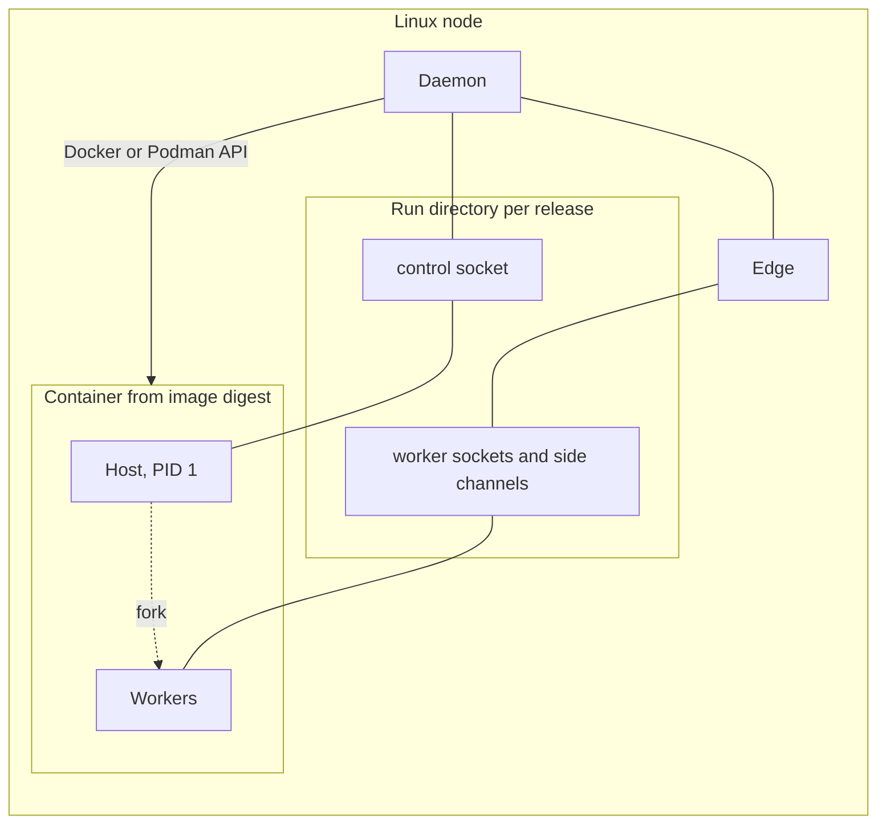

# 8. Interpreters, environments and containers

```{admonition} Design specification
:class: note

This page is part of the Muru design specification and describes intended
design, for contributors. The user documentation is authoritative for released
behaviour. See the [specification index](index.md) for status and how the
specification is maintained.
```

A release names the Python it runs on and where its dependencies live. Muru can provision both through uv, use what already exists, or run the release from a container image. In every case muructl puts the matching runtime library on the host's PYTHONPATH without touching the application's environment.

Provisioning follows a few rules, whichever command asks for it (ADR 0036):

- **Use what exists.** A path or an existing virtualenv is used as it is and probed; nothing is downloaded to replace something that works.

- **Install from locks, never resolve.** Muru installs what `uv.lock` says and never runs a resolver, so the environment a node builds is the one the developer tested. A project without a lock is told the command that makes one. Building needs a `pyproject.toml`, a `uv.lock` and uv; there is no second builder for other tools, and a machine without uv runs on an environment that exists and is told how to get uv (section 8.4).

- **Create what is missing, change what exists only when asked.** The one knob is `build.when`: `auto` (the default) builds an environment that is missing and leaves an existing one alone; `always` builds before every start and again when the lock changes; `never` builds nothing. The same key with the same values is read by `muructl run` and by the daemon. A missing interpreter is installed where a missing environment would be built, and nowhere else; resolution on its own never installs anything.

- **Development mirrors the developer, the daemon builds for deployment.** `muructl run` makes the environment `uv sync` would make for the developer, with the developer's own uv, Pythons and configuration; the daemon builds with `--no-dev` into its own directories, as another user.

- **Builds never run on the request path and never as root** (ADR 0026), with source builds off by default so a lock that needs an sdist fails with a message rather than compiling on the node.

- **Say what will happen before doing it, and what to do when it cannot.** Every download or build is a terminal line in development, an event and a release log entry under the daemon. Every failure names the thing missing and one command that provides it.

## 8.1 Interpreter resolution

A release names its interpreter as a **path** (a virtualenv, a uv-managed Python or a system Python) or as a **request**: a version (`3.13`, `3.14t`), a specifier (`>=3.12`) or an implementation and version (`cpython@3.13`), in uv's request syntax, so there is one grammar to learn and `uv python find` does the parsing.

Sources of a request, highest first:

1. `--python` on the command line, when it is not a path.

2. `python` in `[tool.muru]`, or on a variant, where `3.14t` is how a free-threaded variant is asked for.

3. `.python-version` in the project, uv's own pin.

4. `requires-python` in `[project]`, which is a constraint rather than a request: it is checked against whatever interpreter is chosen, and used to choose one only when nothing else does.

A request from a higher source that violates `requires-python` is an error before anything runs, as it is under uv. A path that violates it is an error too, naming both versions, which catches the virtualenv a developer forgot to rebuild after raising the requirement.

| Step | What happens |
| --- | --- |
| A path is given | used as it is, probed |
| An active virtualenv or the project's `.venv` exists, and `build.when` is not `always` | used as it is, probed |
| A request | `uv python find REQUEST`, which sees every Python on the machine, the user's uv-managed ones included; without uv the request cannot be resolved and fails naming `muructl tools install uv` |
| No request and no environment | `python3` on PATH, with a line saying no environment was found |

**Installing a missing interpreter.** A missing interpreter is installed where a missing environment would be built, and nowhere else. In development muructl never calls `uv python install`: the build's `uv sync --frozen` downloads a Python the project requires and the machine lacks into the developer's own uv install directory, as it would had the developer typed it, and the terminal line says so; a bare `muructl run` against an existing `.venv`, or a `muructl build` of a project without a lock, installs nothing. Under the daemon, `uv python install REQUEST` into STATE/python before the environment build when `tools.python_downloads = 'automatic'`; with `'never'`, or `offline = true`, a request the node cannot satisfy fails the release naming the request, what was found and the install command. Inside a container (section 8.5), never.

**Probing.** Before a host starts, muructl runs the chosen interpreter once with a short script that prints its version, `sys.implementation.cache_tag`, whether the GIL is disabled, platform and libc, `sys.prefix` and `sys.base_prefix`, and whether and which `muru` it can import. The result is cached by path and modification time. Unsupported interpreters fail the release before start-up. The probe tells the runtime library step (section 8.3) which wheel tag to use and, for a virtualenv, finds the base interpreter it was made from, which is what a rebuild must use. The resolved version, path and ABI are recorded in the release so it stays reproducible, and `muructl release show` prints them with the request they came from.

**Where managed Pythons live.** Under the daemon, in STATE/python (`UV_PYTHON_INSTALL_DIR`, or `tools.python_install_dir` for a shared read-only directory), so a release keeps running when the operator's own uv upgrades or removes an interpreter; the directory is owned by the daemon and readable by every application user. In development muructl does not set the variable: the laptop has one uv and one set of Pythons, and a second private set would double the downloads for no isolation gain.

Supported: CPython 3.11 and later, including free-threaded builds from 3.14t. PyPy is not supported initially.

## 8.2 Environment builds

Provisioning is one procedure whoever asks for it: resolve the interpreter, build the environment from the lock, put the runtime library in place, compile bytecode when asked, and say what was done. `muructl build [PATH]` is that procedure as a command, and `muructl run`, the daemon's `Building` state and the build stage of an image are its three callers, so the logic is written and tested once.

```
muructl build                                  # the project in the current directory, for development
muructl build --deployment                     # the environment the daemon or an image would run
muructl build --deployment --deps-only         # dependencies only, before the source is copied in
muructl build --deployment --target /app/.venv --runtime-dir /opt/muru
```

- **Development flavour** (the default): the interpreter by section 8.1, the environment `uv sync --frozen` makes (default groups, dev included, the project editable) in the project's `.venv`, and the runtime library for the interpreter's tag in CACHE/runtime (section 8.3). Because the command is an explicit request, it brings an existing environment up to date with the lock too. It serves nothing and leaves nothing running, which is what preparing a laptop, a devcontainer or a workshop image ahead of a session needs.

- **Deployment flavour** (`--deployment`): `--no-dev`, `--no-build` unless `build.source_builds` allows sdists, the extras and groups of `[tool.muru.build]`, bytecode compiled, the project installed non-editable when `--target` puts the environment outside the source. `--deps-only` is uv's `--no-install-project`, so a Dockerfile can build the dependency layer before `COPY . /app` and finish the build after it.

- **Where things go:** `--target DIR` names the environment (the project's `.venv` by default, `/app/.venv` in the generated Dockerfile), `--runtime-dir DIR` the runtime library directory (the cache by default, `/opt/muru` in an image), `--python` a path or request, `--extra` and `--group` additions for one build, and `--no-runtime` skips the library for an image that brings its own.

- **Then `muructl check`** (section 6.8). `build` prepares and `check` validates what was prepared and has no side effects, so a CI job reads `muructl build --deployment --target /tmp/env && muructl check`.

**Development: `muructl run`.** `muructl run` is `build` under `build.when`, then serve. A project with a lock and no `.venv` is built once, on the first run, with `uv sync --frozen` into the project's `.venv`, exactly what the developer would type, printed as it runs, so a fresh clone followed by `muructl run` works. At start an environment that exists is used as it is, however stale, which keeps a developer's `uv pip install` experiment from being undone by every server start; the run compares it with the lock using `uv sync --frozen --dry-run` and prints one line naming `--build` when it is behind. While running, `auto` acts on the changes it watches the developer make: a change to `uv.lock`, or to `.python-version` or `requires-python` (a different interpreter means a new virtualenv, which `uv sync` makes), builds before the new release starts; a change to `pyproject.toml` alone starts a new release without a build, since the lock did not change and there is nothing to install, with a note naming `uv lock` when the lock is older than the manifest. In the common case `uv add` has already updated `.venv` and the `uv sync --frozen` that follows is a no-op taking tens of milliseconds. The old release serves while a build runs, and a failed build leaves it serving with uv's output in the terminal, as a failed import does. `muructl run --build MODE` sets the key for one run and a bare `--build` means `always`, so "build it first" is `muructl run --build`; `build.when` in `[tool.muru.build]` sets it for a project and in `muru.local.toml` for one machine. `always` also builds on every start; `never` builds neither at start nor on a change, and a missing environment is then the error it is today. Under `--allow-public` the first-run build is off, like the other development behaviours, and the message names `muructl build`. There is no `--sync` (uv's word for the same thing; inside Muru the one verb for provisioning is `build`) and no `--no-build` (uv's spelling for "no sdist builds", which the deployment flavour passes through); `--build never` says it. The `.venv` built this way is the project's environment, which uv owns, not a Muru file, so the rule that development mode writes nothing of Muru's into the project directory (section 13.8) stands. Building anywhere else was rejected: the developer's editor, `uv run` and `uv add` would then see a different environment from the one serving.

**The daemon: `deploy` and `apply`.** A release carries a `build` table, settable in the source's `[tool.muru]`, in a declared release's table and by deploy flags:

```toml
[tool.muru.build]
when = 'auto'            # auto, always, never
extras = ['postgres']    # uv sync --extra
groups = []              # dependency groups beyond the defaults; dev is never included
source_builds = false    # true allows sdists to be built (uv sync without --no-build)
compile_bytecode = true  # uv sync --compile-bytecode, feeds bytecode = 'source'
```

- `auto`: a source with its own `.venv` is used as it is; a source without one and with a lock is built; a source with neither falls back to the previous release's interpreter, then `python3`, and the probe decides whether that interpreter can import the application. `always` builds even when the source has a `.venv`, for a node where the source directory is a developer's checkout. `never` is for prebuilt directories and nodes without network, and is what `offline = true` implies. `when` is the one key development reads too; the rest of the table describes the deployment flavour.

- The build is the `Building` state of section 9.1, `muructl build --deployment --target STATE/envs/APP/RELEASE` run by the controller as the release's user (never root), with the output streamed to the release log tagged `[build]`. `release.building` opens it; `release.built` carries the duration, package count and lock hash; `release.build_failed` carries the last lines and fails the release before start-up. Variants build their own environments under STATE/envs/APP/RELEASE/VARIANT, from the same lock, since 3.14 and 3.14t cannot share one.

- Environments live in the state directory, not the run directory, since a retained release still needs its environment after a daemon restart, and are removed with the release after its retention window. uv hard-links from a per-user cache under STATE, so a second release with the same lock costs seconds and little disk; sharing one environment between releases with the same lock hash was rejected because it couples the lifetimes of two immutable releases (ADR 0003). The project is installed editable, because the source directory is the release.

- Under watch or touch reload a change to `pyproject.toml` or `uv.lock` creates the next release with a build; other changes build again from the unchanged lock, the cheap case. Reusing the directory would make a release mutable.

- `muructl exec RELEASE -- COMMAND` runs with the release's environment on PATH and the runtime library on PYTHONPATH, so `python manage.py migrate` sees what the server sees.

**Without uv.** There is no second builder. `pyproject.toml`, `uv.lock` and uv are what building and the reload behaviour above need, and a machine without uv is told so once, with `muructl tools install uv` (a pinned, checksum-verified single binary) or the distribution's package as the fix. Everything else works there: a path given with `--python`, an active virtualenv or the project's `.venv` is used as it is and probed, `python3` on PATH is the last resort, a system Python with distribution packages works through `--python /usr/bin/python3`, and the runtime library still arrives on PYTHONPATH, fetched and unpacked by muructl without pip or uv (section 8.3). A node where fetching uv is forbidden deploys a prebuilt directory, or builds in CI with `muructl build --deployment` and ships the result. A builder on `python -m venv` and pip from an exported lock was designed and left out until there is demand for it (ADR 0036).

**Bytecode caches.** Compiled bytecode files are named by interpreter cache tag (PEP 3147, for example views.cpython-314.pyc in `__pycache__`), so releases and variants on different Python versions never overwrite each other's files, and Python writes them atomically, so concurrent compilation by several processes is safe. Whether a free-threaded build shares the regular build's cache tag is to be confirmed in the phase 0 spike. Two problems remain, both handled by the daemon:

- When a release directory is not writable by the application user (read-only images, per-application users), Python silently skips writing bytecode and recompiles in memory on every host start and lazy import, which slows cold starts of large applications.

- Writing `__pycache__` into a release directory that should be immutable, or into a source tree edited in place, mixes generated files into the release.

| Mechanism | When | Behaviour |
| --- | --- | --- |
| Redirected cache (default for daemon-managed releases) | always, unless bytecode = 'source' | The daemon sets PYTHONPYCACHEPREFIX to a writable per-release, per-variant directory (STATE/pycache/APP/RELEASE/VARIANT, section 13.8). Bytecode never lands in the source tree, releases never share caches even when their source is edited in place, and the directory is removed with the release |
| Precompilation (recommended for builds and images) | build step, or image build | `build.compile_bytecode` (uv sync --compile-bytecode) for installed packages, and python -m compileall over the application source with each variant's interpreter. For immutable releases and images, unchecked hash-based bytecode (PEP 552, --invalidation-mode unchecked-hash) avoids checking source timestamps at import. Because Python ignores `__pycache__` directories in the source tree while PYTHONPYCACHEPREFIX is set, the daemon detects precompiled bytecode for the variant's cache tag when a release is created and then uses bytecode = 'source' for that release instead of redirecting |
| Default Python behaviour | muructl run and watch reload | `__pycache__` beside the source, as in normal development. The watcher already ignores it |

The setting is bytecode = 'redirect' (default), 'source' or 'off' per release or variant. muructl check reports when a release would run without any usable bytecode cache.

## 8.3 Runtime library installation

The runtime library is Muru's, not the application's (ADR 0037). muructl puts the `muru` package that matches its own version on the host's PYTHONPATH for the interpreter in use, in every mode, so an application need not list it as a dependency and `import muru` works with nothing in `pyproject.toml`.

- **One directory per interpreter tag**, holding the unpacked wheel for that tag and muructl's own version: STATE/runtime/TAG under the daemon, CACHE/runtime/TAG (the user cache of section 13.8) for `muructl run` and `muructl build`, and a directory the image's build stage fills for containers (`/opt/muru` in the generated Dockerfile). When it is used, the host starts with the directory first on PYTHONPATH, so it precedes site-packages.

- **Which copy is used.** Use what exists, and go to the network last. The probe (section 8.1) reports whether and which `muru` the interpreter imports, so the choice costs nothing extra:

  1. The application's environment holds a `muru` of muructl's own version: it is used as it is, nothing is injected and nothing is fetched, and the start-up line says so. The application then sees exactly the environment any other server would give it.

  2. A runtime directory for muructl's version and the interpreter's tag already exists: it is used.

  3. Neither: muructl fetches the wheel, announcing it first, from PyPI with the published hash verified, or from `tools.wheel_dir`. The connection has a short timeout so a machine with no route fails in seconds, not minutes.

  4. The fetch fails, or is not allowed, and the environment holds a `muru` of another version: it is used with a warning naming both versions, provided it speaks a protocol version muructl supports (section 5.8). Only when nothing usable exists does the release fail, naming both ways out: a wheel in `tools.wheel_dir`, or `pip install muru==VERSION` into the environment.

  An environment's `muru` of another version is otherwise shadowed by the injected copy, with the same warning, and the environment is never changed. A developer who wants completion and type checking for `muru.context()` adds `muru` as a dev dependency and nothing else changes.

- **Offline machines need no flag** to get the right result, since a matching copy in the environment is found before any fetch is tried. Where an attempted connection is itself a problem (a policy that logs it, a firewall that drops packets rather than refusing them), `tools.offline = true` under the daemon, and `MURU_OFFLINE=1` or uv's own `UV_OFFLINE=1` in development, mean the network is never tried: the fetch step is skipped and step 4 applies at once, reading `tools.wheel_dir` if set.

- **How the wheel gets there.** The runtime library has no Python dependencies, so no resolver or pip is involved: muructl downloads the wheel and unpacks it, the same with or without uv. In development the fetch happens at most once per tag per Muru version.

- **Containers.** `muructl build --runtime-dir DIR` puts the library in the image during the build stage, and `muructl runtime install --python PYTHON --target DIR` is the same step on its own for an image built some other way. `muructl serve` adds the directory to PYTHONPATH, finding it from the `dev.muru.runtime` label, from `/opt/muru`, or from the environment as a last resort; container releases under the daemon use the image's runtime or the daemon's (`runtime_source`, section 8.5).

- The runtime version must speak a protocol version the daemon supports (section 5.8).

## 8.4 uv

- uv is a separate program run by muructl, not linked in (ADR 0007). It is needed only for interpreter provisioning and builds, never on the request path.

- muructl[uv] is an optional extra that installs uv beside muructl. uv tool install muructl uses the uv already present. uv tool install never exposes executables of dependencies, so the extra cannot shadow a user's uv.

- Lookup order: tools.uv in daemon configuration, MURU_UV, a uv beside muructl, uv on PATH, a managed copy installed with muructl tools install uv (pinned version, checksum verified, under STATE/tools, or the user cache in development). `uv --version` is read once at daemon start and once per `muructl run`, and features that need a newer uv are reported, not assumed.

- **Development uses the developer's uv as it is.** `muructl run` and `muructl build` set no cache, install directory or configuration variables, so the laptop has one set of Pythons and one cache, and the developer's mirrors and indexes apply.

- **The daemon isolates directories, not the project's configuration.** It runs builds with `UV_CACHE_DIR=STATE/uv-cache/USER` (hard links need the same file system and files the release's user can read), `UV_PYTHON_INSTALL_DIR=STATE/python`, `UV_PROJECT_ENVIRONMENT=STATE/envs/APP/RELEASE` and `UV_LINK_MODE=hardlink`. It passes `UV_CONFIG_FILE` when `tools.uv_config` names a `uv.toml` (mirrors, TLS settings) and otherwise leaves uv's configuration discovery alone, so the project's own `[tool.uv]` table (indexes, sources) applies; `UV_NO_CONFIG` discards that table, so a project on a private index could not be built under it, and it is used only for interpreter operations (`python find`, `python install`), where no project settings matter. Whether a config file layers under the project's table or replaces it is to be verified before `uv_config` is documented; if it replaces, the daemon's choices go through `UV_INDEX` and `UV_NATIVE_TLS` instead.

- **Network:** `UV_OFFLINE=1` when `offline = true`, with wheels from `tools.wheel_dir` through `--find-links` and `--no-index`; `UV_PYTHON_DOWNLOADS=never` when `tools.python_downloads = 'never'`, under `muructl serve` and in container probes. `UV_NO_PROGRESS=1` and `--color never` everywhere, since the output goes to a log or a prefixed terminal.

- **Output** is streamed line by line, to the release log under the daemon and to the terminal under `muructl run`, with the last lines in `release.build_failed`.

## 8.5 Container releases

A release can run its host and workers inside a container while the daemon and edge stay outside. They communicate through Unix sockets and descriptor passing in a per-release run directory bind-mounted at /run/muru. Both work across the boundary because the kernel is shared.



```toml
[app.shop.release.r42]
image = 'registry.example.com/shop@sha256:4c1f...'
runtime = 'docker'               # or podman
python = '/app/.venv/bin/python'
entrypoint = 'shop.wsgi:application'
runtime_source = 'image'         # image, or daemon to mount the daemon's runtime library
static_from_image = '/app/static'
container = { network = 'appnet', memory = '4GiB', cpus = 4, read_only = true, tmpfs = ['/tmp'] }
```

- The daemon creates the container with python -m muru.host as the command and restart policy off. It supervises the release itself and drains through the control socket.
- A probe container reads the image's interpreter details before first start.
- The container runs as a fixed non-root uid. The run directory is owned by that uid and shares a group with the edge. Peer credential checks use host-kernel uids.
- Cgroup limits come from the container settings and feed the node budget.
- Descriptor-based file hints and uploads work unchanged. Static directories are copied out of the image into the run directory (static_from_image) or shared through a volume.
- Production is Linux only. On macOS, Docker runs containers in a virtual machine, so for development the daemon runs in the same virtual machine or container, or releases run without containers.
- Kubernetes is a different model (edge as a sidecar sharing an emptyDir). Muru's role there narrows to the process model, preload, timeouts and in-pod scaling.

## 8.6 Images

| Level | Who builds | Muru provides |
| --- | --- | --- |
| Bring your own | The user, any tooling | The image contract and muructl image check |
| Official base images | The user, FROM a Muru base | Python, uv, runtime library under /opt/muru on the path through a .pth file, non-root user, labels, per Python version, free-threaded and distroless variants |
| Built by Muru (later) | muructl image build | A generated multi-stage Dockerfile from pyproject.toml and uv.lock, printable with muructl image dockerfile |

The image contract: an importable application and interpreter (found from the release setting, the dev.muru.python label, VIRTUAL_ENV, /app/.venv/bin/python or python3 on PATH, in that order), a non-root user, optionally the runtime library (from the dev.muru.runtime label, /opt/muru or the environment, section 8.3), and no required CMD or ENTRYPOINT. Nothing is built or installed when Muru runs inside a container: the build stage does it, with uv, and the runtime stage needs neither uv nor network. muructl serve forces build.when = 'never', sets UV_PYTHON_DOWNLOADS=never and UV_OFFLINE=1 for anything it might run, and fails fast when the interpreter, a package or the runtime library is missing, naming the Dockerfile line that provides it. Optional labels dev.muru.entrypoint, dev.muru.interface and dev.muru.static, and a [tool.muru] table in the image, let releases omit settings. A runtime baked into an image older than the supported protocol window fails at the probe unless runtime_source = 'daemon'.

```dockerfile
FROM python:3.13-slim AS build
COPY --from=ghcr.io/astral-sh/uv:latest /uv /usr/local/bin/uv
RUN pip install muructl
WORKDIR /app
COPY pyproject.toml uv.lock ./
RUN muructl build --deployment --deps-only --target /app/.venv
COPY . .
RUN muructl build --deployment --target /app/.venv --runtime-dir /opt/muru
RUN python -m compileall -q --invalidation-mode unchecked-hash /app

FROM python:3.13-slim
COPY --from=build /app /app
COPY --from=build /opt/muru /opt/muru
COPY --from=build /usr/local/bin/muructl /usr/local/bin/muructl
RUN useradd --uid 10001 app
USER app
```
