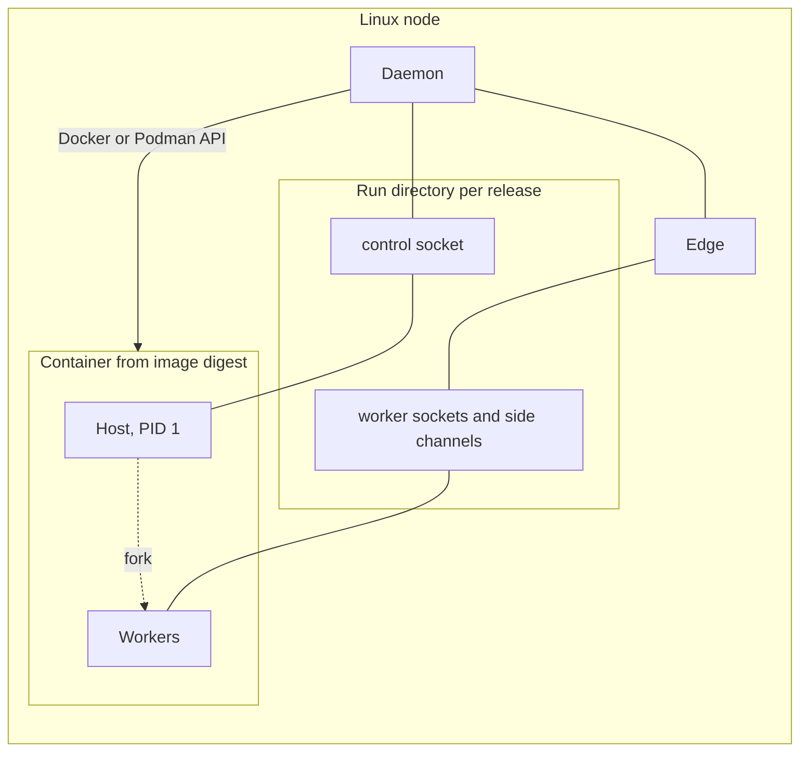

# 8. Interpreters, environments and containers

```{admonition} Design specification
:class: note

This page is part of the Muru design specification and describes intended
design, for contributors. The user documentation is authoritative for released
behaviour. See the [specification index](index.md) for status and how the
specification is maintained.
```

A release names the Python it runs on and where its dependencies live. Muru can provision both through uv, use what already exists, or run the release from a container image. In every case the daemon installs the matching runtime library without touching the application's environment.

## 8.1 Interpreter resolution

- A release names its interpreter as a path (a virtualenv, a uv-managed Python or a system Python) or as a version request such as 3.13.
- Version requests are resolved with uv python find, installing with uv python install when missing. The resolved version, path and ABI are recorded in the release so it stays reproducible.
- The daemon probes the interpreter for its version, cache tag, whether the GIL is disabled, platform and libc, and selects the matching runtime build. Unsupported interpreters fail the release before start-up.
- Supported: CPython 3.11 and later, including free-threaded builds from 3.14t. PyPy is not supported initially.

## 8.2 Environment builds

A release can carry an optional build step, normally uv sync --frozen (or uv pip install) into a per-release virtualenv in the run area. The uv cache and hard links make this fast and cheap on disk. Prebuilt release directories need no build step. Environments are removed with their releases after the retention window. A change to pyproject.toml or uv.lock under watch reload runs the build before the new release starts.

**Bytecode caches.** Compiled bytecode files are named by interpreter cache tag (PEP 3147, for example views.cpython-314.pyc in `__pycache__`), so releases and variants on different Python versions never overwrite each other's files, and Python writes them atomically, so concurrent compilation by several processes is safe. Whether a free-threaded build shares the regular build's cache tag is to be confirmed in the phase 0 spike. Two problems remain, both handled by the daemon:

- When a release directory is not writable by the application user (read-only images, per-application users), Python silently skips writing bytecode and recompiles in memory on every host start and lazy import, which slows cold starts of large applications.
- Writing `__pycache__` into a release directory that should be immutable, or into a source tree edited in place, mixes generated files into the release.

| Mechanism | When | Behaviour |
| --- | --- | --- |
| Redirected cache (default for daemon-managed releases) | always, unless bytecode = 'source' | The daemon sets PYTHONPYCACHEPREFIX to a writable per-release, per-variant directory (STATE/pycache/APP/RELEASE/VARIANT, section 13.8). Bytecode never lands in the source tree, releases never share caches even when their source is edited in place, and the directory is removed with the release |
| Precompilation (recommended for builds and images) | build step, or image build | uv sync --compile-bytecode for installed packages, and python -m compileall over the application source with each variant's interpreter. For immutable releases and images, unchecked hash-based bytecode (PEP 552, --invalidation-mode unchecked-hash) avoids checking source timestamps at import. Because Python ignores `__pycache__` directories in the source tree while PYTHONPYCACHEPREFIX is set, the daemon detects precompiled bytecode for the variant's cache tag when a release is created and then uses bytecode = 'source' for that release instead of redirecting |
| Default Python behaviour | muructl run and watch reload | `__pycache__` beside the source, as in normal development. The watcher already ignores it |

The setting is bytecode = 'redirect' (default), 'source' or 'off' per release or variant. muructl check reports when a release would run without any usable bytecode cache.

## 8.3 Runtime library installation

- The daemon keeps one runtime directory per interpreter tag and puts it on the host's PYTHONPATH. Nothing is installed into the application's environment.
- The runtime library has no Python dependencies, so the daemon installs it by fetching the matching wheel (from PyPI, or a local wheel directory when offline) and unpacking it. No resolver or pip is needed.
- The runtime version must speak a protocol version the daemon supports (section 5.8). If a project's virtualenv contains its own muru, the injected copy takes precedence and the daemon warns about a mismatch.

## 8.4 uv

- uv is a separate program run by muructl, not linked in. It is needed only for interpreter provisioning and builds, never on the request path.
- muructl[uv] is an optional extra that installs uv beside muructl. uv tool install muructl uses the uv already present. uv tool install never exposes executables of dependencies, so the extra cannot shadow a user's uv.
- Lookup order: tools.uv in daemon configuration, MURU_UV, a uv beside muructl, uv on PATH, a managed copy installed with muructl tools install uv (pinned version, checksum verified, under STATE/tools).
- muructl runs uv with UV_NO_CONFIG, its own UV_CACHE_DIR and UV_PYTHON_INSTALL_DIR under the state directory (or a shared read-only install directory for per-application users), and UV_OFFLINE with a local wheel directory when offline = true.
- The daemon checks uv --version at start-up and reports features unavailable with older versions.

## 8.5 Container releases

A release can run its host and workers inside a container while the daemon and edge stay outside. They communicate through Unix sockets and descriptor passing in a per-release run directory bind-mounted at /run/muru. Both work across the boundary because the kernel is shared.



```toml
[app.shop.release.r42]
image = 'registry.example.com/shop@sha256:4c1f...'
runtime = 'docker'               # or podman
python = '/app/.venv/bin/python'
entrypoint = 'shop.wsgi:application'
runtime_source = 'image'         # image, or daemon to mount the daemon's runtime library
static_from_image = '/app/static'
container = { network = 'appnet', memory = '4GiB', cpus = 4, read_only = true, tmpfs = ['/tmp'] }
```

- The daemon creates the container with python -m muru.host as the command and restart policy off. It supervises the release itself and drains through the control socket.
- A probe container reads the image's interpreter details before first start.
- The container runs as a fixed non-root uid. The run directory is owned by that uid and shares a group with the edge. Peer credential checks use host-kernel uids.
- Cgroup limits come from the container settings and feed the node budget.
- Descriptor-based file hints and uploads work unchanged. Static directories are copied out of the image into the run directory (static_from_image) or shared through a volume.
- Production is Linux only. On macOS, Docker runs containers in a virtual machine, so for development the daemon runs in the same virtual machine or container, or releases run without containers.
- Kubernetes is a different model (edge as a sidecar sharing an emptyDir). Muru's role there narrows to the process model, preload, timeouts and in-pod scaling.

## 8.6 Images

| Level | Who builds | Muru provides |
| --- | --- | --- |
| Bring your own | The user, any tooling | The image contract and muructl image check |
| Official base images | The user, FROM a Muru base | Python, uv, runtime library under /opt/muru on the path through a .pth file, non-root user, labels, per Python version, free-threaded and distroless variants |
| Built by Muru (later) | muructl image build | A generated multi-stage Dockerfile from pyproject.toml and uv.lock, printable with muructl image dockerfile |

The image contract: an importable application and interpreter (found from the release setting, the dev.muru.python label, VIRTUAL_ENV, /app/.venv/bin/python or python3 on PATH, in that order), a non-root user, optionally the runtime library, and no required CMD or ENTRYPOINT. Optional labels dev.muru.entrypoint, dev.muru.interface and dev.muru.static, and a [tool.muru] table in the image, let releases omit settings. A runtime baked into an image older than the supported protocol window fails at the probe unless runtime_source = 'daemon'.

```dockerfile
FROM python:3.13-slim
COPY --from=ghcr.io/astral-sh/uv:latest /uv /usr/local/bin/uv
WORKDIR /app
COPY pyproject.toml uv.lock ./
RUN uv sync --frozen --no-dev --no-install-project
COPY . .
RUN uv sync --frozen --no-dev --compile-bytecode
RUN python -m compileall -q --invalidation-mode unchecked-hash /app
RUN useradd --uid 10001 app
USER app
```
