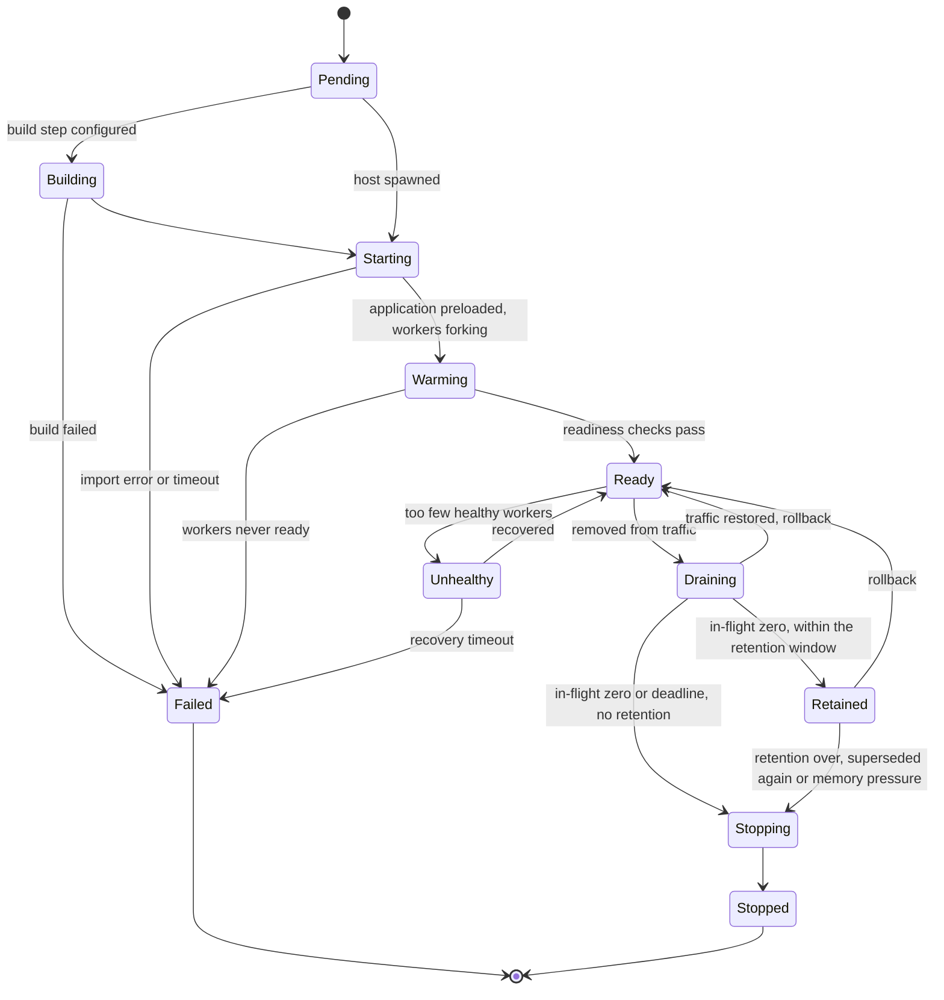
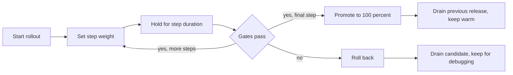
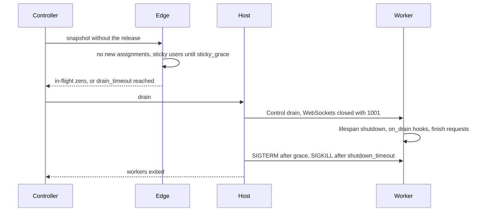
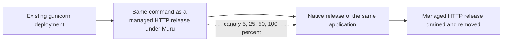
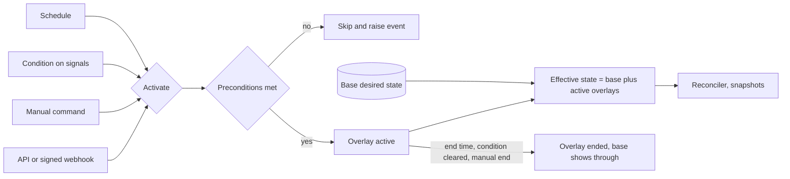

# 9. Releases and traffic management

```{admonition} Design specification
:class: note

This page is part of the Muru design specification and describes intended
design, for contributors. The user documentation is authoritative for released
behaviour. See the [specification index](index.md) for status and how the
specification is maintained.
```

A release's lifecycle state says whether it can serve. Its traffic policy says whether it does. Every deployment strategy is a sequence of policy changes plus lifecycle management, and none of them restarts a shared server.

## 9.1 Release lifecycle



Superseded releases stay warm for a retention window (default 30 minutes, or the deploy's retain setting), so rollback avoids a cold start; one release per application is retained, and a release superseded again is stopped. Once drained, a retained release scales down to a warm floor: its preloaded host plus retain_workers per required worker group (default 1). Because workers fork from the preloaded host, scaling back up takes seconds at most. If the node goes over its memory budget, retained releases drop to the host alone, and are stopped, oldest first, if that is still not enough. These defaults are provisional and flagged for review (section 19.2). Readiness requires every required worker group, in every variant, to have its minimum ready workers and the release checks of section 9.11 to pass.

- **Details fixed by the implementation.** A release whose workers are all ready stays warming until the daemon has pushed the snapshot that gives it to the edge, as the serving release, a held release, a canary candidate or a release a traffic policy names, and is ready only then, so `muructl release wait` never answers before a request can reach it. The `release.ready` event marks the workers' readiness, with the time they took, and comes before `traffic.switched`.

## 9.2 Strategies

| Strategy | Mechanism |
| --- | --- |
| Blue/green | Start the new release, smoke test through a preview header or hostname, flip weights 0/100, drain the old release and keep it warm |
| Weighted canary | Stepped weights with holds and gates, automatic rollback on failed gates |
| A/B by cohort | Bucket ranges, header or cookie matches, with a salt per experiment |
| Preview or dark launch | Header, cookie or hostname pins a release without public traffic |
| Per-route policies | Different routes of one application on different releases |
| Shadow traffic (later) | Mirror safe requests to a candidate and discard its responses |

## 9.3 Canary gates



Gates compare the candidate with the baseline over the same window, with a minimum request count before a verdict: 5xx rate, p95 and p99 latency, worker crashes and timeout kills, queue wait, and optional probe URLs. Steps can require manual approval. Every step and gate result is an event.

- **Details fixed by the implementation.** The gates are `max_error_rate` (1%), `max_p95_ms` and `max_p99_ms` (none), read from the edge's request counters and total request time histogram for each release, and `max_worker_faults` (0): the release's `worker.exited` events at warning or error level, a crash, and its `worker.timeout_killed` events, the hard timeout's and the loop stall timeout's, counted by the daemon from the host's events. Each fails only when the candidate is over its limit and worse than the baseline over the step; the fault gate is judged at once, before `min_requests` (100) is reached, since one crash is evidence enough. Queue wait and probe URL gates are still to come.

## 9.4 Bucketing and stickiness

- bucket = hash(salt, key) mod 10000. Release ranges are contiguous, and the newest release grows downward from the top, so a user in the canary at 10% stays in it at 25%.
- Hash keys: an anonymous id cookie issued by the edge (default), a named header such as a user id set by a trusted upstream proxy, an application cookie, or the client address as a last resort.
- Strict stickiness issues a cookie recording the release, honoured while that release serves and ignored once it stops. sticky_grace bounds how long sticky users keep a draining release alive.

## 9.5 Draining



## 9.6 Rollback and deploy freezes

Rollback first scales the retained release back to its previous worker counts (forks from its preloaded host), then restores the previous traffic policy once those workers are ready, so the rollback does not land on a single warm worker. A release outside its retention window is started again first. Schedules with freeze_deploys block new releases and rollouts during their windows unless an explicit override is given, which is audit-logged.

- **Details fixed by the implementation.** A freeze is `freeze_deploys = true` on an application in any active overlay, a schedule's included. It refuses DeployRequest, an apply that would deploy one of the application's releases, StartRollout, PromoteRelease and a rollout's promotion, each of which takes `override_freeze` (`--override-freeze`), recorded as a deploy.freeze_overridden warning event naming the overlays; a rollout under way holds its step while the freeze lasts, and rollback, pause and abort are never frozen.

## 9.7 Shared state during overlap

Muru cannot make two releases safe to run against shared state. The documentation must recommend expand and contract database migrations and compatible cache formats for the overlap window, and muructl exec is the supported way to run migrations as a deliberate step.

## 9.8 Reload

Reloading is off by default. Every reload creates a new release from the same source and drains the old one; there is never an in-place module reload.

| Mode | Trigger | Use |
| --- | --- | --- |
| off | muructl reload APP, or a deploy | production |
| touch | modification time of the entrypoint module or a trigger file | hosts updated in place |
| watch | changes under watched directories | development |

- One watcher in the daemon or muructl run process (inotify or FSEvents), never per worker. `__pycache__`, `.git`, virtualenvs, `*.pyc`, `node_modules` and editor files are ignored, and `.gitignore` is honoured.
- Changes are debounced (default 300 ms). A release still starting when new changes arrive is abandoned and replaced. A failed import leaves the previous release serving and shows the error.
- Polling is used when poll = true or when the inotify watch limit is reached, which is needed on some network file systems and macOS container bind mounts.
- Releases from mutable paths record a source fingerprint (git revision and dirty flag, or a hash of watched files).

## 9.9 Managed HTTP server releases (migration)

To let existing deployments move to Muru in steps, a release can run an ordinary HTTP server process (gunicorn, uvicorn, Granian, mod_wsgi-express, or any server that can bind a given address) instead of Muru workers. Muru starts and supervises it and routes to it like an upstream, so it gets releases, traffic policies, drains and rollbacks. The intended use is a cutover: run the current deployment unchanged under Muru first, then canary traffic to native workers.



```toml
[app.legacy.release.r9]
kind = 'http'
profile = 'gunicorn'           # gunicorn, uvicorn, granian, mod_wsgi-express or generic
command = ['gunicorn', '--workers', '4', '--bind', '{bind}', 'legacy.wsgi:application']
cwd = '/srv/legacy'
env = { DJANGO_SETTINGS_MODULE = 'legacy.settings' }
bind = 'unix'                  # unix or port
instances = 1
readiness = { path = '/healthz', timeout = '60s' }
```

- **Binding:** the daemon allocates a Unix socket path or a free loopback port per instance and substitutes it for {bind} in the command, also setting MURU_HTTP_BIND (and PORT). Profiles know each server's flag for Unix sockets.
- **Readiness:** an HTTP probe on the configured path, retried until timeout. Without a path, readiness means the socket accepts connections and answers any HTTP response.
- **Lifecycle:** each instance is a supervised child (or container) with crash restarts and backoff. Drain stops new requests at the edge, waits for in-flight requests, then sends the profile's graceful stop signal, then SIGKILL after the grace period.
- **Profiles** hold per-server defaults: graceful stop signal (SIGTERM for gunicorn, uvicorn and Granian, SIGINT or SIGTERM per mod_wsgi-express mode), how to bind a Unix socket, and readiness hints. generic needs these set explicitly.
- **Traffic:** a managed HTTP release is a normal backend in traffic policies, so canaries, A/B splits, sticky sessions, previews and rollback work between it and native releases of the same application.
- **Logs and events:** stdout and stderr are captured by the log collector, and lifecycle changes are events.
- **Scope limits:** fixed instance counts only (no autoscaling of instances), and none of the Python-specific features (preload by Muru, worker groups, mounts, soft timeouts, memory policy, Python signals, descriptor passing). Requests are re-serialised as HTTP with the normalisation rules of section 4.13. The server's own process management stays in charge inside each instance.

Instance autoscaling and additional profiles remain future ideas (section 20.1).

- **Details fixed by the implementation.** A managed release is declared with `kind = 'http'`, `profile`, `command`, `cwd` (or `source`, which it stands in for), `bind` (unix, the default, or port), `instances` (1), `readiness` with `path` and `timeout` (60 s), and `stop_signal`, or deployed with `muructl deploy --server PROFILE` and the command after `--`; the worker settings of a release do not apply to it and are refused, while `env`, `error_pages`, `error_override`, `maintenance` and `timeouts.shutdown_timeout` do apply. `{bind}` in the command is replaced by the address in the server's own form (`unix:PATH` or `127.0.0.1:PORT` for gunicorn and generic, the socket path or `127.0.0.1:PORT` for uvicorn and Granian), `{socket}` by the socket path and `{port}` by the port; a command naming none of them gets the profile's flags appended (`--bind` for gunicorn, `--uds` or `--host --port` for uvicorn and Granian, `--host --port` for mod_wsgi-express, nothing for generic), and mod_wsgi-express binds a port only. The environment carries MURU_HTTP_BIND, PORT for a port and MURU_INSTANCE. Sockets live under the release's run directory, open to the edge's group (section 10.9), and the instances run as the application's user. Readiness is a GET of the path every 100 ms, each within 2 s, passing on 2xx or 3xx, or any HTTP response without a path; an instance that exits first, or the timeout, fails the release. The stop signal is TERM for every profile, mod_wsgi-express included, unless `stop_signal` names another, and SIGKILL follows after `shutdown_timeout` (5 s). An instance that exits is started again after a wait doubling from 1 s to 30 s, reset once it has run for a minute, recorded as server.exited, server.started and server.failed; the release stays ready. The edge routes to the release as an upstream named `app@release`: http1, X-Muru headers trusted, ejection after 3 failed requests for 5 s, no probes; requests are labelled with the application, the release, `http` as the group and the instance's address as the mount, muru_upstream_health reports each instance under that name, and muru_workers_ready counts the instances running under group `http`. Standard output and error go to the release's log file directly, rotated by copy and truncation since the server cannot be told to reopen it. A daemon that detaches or upgrades leaves the instances running and the next daemon re-adopts them from `servers.toml` in the run directory, restarting a crashed one as its own child. `muructl release list` shows the instance count and the profile, and `muructl scale` refuses a managed release.

## 9.10 Overlays

An overlay is a named, partial configuration that is layered on top of the base desired state while it is active. Overlays never modify the base configuration, so ending one simply stops applying it, and changes made to the base in the meantime show through. One mechanism covers timed blue/green switches, maintenance windows, read-only periods for backups, reduced-feature modes during expected peaks, circuit breakers and crawler handling.



**What an overlay can set**

- Traffic policy weights and pins for routes (for example a timed switch to a new release).
- Maintenance mode for applications or routes, with its exemptions.
- Site modes and method restrictions (section 4.15), for read-only or limited operation.
- Route targets, for example sending a route to a static snapshot, a different release or an upstream.
- Client class routing and rate limits.
- Scaling floors and ceilings, and deploy freezes. Capacity schedules (section 7.5) are shorthand for overlays that set only these.
- Error page selections.

```toml
[overlay.nightly-backup]
routes.shop-root = { mode = 'read-only', deny = ['POST', 'PUT', 'PATCH', 'DELETE'] }
trigger = { schedule = { cron = '0 2 * * *', duration = '1h', timezone = 'Australia/Sydney' } }

[overlay.cutover-r43]
routes.shop-root.traffic = { pin = 'r43' }
trigger = { schedule = { start = '2026-11-02T09:00', timezone = 'Australia/Sydney' } }   # no end, so it stays until promoted or ended
warm_up = { start_release = 'r43', lead = '30m' }
preconditions = { release_ready = 'r43', probe = '/healthz' }

[overlay.db-outage]
routes.shop-root = { target = { static = '/srv/shop/snapshot' }, mode = 'degraded' }
trigger = { condition = { when = "error_rate{route='shop-root',reason='app_error'} > 0.2", for = '1m', clear_when = 'error_rate < 0.02', clear_for = '5m' } }
latch = true
advisory = true

[overlay.crawler-surge]
routes.shop-root.client_routes = { ai_crawler = { target = { static = '/srv/shop/snapshot' } } }
trigger = { condition = { when = "request_share{client_class='ai_crawler'} > 0.3", for = '5m', clear_when = 'request_share < 0.1', clear_for = '15m' } }
```

**Triggers**

| Trigger | Behaviour |
| --- | --- |
| schedule | One-off start and optional end, or cron plus duration, in a named time zone with daylight saving handled. An overlay with a start and no end stays active until ended or promoted |
| condition | An expression over Muru's signals (request rate and share, error rate by reason, latency percentiles, queue wait, saturation, scaling at maximum or denied by budget, node memory, upstream health), with separate activate and clear thresholds and sustain windows |
| manual | muructl overlay activate NAME and muructl overlay end NAME, optionally with --for or --until |
| external | The admin API, or a signed webhook endpoint for monitoring and alerting systems |

**Safeguards**

- **Preconditions:** checked at activation, such as a release being ready or a probe passing. If they fail, the overlay is not applied and a skipped event is raised, so a timed switch never moves traffic to something broken. warm_up can start a release ahead of a scheduled switch.
- **Condition triggers against flapping:** hysteresis through separate clear thresholds and windows, a minimum active duration (default 5 minutes), a cooldown after ending (default 10 minutes), and a cap on activations per hour. latch = true keeps an overlay active until a person ends it, which suits error-triggered overlays.
- **Advisory mode:** new condition triggers default to advisory = true, which only raises would_activate events, so thresholds can be tuned before they act.
- **Prefer the right mechanism:** errors caused by a new release belong to canary gates and rollback (section 9.3), and load belongs to the autoscaler first. Conditions such as scaling at max_workers or denied by budget let a degraded-mode overlay act only when scaling cannot keep up.
- **Conflicts:** two active overlays setting the same field is a validation error unless they have explicit priorities. Active overlays sit above base configuration and below time-limited runtime overrides. An overlay that pins traffic on a route pauses any rollout on that route.
- **Visibility:** muructl overlay preview NAME shows the effective changes before activation. config show --effective attributes values to overlays. Activation, end, skip and would_activate are events, and the dashboard shows active and upcoming overlays.
- **Making it permanent:** muructl overlay promote NAME folds an active overlay's changes into the base configuration and ends it, which is how a timed blue/green switch becomes the new normal.
- **Daemon restarts and clocks:** the reconciler evaluates which overlays should be active from the current time and signals, so a restart in the middle of a window resumes it correctly. The daemon warns when the system clock is not synchronised.
- **Details fixed by the implementation.** Overlays are declared in applied files and recorded in the store; a route gains `name` (unique, a valid name) by which `routes.NAME` reaches it. An overlay sets, on a route, `mode`, `deny` with `answer`, `traffic` (`pin`, which becomes a 100% share of that release, or `split`), `target` (one of `app`, `static`, `upstream`; a target other than an application drops the route's traffic policy), `rate_limits`, `error_pages` (each page, by status or status:reason, in place of the route's for its key, its file an absolute path, and each key a field of its own for conflicts) and `client_routes` (by client class, each with these fields but `client_routes`, changing the route for that class alone at the route's host and path, or else adding a copy of the route, with the overlay's changes to it, ahead of it, which `promote` writes as a route; the class one the daemon's file or an applied file defines, and each class a field of its own for conflicts), and, on an application, `maintenance`; it takes `priority` (0 without it), `preconditions.release_ready` (`app@release`, or a release when its routes belong to one application, satisfied by a ready or retained release) and `trigger.schedule` with `start`, an optional `end` and `timezone` (IANA, the system's zone without one), each a local date and time read with Temporal's compatible rule at daylight saving changes, or an RFC 3339 time, or with `cron` (five fields of numbers, names, ranges, steps and lists, or @hourly to @yearly, a day matching either restricted day field matching) and `duration` (at least a minute), each occurrence a local time read by the same rule, a window still active when the next begins running on to the later one's end. `advisory = true` makes each window raise overlay.would_activate, saying whether the preconditions hold, and hold the overlay as `advised` instead of activating it; `latch = true` keeps a scheduled activation past its window until a person ends it. `warm_up` takes `lead` and `start_release` (named as `release_ready` is), which runs through the lead, without traffic, announced by overlay.warming, and is retained as superseded releases are once nothing keeps it. Two overlays setting the same field need different priorities, and apply refuses them otherwise, with what they name checked to exist. State is recorded per overlay: active by `schedule` (until its end) or `manual` (until `--for` or `--until`, or for good), or held after a person ended it inside its window (`ended`, until the window ends), after a failing precondition at a scheduled start (`skipped`, for the window) or after `promote` (`promoted`, for good). The daemon steps each overlay every second and gives the edge the result with the active overlays applied lowest priority first; a pin or split holds the application's rollout, and the releases overlays name are kept running as policies' are. `promote` writes the named routes as the overlay leaves them and its maintenance settings to the base. `muructl overlay list`, `activate`, `end`, `preview` and `promote` go through ListOverlays, ControlOverlay and PreviewOverlay; overlay.activated, overlay.ended, overlay.skipped, overlay.would_activate, overlay.warming and overlay.promoted are the events. An overlay's `apps.NAME` also takes `group`, `min_workers`, `max_workers`, `scale_in` and `freeze_deploys` (sections 7.5 and 9.6), which never conflict, and through a warm-up's lead its floors already apply, with `start_release` optional. `trigger.external = true` lets the daemon file's `[overlay_webhook]` table (`listen`, and `secret` or `secret_file`) take `POST /v1/overlays/NAME:trigger` with a JSON body of `action` (`activate`, with `for` or `until`, or `end`) and `time`, which must be within five minutes of the daemon's clock, signed as `X-Muru-Signature: sha256=` and the hex HMAC-SHA256 of the body, as event sinks sign; activations it makes have the source `external`, and the answers are JSON with 200, 400, 401 (`bad_signature`, `stale`), 404, 405 or 409. `muructl config show [APP] --effective` writes the exported configuration with the active overlays' route changes applied and without the overlays, headed by one line per field an active overlay sets that is in force, attributed to it (a schedule's by that name), capacity and freezes listed for each overlay, and then by the release settings' layers of section 3.3. While any overlay has a schedule, the daemon reads the kernel's clock state (adjtimex on Linux, ntp_adjtime on macOS) every ten minutes and raises clock.unsynchronised, once, when it reports TIME_ERROR, and clock.synchronised when that clears. Error pages are selected on routes, which come first in the order of section 4.12, since a release's own pages are fixed when it is created and `promote` could not keep them. Condition triggers are phase 4.

## 9.11 Health, readiness and liveness

Health is decided at four levels. Built-in signals always apply; application-defined probes are optional and belong to mounts, because each mount is a separate entrypoint and interface.

| Level | Decided by | Configured by | Effect |
| --- | --- | --- | --- |
| 1. Worker started | Built-in: forked, post_fork hooks done, gRPC server and side channel listening, factories created, ASGI lifespan startup succeeded for every ASGI mount the worker loads | nothing | Failure is a worker start failure, retried with backoff |
| 2. Worker ready | Readiness probes for each mount the worker loads, sent directly to that worker | readiness on each mount | The worker joins routing only when all required probes pass |
| 3. Release ready | Required groups in every variant have their minimum ready workers, then release checks pass through full edge routing | checks on the release | Traffic may move to the release (section 9.1) |
| 4. Worker alive | Native heartbeats and request progress always. Optional liveness probes per mount | liveness on each mount | Repeated failure removes the worker from routing and replaces it gracefully |

```toml
[app.shop.release.r42]
entrypoint = 'shop.wsgi:application'
readiness = { path = '/healthz', timeout = '5s', expect = [200, 204] }
checks = [{ path = '/api/status' }, { path = '/api/heavy/ping', expect = [200] }]

[app.shop.release.r42.mounts.ws]
path = '/ws'
interface = 'asgi'
entrypoint = 'shop.asgi:application'
readiness = { path = '/healthz', required = false }        # probed as /ws/healthz
liveness = { path = '/healthz', interval = '30s', failures = 3 }
```

**Mounts, groups and variants**

- The top-level readiness and liveness settings belong to the default mount. Probe paths are relative to their mount.
- Each worker is probed for the mounts its group loads, so a group that loads a subset of mounts is probed only for those. Variants need nothing special: their workers are probed like any other.
- A probe marked required = false records failures without blocking the worker.
- Release checks are different: they are sent through the edge's real routing once workers are ready and before any traffic moves, so they exercise variant and group selection the way a client would. They serve as smoke tests for blue/green switches, canaries and timed overlays (whose preconditions can reference them).

**Liveness without false kills**

- An HTTP probe that waits in a full thread pool can fail only because the worker is busy. The primary liveness signal is therefore native: the Rust layer's heartbeat to the host, and evidence that requests are completing. Requests that hang are handled by timeouts (section 7.6).
- HTTP liveness probes are opt-in, for application-level failures such as a broken connection pool. They require several consecutive failures, are skipped while the worker's queue is saturated, and lead to a graceful replacement, never an immediate kill.

**How probes are handled**

- Probe requests carry muru.probe (readiness, liveness or check) in the environ or scope and a recognisable user agent.
- They are excluded from request metrics, access logs and autoscaler signals, and counted separately (muru_probe_results_total).
- They can target internal-only paths, so a health endpoint need not be public. A health URL for an external load balancer is simply an ordinary route.
- Probes have their own short timeouts and never count toward the churn budget. Probe results are visible in the dashboard and muructl release show, and failures are events.
- Managed HTTP server releases (section 9.9) use the same readiness and liveness settings, probed over HTTP. Future gRPC mounts would use the standard grpc.health.v1 service.
