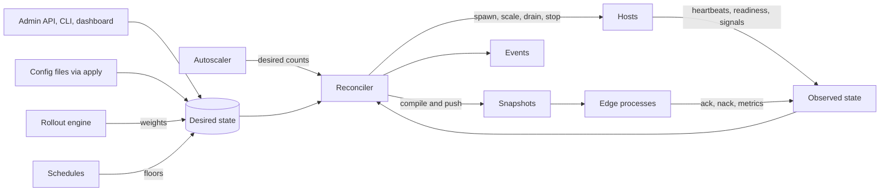
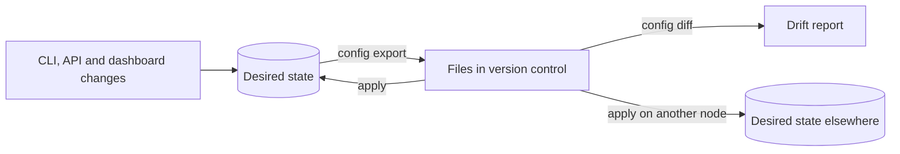

# 10. Control plane

```{admonition} Design specification
:class: note

This page is part of the Muru design specification and describes intended
design, for contributors. The user documentation is authoritative for released
behaviour. See the [specification index](index.md) for status and how the
specification is maintained.
```

The controller stores desired state and continuously drives observed state toward it. Imperative commands, declarative files, the dashboard, schedules and rollouts all change desired state; only the reconciler acts.

## 10.1 Reconciler



The reconciler is level-triggered and idempotent: each pass compares desired and observed state per object and issues the minimal actions, so a restart in the middle of a deploy simply continues.

## 10.2 State store, persistence and recovery

- SQLite in WAL mode in the state directory (section 13.8), holding desired state, release records, rollout history, events within retention and the audit log. Schema migrations are forward-compatible for one version, so a failed daemon upgrade can be reversed.
- Each host is started with a random token and a run directory containing its control socket. After a daemon restart the daemon scans run directories, verifies tokens and process start times, and re-adopts hosts. Hosts not in desired state are drained and removed after a grace period.
- muructl daemon backup and restore save and load the whole store.

## 10.3 Configuration files

- The daemon configuration file (found as described in section 13.8) holds node settings: listeners and edge pools, paths, budgets, tools, event sinks, admin access. It is re-read with muructl daemon reload or SIGHUP.
- **Details fixed by the implementation.** The file is read the same way at start and on reload, checked whole, and the reload applies what changed, each table in its own way. The edge's tables (`[proxy]`, `[compression]`, `[error_pages]`, `[error_override]`, `[[client_class]]`, `[rate_limit]`, `[limits]`, a listener's `h2c` and the access log keys of `[logs]`) go to the edge in the next snapshot, which carries the limits (section 4.6) and the access log's filter (section 11.2) as it carries the rest; a connection already open keeps the limits it was accepted under, and the listeners' connection limits and the spool's quota change at once. A changed set of `[[listener]]` entries starts a new edge on the new listeners and stops the old one as section 13.4 does, a kept listener keeping its socket and backlog; the new listeners are bound before anything is applied, so one that cannot be bound fails the reload with nothing changed. `[[events.sink]]` entries are started, stopped or restarted by name, each on the cursor the store keeps for it, so a sink that comes back delivers what it missed. The budget, the dashboard's actions switch and the secret stores (section 10.8, consulted when a release starts) are swapped in place, and the log rotator takes the new `[logs]` policy for its next check (section 11.3), a changed period rotating each file once. The `[metrics]` table, the dashboard's listen address, `[overlay_webhook]` and the daemon's user are read at start, and the command line's `--listen`, `--metrics`, `--dashboard` and `--user` stand over the file on every reload. The reload's answer and the `config.reloaded` event name what changed and what was done about it, what is unchanged, what could not be applied and what is read at start.
- Application configuration can be applied from files (muructl apply -f FILE or DIR) or created through the CLI and API. Files support ${VAR} interpolation.
- The schema is versioned (schema_version at the top of each file), validated before apply, and published as JSON Schema for editor support.

## 10.4 Export, diff and apply



- Export writes desired state only, never observed state. Applying an export to its source produces no changes.
- Options: whole system or --app, --split into one file per application, --all-releases, --resolve-rollouts, --redact, --param name=value to replace literals with variables, TOML or JSON.
- Export writes a release the daemon has, with its settings spelled out whether or not they are the defaults and its interpreter as the path it resolved to, so that the file applies back to the daemon it came from without a change (ADR 0052). Without --all-releases it writes each application's serving release and every release that a route it writes names in its traffic split or client classes, so that the file also applies to another node, where `serving` starts those releases held. Where each of those settings came from is what `config show --effective` reports (section 3.3).
- Secrets are exported as references, never values. Output is deterministically ordered with a header naming version, node, time and state version.
- apply supports --dry-run (below) and --prune, which removes objects that the files no longer contain. A prune that would remove a release a route the files keep names in its traffic split or client classes, or the application such a route names, is refused, naming the route and what it names.
- apply takes the flags that say how a release is deployed, as muructl deploy does, and they act on every release the apply adds, in every application: --hold starts them and leaves traffic where it is, --no-wait returns once they are recorded, and --retain and --retain-workers say how long, and with how many workers, a release one of them replaces, or a promotion takes over from, stays warm. A plan and a report say `held` of each release started that way, and a dry run says what becomes of each release that would be replaced. A file has no key for any of them: they describe the act of applying, not the state applied (ADR 0052).
- An application's `serving` key names the release that serves its traffic, a declared release or one the daemon has; naming neither is refused (ADR 0054). The other releases the apply adds are started held, serving only what a route split, a preview or a rollout gives them, and naming a release the daemon has that does not serve plans a `promote`, the switch and drain of a blue/green promotion (section 9.2), carried out after the hosts, routes and overlays so that a split the same files write keeps the releases it names. Without the key, each release the apply adds serves in turn, so the last in id order serves in the end: ids of the form `rN` first, by number, then every other id, by name. --hold with a key that would move traffic is refused. While a rollout is under way the key may name its baseline or its candidate, and the rollout moves the traffic: nothing is promoted, naming the baseline warns that applying the files again after the rollout promotes would promote the baseline back, and naming another release is refused until the rollout is promoted or aborted. With --prune, the release that serves after the apply, by the key or without it, must be declared, or the plan refuses. Export writes the key for each application with a serving release. A plan's deploy says `held`, `serving`, or without the key `serving until` the release that replaces it, and a promotion names the release it takes over from.
- muructl render APP [SOURCE] writes the release a command line describes as an `[app.APP.release.ID]` table of this format, for a file kept in version control or given to apply. It takes the settings muructl deploy takes for a release, defined once for both commands, and none of the flags about how a deploy is carried out or where a daemon is. It contacts no daemon. The id is --release, else r1. Each setting comes from the flags, then the source's own settings, then the defaults, and never from an earlier release, so applying the table gives the release a deploy with --fresh gives for the same flags. A setting left at its default is not written; --full writes every setting a flag can set, with a comment beside each naming the command line, the source's settings or the default, and names those that are off unless set. The source is written as the command line gives it, and a relative one is taken from the file's directory when applied. The interpreter is written only when a flag or the source's settings name one, since the path it would resolve to here is not the node's: the daemon finds it at the apply, as it builds an environment the release needs. Secrets are written as references. What a deploy would refuse is refused and nothing is written. --json writes the same document as JSON (ADR 0052).
- A file in this format kept beside a project's code is named `muru.daemon.toml` by convention, since `muru.toml` there is the project's settings file (section 6.8), which has other keys and is read from a release's source. A project's settings file refused for a key of this format says what the file was taken for and names the convention (ADR 0051). A release's table needs only its `source` there, since what it leaves out comes from the source's own settings.

**Dry runs and plans.** muructl apply --dry-run reports what an apply would change and what the system would do about it, without changing anything. The report has four parts:

1. **Validation:** schema errors, unknown keys and type errors with file and line; broken references (routes to missing applications or upstreams, release paths or images that do not exist, undefined mounts, groups or accept_redirects_from targets); and conflicts (duplicate host names, overlapping group paths, overlays writing the same field without priorities, inconsistent timeouts such as a hard timeout below the soft timeout).
2. **Diff:** objects added, changed and removed (removals only with --prune), with field-level differences, the layer each value comes from, and secrets redacted.
3. **Plan:** the actions the reconciler would take, grouped by disruption.
4. **Impact and warnings:** whether new releases or variants fit the node's memory budget (estimated from comparable running releases), deploy freezes that would block part of the apply, active overlays that would mask a change while they last, running rollouts the change would pause or conflict with, and anything the dry run cannot verify.

| Plan class | Examples |
| --- | --- |
| Live, no disruption | route, limit, proxy, error page, weight and certificate changes, applied in the next snapshot |
| Scaling | workers to fork or drain, schedules to activate |
| Rolling restart | thread counts, max_requests, memory policy or hook changes, per group, with the max_surge that will be used |
| New release | code, interpreter, environment, entrypoint or mount changes, including any build step and how traffic would move under the application's default strategy |
| Removal | releases, routes or hosts to drain and delete (only with --prune) |

muructl deploy --dry-run asks the daemon the same of one deploy: the id the release would take, each setting with the layer it would come from (the flags, the source's settings, the previous release unless the deploy is fresh, or the default), whether an environment would be built, what becomes of the release that serves, and what would refuse the deploy: an id already taken, a deploy freeze, a setting that fails its check or a release the node's memory budget has no room for. It installs nothing, so an interpreter a deploy would fetch is reported as missing. A deploy always plans a change, so its exit code is 0 when it would go ahead and 1 when it would be refused.

What a dry run cannot know, such as whether new code imports cleanly, is listed explicitly. --check additionally runs muructl check on new or changed releases in throwaway hosts.

For scripts and CI: --json gives the same report in machine-readable form, and the exit code is 0 for no changes, 2 for changes planned and 1 for errors; after an apply it is 1 when a change failed or the edge did not take the snapshot that carries the changes, which the report names. --save-plan FILE records the plan with the state versions it was computed against, and muructl apply --plan FILE applies exactly that plan, refusing if desired state has changed since. This supports a reviewed workflow in which a pull request's plan is produced in CI, reviewed and then applied unchanged.

- **Details fixed by the implementation.** `--resolve-rollouts` writes each rollout under way (running, paused or awaiting approval) as where it stands, since rollouts are not declared in files: the candidate and the baseline are both declared, and each of the application's routes gets a traffic split giving the candidate its share in force and the baseline what the route's other shares leave, so the file gives the same split whichever release ends up serving after an apply. A rollout that has ended is not written.

## 10.5 What changes live

| Change | Mechanism | Disruption |
| --- | --- | --- |
| Hosts, routes, weights, limits, timeouts, error pages, proxies, certificates | snapshot swap | none |
| Worker counts, scaling settings, schedules | host forks or drains | none |
| Thread counts, max_requests, memory policy, hooks | rolling worker restart per group | none, bounded by max_surge |
| Code, interpreter, environment, entrypoints, mounts | new release | none |
| Edge pools and process counts | edge processes added or replaced with handoff | none |
| Edge or daemon binary | handoff or re-exec | none to traffic |
| New listener address | daemon creates socket, edge adopts it | none for existing listeners |

## 10.6 Admin API and access

- gRPC service muru.admin.v1 on the admin Unix socket (owner and group restricted), optionally over TCP with mTLS. A JSON gateway exposes the same operations for the dashboard and scripts. Appendix B lists resources and operations.
- Roles: read, deploy and admin. Socket access maps local users to roles through group membership. TCP access maps client certificate subjects or bearer tokens to roles.
- Every mutating call carries an idempotency key, is checked against resource_version, written to the audit log with the caller's identity, and emitted as an event.

## 10.7 Dashboard

Browsers cannot speak native gRPC, so the dashboard uses the JSON gateway: plain HTTP with JSON and Server-Sent Events, served by the same process as the admin API. Pages are rendered on the server from Rust templates (askama) and kept live with htmx and its Server-Sent Events extension, fed by the Watch streams. Charts use uPlot. htmx and uPlot are small JavaScript files vendored into the repository and embedded in the binary, so building the dashboard needs only cargo, with no Node toolchain or bundler. A minimal read-only dashboard is available in muructl run from phase 1 (workers, requests per second, latency, recent requests and logs), and grows with each phase. If richer client-side interaction is needed later, individual views can move to a small component library such as Preact without changing the gateway. Under the daemon every page needs a signed-in session, which may look, or act when it was asked for with the actions and configuration allows them (ADR 0030). Mutating actions (promote, roll back, drain, pin scale, maintenance) are authenticated, CSRF-protected and audit-logged. Views: overview, applications and releases, hosts and workers with scaling signals and decisions, routes and rollouts, drains and events, throughput charts from in-memory history (1 hour at 1 second, 24 hours at 1 minute), and logs. It binds to loopback or the admin socket by default and is served with a strict content security policy.

- **Details fixed by the implementation.** Authentication rests on the admin socket: `muructl dashboard login` calls DashboardLogin, which issues a random single-use code good for five minutes and answers with the link `/login?code=` on the dashboard's address, or under `--url` (or `MURU_DASHBOARD_URL`), and redeeming it sets the session cookie `muru_dashboard` (HttpOnly, SameSite=Strict, no Path, twelve hours) and answers 303 to `./`. `--actions` asks for a session that may act, refused unless the daemon file's `[dashboard]` table has `actions = true`; `--token` opens a session at once and prints its id, which a script sends as `Authorization: Bearer`. Sessions live in the daemon's memory, so a restart ends them. Every path needs a session except `/login`, `/metrics` and `/static/`; without one, `/` answers 401 with a page saying how to sign in and the rest 401 in plain text. The pages' addresses, the charts' requests and the redirects are relative, so the dashboard works under any path prefix. An action is a POST to `/actions/NAME` from a session that may act, with a body of at most 4 KiB: by cookie, it must come from the dashboard's own origin, which `Sec-Fetch-Site: same-origin` shows when the browser sends it and otherwise an Origin of `http://` or `https://` and the request's Host, and carry the session's own token in a `csrf` field, compared in constant time; by bearer token neither is needed. The answer is 303 to `../`, the page, or to `../` and a `back` field naming a worker page, or 400 for a form that is not an action, 403, or 409 with the reason the action failed. The pages add `form-action 'self'` and `frame-ancestors 'none'` to their policy. The actions are `maintenance` (`app`, `state`), `promote` (`app`, `release`, refused for an application an overlay freezes, with no override from a page), `rollback` (`app`), `drain` (`app`, `release`), `scale` (`app`, `release`, `group`, `processes` or `unpin`) and `restart` (`app`, `release`, `worker`, `force`), each carried out through the reconciler as the admin API's call is, the page offering each where the release's or worker's state allows it. The worker inspection views (section 11.7) are `/workers?release=APP@RELEASE`, the release's workers as `debug status` lists them, refreshed every two seconds, with their stacks merged as `debug stacks` merges them, and `/worker?release=APP@RELEASE&worker=N`, one worker's status, stacks and tasks, with its memory on request, since counting its objects holds the interpreter; each asks the workers through the reconciler as the Debug call does, with the same waits, so a memory view is a `debug.memory` event as the command is. The fragments `/fragment/workers/OP` and the JSON `/v1/debug/OP`, for `status`, `stacks`, `tasks` and `memory`, take the same `release` and `worker` parameters; the JSON is shaped as `muructl debug --json` prints it, and a release that is not running is 409 to a script and a sentence in a page. Issuing a link or a token is a `dashboard.login_issued` event and each action a `dashboard.action` event naming the first eight characters of the session's id, beside the action's own events. `muructl run`'s dashboard needs no session.

## 10.8 Secrets

Applications need credentials, and the configuration model refers to them by name so that exports, events, logs and dry runs never contain their values.

- **Stores.** Secret stores are declared in the daemon configuration, each with a name and a kind: file (a directory of files readable only by the daemon), env (variables in the daemon's own environment, for container and CI deployments), or exec (a configured command that prints the value for a given key, used as the adapter for Vault, cloud secret managers or the 1Password CLI).

```toml
[secrets.store.local]
kind = 'file'

[secrets.store.ci]
kind = 'env'

[secrets.store.vault]
kind = 'exec'
command = ['/usr/local/bin/vault-read', '{key}']
timeout = '5s'
```

- **References.** Configuration refers to a secret with a structured value naming the store and key, in the same style as every other setting:

```toml
[app.shop.release.r42.env]
DJANGO_SETTINGS_MODULE = 'shop.settings'
DB_PASSWORD = { secret = { store = 'local', key = 'shop-db-password' } }
API_KEY = { secret = { store = 'vault', key = 'shop/api-key' }, as = 'file' }
```

- **Delivery.** By default the value is delivered as an environment variable. With as = 'file', it is written to a file under the release's run directory with mode 0400 owned by the application user, and VAR_FILE holds its path, following the NAME_FILE convention. The host's files are removed whenever it stops for good or goes idle, and written again at its next start; a detaching daemon leaves them for the host still serving. A command run with the release (section 9.12) writes its own under RUNTIME/apps/APP/RELEASE/commands/N, removed when it ends. Values are resolved when a release is created and are part of the release's identity: rotating a secret means a new release, which gets the usual drain and rollback.
- **Handling.** Values are held only as long as needed, never written to the state store, exports, events, logs, dry-run output or diagnostic bundles, and never passed on a command line. Exports and diffs show the store and key. muructl secret set, list and remove manage file stores; list shows names only.

## 10.9 Per-application users and isolation

```toml
[app.shop]
user = 'shop'
group = 'shop'
umask = '027'
limits = { nofile = 65536, memory = '4GiB', cpu = 2.0 }     # cgroup limits on Linux
```

- When the daemon runs as root, each application's hosts and workers run as the configured user and group, or as the service user (ADR 0026: `muru`, or the `[daemon]` table's `user` or `--user`) when the application names none; never as root unless `user = 'root'` is written, which records an `app.user_is_root` warning at each release start. The release's run directory and socket directory are owned by that user, with the edge's group given access to the sockets only. Without root (user mode), everything runs as the daemon's user and a configured user is reported as not applied.
- The daemon creates no accounts. A root daemon whose service user does not exist, or is root, refuses to start and names the remedies. The packages ship a sysusers.d entry for `muru`.
- limits map to per-release cgroups on Linux (section 8.5 describes the container equivalent). cgroups are created by the daemon under its own slice, and delegated by systemd when the unit runs under it.
- Applications never see each other's run directories, spool directories, bytecode caches or secrets, and cannot reach the admin socket unless their user is in the admin group.

## 10.10 Atomic apply

An apply (and every API mutation touching several objects) is validated as a whole and either lands entirely or not at all, producing one new desired-state version. The reconciler then compiles one snapshot for the resulting state. So a change that adds a host, a route and a release cannot leave a route pointing at a host that does not exist, even if the daemon restarts in the middle of the apply.

## 10.11 An MCP server for coding agents

`muructl mcp serve` gives a coding agent the daemon's operations as tools over the Model Context Protocol, on standard input and output, so an agent can deploy each change as a release, test it, read what Muru observes and roll back or drain (ADR 0039). A project lists it in its MCP configuration (`.mcp.json` for Claude Code) as `muructl mcp serve`, with `--up` to start the user daemon when none answers.

- Each tool runs the matching muructl command with `--json` against the same daemon, with the server's `--socket` and location options, and returns what it prints; a command that fails makes the tool return its error's sentence as a tool error. Results therefore have the shapes of the JSON output reference, which every command that reports something shares (`--json` prints the admin API's answer with its field names, JSON lines for streams, `{"error": ...}` on failure).
- The tools are few and shaped like tasks: status, list (one kind of object), release, commands, events, logs, debug (status, stacks, tasks, memory, inspect), scale status, config (show, diff), metrics, websockets and overlay preview read; deploy, promote, rollback, drain, rollout, scale, run command, restart, overlay, maintenance, apply, log level, access log, reopen logs and reload config change things. Stopping, shutting down or upgrading the daemon, running code in workers and one-off commands are not offered; run command runs only what an application declares (section 9.12), and refuses a secret input given as a value, which must name a secret store entry instead. A docs tool returns pages of the user guide embedded in the binary.
- Streams become bounded snapshots: events after a sequence number, the last lines of a log.
- `--read-only` leaves out every tool that changes something; `--allow TOOL,...` keeps only those named. Both are enforced by the server, since the protocol's read-only and destructive annotations, which every tool carries, are advisory.
- The initialize response's instructions carry a short model of Muru's objects (application, release, traffic, rollout, overlay, apply against deploy, and that only the reconciler acts).
- Whoever launches the server has the admin socket's access; for a developer's user daemon that is the intent. Remote agents, and applications acting on their own instance, wait on the TCP admin listener and its access model (section 10.6), with a streamable HTTP transport.
- A skill the project carries, printed and installed by `muructl mcp skill`, teaches what the tools cannot: the development loop, what each operation does to traffic, and what to check after each.
