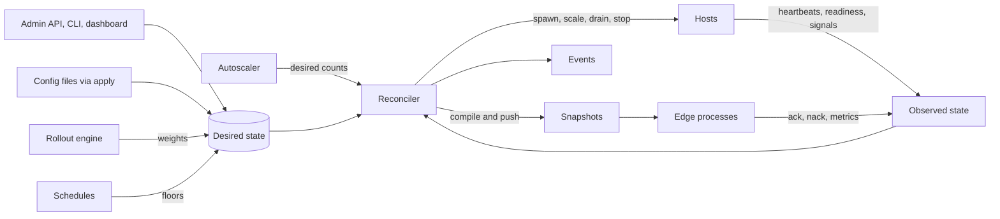
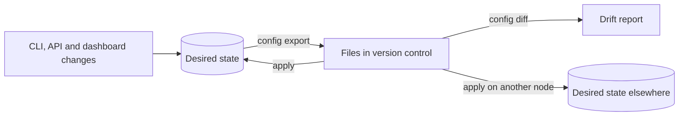

# 10. Control plane

```{admonition} Design specification
:class: note

This page is part of the Muru design specification and describes intended
design, for contributors. The user documentation is authoritative for released
behaviour. See the [specification index](index.md) for status and how the
specification is maintained.
```

The controller stores desired state and continuously drives observed state toward it. Imperative commands, declarative files, the dashboard, schedules and rollouts all change desired state; only the reconciler acts.

## 10.1 Reconciler



The reconciler is level-triggered and idempotent: each pass compares desired and observed state per object and issues the minimal actions, so a restart in the middle of a deploy simply continues.

## 10.2 State store, persistence and recovery

- SQLite in WAL mode in the state directory (section 13.8), holding desired state, release records, rollout history, events within retention and the audit log. Schema migrations are forward-compatible for one version, so a failed daemon upgrade can be reversed.
- Each host is started with a random token and a run directory containing its control socket. After a daemon restart the daemon scans run directories, verifies tokens and process start times, and re-adopts hosts. Hosts not in desired state are drained and removed after a grace period.
- muructl daemon backup and restore save and load the whole store.

## 10.3 Configuration files

- The daemon configuration file (found as described in section 13.8) holds node settings: listeners and edge pools, paths, budgets, tools, event sinks, admin access. It is re-read with muructl daemon reload or SIGHUP.
- Application configuration can be applied from files (muructl apply -f FILE or DIR) or created through the CLI and API. Files support ${VAR} interpolation.
- The schema is versioned (schema_version at the top of each file), validated before apply, and published as JSON Schema for editor support.

## 10.4 Export, diff and apply



- Export writes desired state only, never observed state. Applying an export to its source produces no changes.
- Options: whole system or --app, --split into one file per application, --full with comments naming each value's layer (default writes only non-default values), --all-releases, --resolve-rollouts, --redact, --param name=value to replace literals with variables, TOML or JSON.
- Secrets are exported as references, never values. Output is deterministically ordered with a header naming version, node, time and state version.
- apply supports --dry-run (below) and --prune, which removes objects that the files no longer contain.

**Dry runs and plans.** muructl apply --dry-run reports what an apply would change and what the system would do about it, without changing anything. The report has four parts:

1. **Validation:** schema errors, unknown keys and type errors with file and line; broken references (routes to missing applications or upstreams, release paths or images that do not exist, undefined mounts, groups or accept_redirects_from targets); and conflicts (duplicate host names, overlapping group paths, overlays writing the same field without priorities, inconsistent timeouts such as a hard timeout below the soft timeout).
2. **Diff:** objects added, changed and removed (removals only with --prune), with field-level differences, the layer each value comes from, and secrets redacted.
3. **Plan:** the actions the reconciler would take, grouped by disruption.
4. **Impact and warnings:** whether new releases or variants fit the node's memory budget (estimated from comparable running releases), deploy freezes that would block part of the apply, active overlays that would mask a change while they last, running rollouts the change would pause or conflict with, and anything the dry run cannot verify.

| Plan class | Examples |
| --- | --- |
| Live, no disruption | route, limit, proxy, error page, weight and certificate changes, applied in the next snapshot |
| Scaling | workers to fork or drain, schedules to activate |
| Rolling restart | thread counts, max_requests, memory policy or hook changes, per group, with the max_surge that will be used |
| New release | code, interpreter, environment, entrypoint or mount changes, including any build step and how traffic would move under the application's default strategy |
| Removal | releases, routes or hosts to drain and delete (only with --prune) |

What a dry run cannot know, such as whether new code imports cleanly, is listed explicitly. --check additionally runs muructl check on new or changed releases in throwaway hosts.

For scripts and CI: --json gives the same report in machine-readable form, and the exit code is 0 for no changes, 2 for changes planned and 1 for errors. --save-plan FILE records the plan with the state versions it was computed against, and muructl apply --plan FILE applies exactly that plan, refusing if desired state has changed since. This supports a reviewed workflow in which a pull request's plan is produced in CI, reviewed and then applied unchanged.

## 10.5 What changes live

| Change | Mechanism | Disruption |
| --- | --- | --- |
| Hosts, routes, weights, limits, timeouts, error pages, proxies, certificates | snapshot swap | none |
| Worker counts, scaling settings, schedules | host forks or drains | none |
| Thread counts, max_requests, memory policy, hooks | rolling worker restart per group | none, bounded by max_surge |
| Code, interpreter, environment, entrypoints, mounts | new release | none |
| Edge pools and process counts | edge processes added or replaced with handoff | none |
| Edge or daemon binary | handoff or re-exec | none to traffic |
| New listener address | daemon creates socket, edge adopts it | none for existing listeners |

## 10.6 Admin API and access

- gRPC service muru.admin.v1 on the admin Unix socket (owner and group restricted), optionally over TCP with mTLS. A JSON gateway exposes the same operations for the dashboard and scripts. Appendix B lists resources and operations.
- Roles: read, deploy and admin. Socket access maps local users to roles through group membership. TCP access maps client certificate subjects or bearer tokens to roles.
- Every mutating call carries an idempotency key, is checked against resource_version, written to the audit log with the caller's identity, and emitted as an event.

## 10.7 Dashboard

Browsers cannot speak native gRPC, so the dashboard uses the JSON gateway: plain HTTP with JSON and Server-Sent Events, served by the same process as the admin API. Pages are rendered on the server from Rust templates (askama) and kept live with htmx and its Server-Sent Events extension, fed by the Watch streams. Charts use uPlot. htmx and uPlot are small JavaScript files vendored into the repository and embedded in the binary, so building the dashboard needs only cargo, with no Node toolchain or bundler. A minimal read-only dashboard is available in muructl run from phase 1 (workers, requests per second, latency, recent requests and logs), and grows with each phase. If richer client-side interaction is needed later, individual views can move to a small component library such as Preact without changing the gateway. Read-only by default. Mutating actions (promote, roll back, drain, pin scale, maintenance) are enabled by configuration, authenticated, CSRF-protected and audit-logged. Views: overview, applications and releases, hosts and workers with scaling signals and decisions, routes and rollouts, drains and events, throughput charts from in-memory history (1 hour at 1 second, 24 hours at 1 minute), and logs. It binds to loopback or the admin socket by default and is served with a strict content security policy.

## 10.8 Secrets

Applications need credentials, and the configuration model refers to them by name so that exports, events, logs and dry runs never contain their values.

- **Stores.** Secret stores are declared in the daemon configuration, each with a name and a kind: file (a directory of files readable only by the daemon), env (variables in the daemon's own environment, for container and CI deployments), or exec (a configured command that prints the value for a given key, used as the adapter for Vault, cloud secret managers or the 1Password CLI).

```toml
[secrets.store.local]
kind = 'file'

[secrets.store.ci]
kind = 'env'

[secrets.store.vault]
kind = 'exec'
command = ['/usr/local/bin/vault-read', '{key}']
timeout = '5s'
```

- **References.** Configuration refers to a secret with a structured value naming the store and key, in the same style as every other setting:

```toml
[app.shop.release.r42.env]
DJANGO_SETTINGS_MODULE = 'shop.settings'
DB_PASSWORD = { secret = { store = 'local', key = 'shop-db-password' } }
API_KEY = { secret = { store = 'vault', key = 'shop/api-key' }, as = 'file' }
```

- **Delivery.** By default the value is delivered as an environment variable. With as = 'file', it is written to a file under the release's run directory with mode 0400 owned by the application user, and VAR_FILE holds its path, following the NAME_FILE convention. Values are resolved when a release is created and are part of the release's identity: rotating a secret means a new release, which gets the usual drain and rollback.
- **Handling.** Values are held only as long as needed, never written to the state store, exports, events, logs, dry-run output or diagnostic bundles, and never passed on a command line. Exports and diffs show the store and key. muructl secret set, list and remove manage file stores; list shows names only.

## 10.9 Per-application users and isolation

```toml
[app.shop]
user = 'shop'
group = 'shop'
umask = '027'
limits = { nofile = 65536, memory = '4GiB', cpu = 2.0 }     # cgroup limits on Linux
```

- When the daemon runs as root, each application's hosts and workers run as the configured user and group, or as the service user (ADR 0026: `muru`, or the `[daemon]` table's `user` or `--user`) when the application names none; never as root unless `user = 'root'` is written, which records an `app.user_is_root` warning at each release start. The release's run directory and socket directory are owned by that user, with the edge's group given access to the sockets only. Without root (user mode), everything runs as the daemon's user and a configured user is reported as not applied.
- The daemon creates no accounts. A root daemon whose service user does not exist, or is root, refuses to start and names the remedies. The packages ship a sysusers.d entry for `muru`.
- limits map to per-release cgroups on Linux (section 8.5 describes the container equivalent). cgroups are created by the daemon under its own slice, and delegated by systemd when the unit runs under it.
- Applications never see each other's run directories, spool directories, bytecode caches or secrets, and cannot reach the admin socket unless their user is in the admin group.

## 10.10 Atomic apply

An apply (and every API mutation touching several objects) is validated as a whole and either lands entirely or not at all, producing one new desired-state version. The reconciler then compiles one snapshot for the resulting state. So a change that adds a host, a route and a release cannot leave a route pointing at a host that does not exist, even if the daemon restarts in the middle of the apply.
