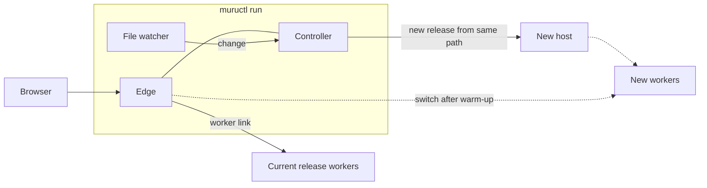
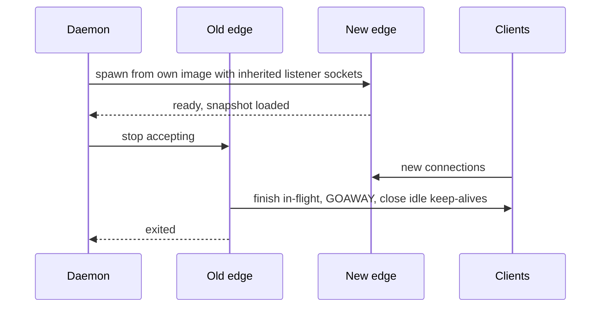

# 13. Operations

```{admonition} Design specification
:class: note

This page is part of the Muru design specification and describes intended
design, for contributors. The user documentation is authoritative for released
behaviour. See the [specification index](index.md) for status and how the
specification is maintained.
```

The same components run in every setting, from a laptop to a production node. Development mode embeds the controller and edge in one process; production runs them as a daemon with separate edge processes.

## 13.1 Development mode

```
muructl run                                        # uses [tool.muru] in the current project
muructl run shop.wsgi:application --reload
muructl run myapp.main:create_app --factory --python 3.13
muructl run ./myproject --processes 2 --threads 8 --bind 127.0.0.1:9000
muructl run app:app --single                       # one process, one thread, no fork, for debuggers
```

- No daemon, root, state store or systemd, and nothing written into the project directory (locations in section 13.8). Controller and edge run as threads of one process, hosts and workers as children. Loopback only, HTTP on port 8080 by default, HTTPS on 8443 when enabled (below).
- Interface detection from the callable. The interpreter comes from the active virtualenv or ./.venv, otherwise uv resolves --python or requires-python.
- Defaults: one worker with a few threads for WSGI, one event loop for ASGI, preload auto as in the daemon (so an import that is not fork-safe is reported on the laptop, not in production), wsgi.multiprocess False for single-process runs, 100 MB body limit.
- Terminal output shows tagged application output and, by default, compact access log lines. --access-log controls the access log: terminal (default), off, errors (only 4xx and 5xx responses and requests slower than --slow, default 1 s), or a file path, which writes it there instead of the terminal. --access-log-exclude PATTERN hides matching paths, for example static assets or health probes (probes are already excluded). Whatever is shown, the access log is still kept in memory and available through muructl logs --access and the dashboard. The dashboard and admin socket are available on loopback.
- --print-config writes the equivalent declarative file, which is the path to a long-running setup.

**HTTPS in development.** TLS works in development mode with the same edge code as production, which matters for testing Secure cookies, HTTP/2 (browsers only use it over TLS), WebSockets over wss and anything that checks wsgi.url_scheme.

```
muructl run app:app --https                               # HTTP on 8080 and HTTPS on 8443
muructl run app:app --https-only                          # HTTPS on 8443, HTTP redirects to it
muructl run app:app --tls-cert cert.pem --tls-key key.pem # your own certificate
muructl run app:app --https --host shop.localhost         # extra names on the certificate
```

- **Certificates:** with --https and no certificate given, muructl creates one for localhost, 127.0.0.1, ::1 and any --host names. If a local development certificate authority created by mkcert is installed (found through mkcert -CAROOT), the certificate is issued from it, so browsers trust it without warnings. Otherwise a self-signed certificate is created and muructl prints how to trust it or install mkcert. Generated certificates and keys are kept in the user cache directory (section 13.8), never in the project, and are reused until they near expiry.
- **Ports:** HTTP 8080 and HTTPS 8443 by default, changed with --port and --https-port. If a port is in use, muructl run fails with a message naming the port and the process holding it where it can determine that. --port auto picks free ports and prints them.
- **Headers:** Muru adds no HSTS header in development, because HSTS on localhost would affect every other local server. The development page warns if the application itself sends one.



## 13.2 From one application to many

| Level | Commands | What you get |
| --- | --- | --- |
| Development | muructl run --reload | ephemeral, no configuration |
| One long-running application | muructl up, muructl deploy APP PATH | daemon, state, zero-downtime deploys |
| Several applications | muructl apply -f config/ | virtual hosts, TLS, per-application users |
| Managed rollouts | muructl rollout canary ... | canaries, gates, A/B |

## 13.3 Running under systemd

```
[Unit]
Description=Muru
After=network-online.target

[Service]
Type=notify
ExecStart=/usr/bin/muructl daemon run --system
ExecReload=/usr/bin/muructl daemon reload
ExecStop=/usr/bin/muructl daemon stop --shutdown --timeout 60s
TimeoutStopSec=90
ConfigurationDirectory=muru
StateDirectory=muru
CacheDirectory=muru
LogsDirectory=muru
RuntimeDirectory=muru
RuntimeDirectoryPreserve=yes
KillMode=process
Restart=on-failure
LimitNOFILE=1048576

[Install]
WantedBy=multi-user.target
```

The directory settings let systemd create and own the locations (section 13.8), which the daemon reads from the environment, so no paths are hard-coded. KillMode=process keeps hosts running if systemd restarts the daemon, so they can be re-adopted, and RuntimeDirectoryPreserve=yes keeps their control sockets in place across that restart. The daemon notifies readiness with sd_notify. Without systemd, muructl daemon start, stop, restart and status manage a background daemon.

**Stopping the daemon.** muructl daemon stop (and systemd's stop) detaches by default: the daemon exits but hosts, workers and edges keep serving, and the next daemon start re-adopts them, so a daemon restart or upgrade never interrupts traffic. muructl daemon stop --shutdown drains every release (with the drain timeouts of section 9.5), stops edges and hosts, then exits, for taking a node out of service or before a reboot. On a system shutdown, systemd stops the unit; the ExecStop line in the unit above gives applications a bounded drain before remaining processes are killed.

## 13.4 Upgrading Muru itself



- Installing a new package changes nothing until muructl daemon upgrade. The daemon then re-execs from the new binary (keeping its pid, children and listener sockets), reloads state, re-adopts hosts and replaces the edges with the handoff above.
- Runtime library upgrades take effect for new releases. Old releases keep their runtime within the protocol compatibility window.

## 13.5 Backups

muructl daemon backup writes the state store (desired state, release records, rollout history, events and audit log). Configuration exports are the recommended way to keep desired state in version control; backups preserve history.

## 13.6 Large monoliths

- Warm-up gating keeps slow-starting releases out of traffic until ready, with per-release startup timeouts.
- Two releases overlap during deploys, roughly doubling memory. The daemon checks the node memory budget before starting a release and refuses or queues the deploy instead of letting the node swap.
- Workers start in staggered batches. gc.freeze() and preload keep memory shared.
- Cgroups or containers give per-release limits.

## 13.7 Beyond one node

Multi-node operation is a later phase: the supervisor role becomes a per-node daemon, a controller manages several nodes, and edges run per node behind an L4 load balancer or centrally. Worker endpoints already sit behind an address abstraction, so Unix sockets can become TCP with mTLS.

## 13.8 File locations

Muru has no fixed paths. Each location is resolved at start-up from the first of these that applies:

1. Explicit options: --config, --state-dir, --run-dir, --log-dir and --cache-dir, or the matching keys in the configuration file.
2. Environment variables: MURU_CONFIG, MURU_STATE_DIR, MURU_RUN_DIR, MURU_LOG_DIR and MURU_CACHE_DIR.
3. Directories provided by systemd: when the unit sets ConfigurationDirectory=, StateDirectory=, RuntimeDirectory=, LogsDirectory= or CacheDirectory=, systemd creates them with the right ownership and passes their paths in environment variables, which the daemon uses. The unit file then decides the locations.
4. Defaults for the mode the process runs in.

| Location | Holds | System mode (root, or --system) | User mode, Linux | User mode, macOS | Development (muructl run) |
| --- | --- | --- | --- | --- | --- |
| Config | daemon configuration file, and relative paths in it such as lists | /etc/muru/muru.toml | ~/.config/muru/muru.toml | ~/Library/Application Support/muru/muru.toml | none, configuration from flags and the project's [tool.muru] |
| State | state store, built environments, redirected bytecode, managed tools, uv's Python installs | /var/lib/muru | ~/.local/state/muru | ~/Library/Application Support/muru | in memory, or --state-dir |
| Runtime | admin socket, per-release run directories with control and worker sockets | /run/muru | $XDG_RUNTIME_DIR/muru | /tmp/muru-UID (short, for the 104-byte socket path limit) | a per-run directory under the user runtime location, removed on exit |
| Logs | log files when file sinks are configured | /var/log/muru, or journald | ~/.local/state/muru/logs | ~/Library/Logs/muru | terminal, or --log-dir |
| Cache | runtime library wheels per interpreter tag and other re-creatable files | /var/cache/muru | ~/.cache/muru | ~/Library/Caches/muru | the user cache location |

Linux user-mode defaults follow the XDG base directory conventions (XDG_CONFIG_HOME, XDG_STATE_HOME, XDG_RUNTIME_DIR and XDG_CACHE_HOME are honoured when set). Paths elsewhere in this specification that sit under these locations are relative to them, for example STATE/pycache or RUNTIME/admin.sock.

**Development runs.** muructl run uses neither the system nor the daemon's user locations and writes nothing into the project directory. Sockets and run directories go in a temporary per-run directory, state stays in memory unless --state-dir is given, logs go to the terminal, bytecode uses the normal `__pycache__` beside the source, and the application's own virtualenv is used as is. Only re-creatable artifacts shared across projects go in the user cache. Several development runs, in different projects, can run at the same time without a daemon.

**Finding a running instance.** Client commands look for an admin socket in this order: MURU_SOCKET (or --socket), a development run started from the current project directory (each run records its socket under the user runtime location, keyed by project directory), the user daemon's socket, then the system daemon's socket. muructl status reports which one it connected to. muructl run prints its socket and dashboard address at start-up.

**Visibility.** muructl daemon run --print-paths, muructl status and just doctor show every resolved location and which rule chose it.
