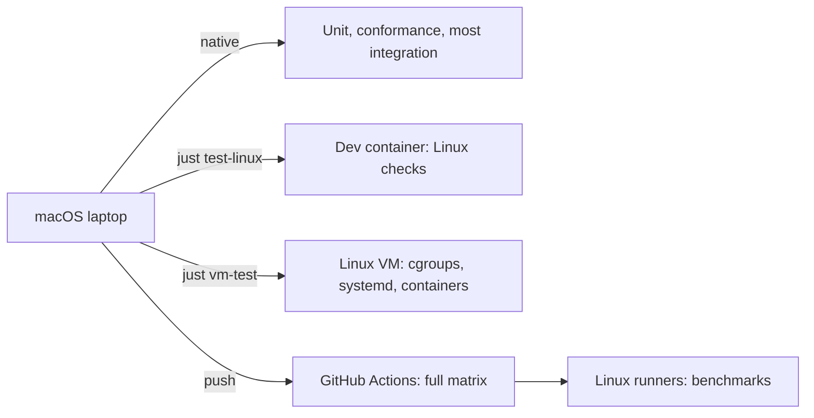

# 15. Testing strategy

```{admonition} Design specification
:class: note

This page is part of the Muru design specification and describes intended
design, for contributors. The user documentation is authoritative for released
behaviour. See the [specification index](index.md) for status and how the
specification is maintained.
```

Most of Muru's value is in behaviour under change and failure (deploys, drains, crashes, upgrades), so integration and fault-injection tests matter as much as unit tests. Every test that needs something unusual (Docker, network, root, a specific Python) is marked, so the default local run needs only Rust, uv and Python.

## 15.1 Test layers

| Layer | Tooling | What it covers |
| --- | --- | --- |
| Rust unit tests | cargo nextest, proptest | Config parsing and precedence, host and path matching, bucketing ranges and stability, header normalisation, proxy resolution, flush policy, scaling decisions with a fake clock, schedule evaluation, snapshot compilation, event encoding |
| Python unit tests | pytest | Host control loop, hooks, logging defaults (lastResort behaviour with basicConfig and dictConfig), configuration loading, uploads API, context API outside Muru |
| Bridge tests | pytest with the extension in an in-process test mode | WSGI and ASGI semantics without a running edge: environ and scope contents, input reading, close(), file_wrapper, exc_info, lifespan, disconnects, backpressure |
| Conformance | Custom suites plus external tools | PEP 3333 behaviour (including wsgiref.validate), ASGI 3.0 HTTP, WebSocket and lifespan, HTTP/1.1 parsing and request smuggling corpus, HTTP/2 with h2spec, WebSockets with the Autobahn test suite, gRPC with the gRPC interoperability test client (including gRPC-Web) |
| Protocol compatibility | Rust and Python tests | Daemon at version N against runtime N and N-1, rejection outside the window |
| Integration | pytest driving muructl, muru-testkit | End-to-end scenarios against fixture applications (15.2) |
| Fault injection | Integration harness with kill, stop and resource limits | Crashes, hangs, slow clients, full disks, lost heartbeats |
| Fuzzing | cargo-fuzz | Request heads, header normalisation, forwarding header parsing, multipart parsing, host patterns, configuration files, protocol frames |
| Performance | Benchmark harness (oha or wrk2 style load) | Comparisons and regression tracking (15.4) |
| Soak | Long-running integration scenario | Memory and descriptor stability over 24 hours with regular deploys |

## 15.2 Integration scenarios

- Run each fixture application (plain WSGI, plain ASGI, Flask, Django, Starlette, FastAPI, a WebSocket application, a deliberately leaking application, a slow-import monolith simulation) through muructl run and the daemon, and pass its own test client suite over HTTP.
- Deploy, canary, rollback and blue/green under constant load with zero failed requests, including releases on different Python versions.
- Drain with long requests, streaming responses and WebSockets (1001 close observed).
- Preload modes: fixture applications that open a database or Redis connection, start a Python thread, start a native thread (through a C library), spawn a subprocess, or create an event loop at import each make preload = 'auto' fall back with a warning naming the cause, make preload = true fail the release, and work under preload = false. A fork-safe fixture preloads under auto.
- Kill -9 of a worker, host, edge and daemon during load: expected failures only for requests on the killed worker, re-adoption after daemon restart, no lost listeners.
- Daemon upgrade and edge replacement with zero failed requests.
- Soft and hard timeouts with Python and C-level blocking, stack capture, replacement.
- Memory policy with the leaking application: reclaim, graceful recycle, hard limit, rate limiting.
- Autoscaler scenarios with synthetic load shapes (step, ramp, sawtooth, bursty), asserting worker counts and churn budgets, using an injectable clock.
- Schedules, warm-up and deploy freezes with a fake clock.
- Internal redirects, internal routes and mounts, error pages and override, maintenance mode.
- Uploads: multipart and raw, prechecks, quotas, crash during upload leaves no files.
- Virtual hosts with a test certificate authority: SNI, wildcards, 421 cases.
- Trusted proxies: spoofing attempts, underscore headers, recursive chains, PROXY protocol.
- Log rotation by size, time, logrotate rename plus reopen, and copytruncate, asserting no lost lines.
- Events: every scenario asserts the expected event sequence, and webhook delivery survives a receiver outage.
- Configuration export, apply and diff round-trip with no changes.
- Containers (marked requires_docker): container releases, descriptor passing across the boundary, PID 1 reaping, image probe.
- uv (marked requires_network unless a local wheel directory is provided): interpreter provisioning, builds, runtime installation offline.

## 15.3 Fault and edge cases to cover explicitly

Slow clients that trickle headers and bodies, clients that disconnect mid-request and mid-response, oversized and malformed requests, full spool and log disks, exhausted descriptor limits, applications that ignore close frames, applications that start threads at import, applications that fork subprocesses, and preload failures. Path handling is tested with case and Unicode-normalisation variants of protected, hidden and excluded paths, natively on macOS and on Linux, asserting identical results on both.

## 15.4 Performance

- Scenarios: small responses, large responses, tiny-chunk streaming, large uploads, many idle keep-alive connections, WebSocket echo, mixed WSGI and ASGI mounts.
- Comparisons on the same machine and fixtures: gunicorn (sync and gthread), uvicorn, Granian, and mod_wsgi-express in three configurations: embedded mode, daemon mode with defaults, and daemon mode with script reloading disabled and queue timeout set to 0, which removes per-request checks in the daemon protocol and gives the fairest daemon baseline.
- Metrics: throughput, latency percentiles, CPU per request, memory per worker.
- The benchmark harness stores results as JSON. CI compares against the last main-branch results and flags regressions beyond a threshold (initially 10%) without failing builds.

## 15.5 Running tests locally

```
just dev                  # build the extension into a development virtualenv (maturin develop)
just test                 # Rust unit tests and Python unit tests
just test-integration     # integration scenarios that need no Docker or network
just conformance          # WSGI, ASGI, HTTP and WebSocket suites
just test-docker          # container scenarios
just fuzz TARGET          # run one fuzz target
just bench                # performance scenarios
nox -s tests-3.13         # Python tests on one interpreter, created with uv
nox -s tests-3.15t        # free-threaded build
```

Tests that need Docker, network, root (cgroups, user switching) or long running time carry pytest markers (requires_docker, requires_network, requires_root, slow) and are skipped by default. Tests that depend on Linux-only features carry requires_linux and are skipped on macOS (section 15.6). Coverage is collected with cargo-llvm-cov and coverage.py and reported in CI. Targets start at 80% line coverage for libraries and are raised as the code stabilises.

## 15.6 Development environment

Development is expected on both Linux and macOS. Tests carry a requires_linux marker where they depend on Linux-only features (section 14.3), so the same suites run everywhere and skip what the platform cannot do.

| Where | Use for | How |
| --- | --- | --- |
| Native macOS or Linux | Day-to-day development, muructl run, unit tests, conformance suites, and integration scenarios without Linux-only features | just dev, just test, just test-integration, just conformance |
| Linux development container | Quick Linux checks and editor integration (devcontainer) | just test-linux runs the Linux suites in the dev image with the source bind-mounted |
| Linux virtual machine | Linux-only features under realistic conditions: cgroups, subreaper, O_TMPFILE uploads, USS and PSS, several edge processes, inotify, systemd, and container releases | just vm-up, then just vm-test, which syncs the source and runs the suites over SSH |
| GitHub Actions | Everything, on every pull request (section 16) | automatic |
| Dedicated Linux hosts or CI runners | Performance benchmarks | just bench on Linux only. macOS and desktop container VMs are not representative |



**Development image and devcontainer.** The repository ships images/dev/Dockerfile and .devcontainer/devcontainer.json. The image contains the pinned Rust toolchain, uv, every supported CPython including free-threaded builds, maturin, nox, just and the external test tools (h2spec, the Autobahn test suite, a load generator). Notes for its use:

- Linux build output goes to a separate Cargo target directory in a named volume, so macOS and Linux builds never overwrite each other. Python virtual environments for Linux live in the volume too.
- Tests that need cgroups or user switching require extra privileges (--privileged, or delegated cgroups). just test-linux enables them only for the requires_root suites.
- Container-release tests are possible but awkward here, because the daemon inside the dev container launches sibling containers through the Docker socket, and the run directory must be a path both can see (a shared named volume). The virtual machine is the recommended place for them.
- Directories bind-mounted from macOS into a Linux container keep macOS's case-insensitive behaviour, so case-related bugs can pass in the dev container. The VM's own disk and CI behave like production.

**Linux virtual machine.** A VM definition for Lima (packaging/dev/lima.yaml), also usable with OrbStack machines, provides a recent Ubuntu with systemd, cgroups v2 delegation, Docker or Podman running natively inside the VM, and the same toolchain as the dev image. In it, container releases, systemd units, log rotation with logrotate and every requires_linux test behave as on a real server. just vm-up creates and provisions it, just vm-test syncs the source and runs the suites, and just vm-shell opens a shell. UTM or Multipass can be used with the same provisioning script.

**Expectations.** Local Linux runs are a convenience, not a gate. GitHub Actions runs the full Linux matrix on every pull request, so Linux-only behaviour is always tested before merge even when it was not run locally.

**Prerequisites.** The aim is a short list of system tools; everything else is installed per project by rustup, cargo and uv, at versions pinned in the repository.

| Tool | Needed for | macOS | Linux (Debian or Ubuntu) | Required |
| --- | --- | --- | --- | --- |
| C toolchain and git | Building native code, version control | xcode-select --install | apt install build-essential pkg-config git | yes |
| rustup | Rust toolchain pinned by rust-toolchain.toml, with rustfmt, clippy and llvm-tools-preview | brew install rustup, then rustup-init | rustup.rs installer | yes |
| uv | Python interpreters (all supported versions including free-threaded), virtual environments, maturin, nox, ruff, mypy and Sphinx as project tools | brew install uv | uv installer | yes |
| just | Task runner | brew install just | apt install just, or cargo install | yes |
| cargo-nextest, cargo-llvm-cov, cargo-deny, cargo-audit | Rust tests, coverage, dependency checks | installed by just bootstrap (cargo-binstall where available) | same | yes |
| Nightly Rust and cargo-fuzz | Fuzzing | installed by just bootstrap-fuzz | same | optional |
| Docker Desktop, OrbStack or Colima | Dev container, Autobahn WebSocket suite (runs as an image), container tests | brew install --cask orbstack (or docker, or colima) | Docker Engine or Podman | optional |
| Lima or OrbStack machines | Linux VM for Linux-only tests | brew install lima | not needed | optional on macOS |
| oha | Load generation for benchmarks | brew install oha | cargo install oha | optional |
| h2spec | HTTP/2 conformance | release binary, fetched by just bootstrap-conformance | same | optional |
| gh | Pull requests and CI logs from the terminal | brew install gh | apt install gh | optional |

Not needed: Node.js (the dashboard has no build step), OpenSSL, cmake, Go or NASM (rustls on the ring provider is used, built by the C compiler, ADR 0024), protoc (a vendored protoc is used by the build), a system SQLite (bundled) or a system Python (uv provides them).

**Setup and checks.** Three just targets make the environment reproducible for people and for AI coding agents alike:

| Target | Does |
| --- | --- |
| just doctor | Checks every prerequisite and reports, per tool, found or missing, version against the minimum, and the exact install command for the current platform. Also checks the Rust toolchain from rust-toolchain.toml, the Python versions uv has installed, the descriptor limit, the length of the temporary directory path (macOS socket limit), whether a container runtime and a VM are reachable, and which test markers will be skipped. Exits non-zero when a required tool is missing. just doctor --json gives the same report in machine-readable form |
| just bootstrap | Installs everything that does not need system privileges: Rust components, cargo tools, the supported Python interpreters through uv, the project's development environment (uv sync) and the extension in development mode. Safe to run repeatedly |
| just bootstrap-conformance, just bootstrap-fuzz | Optional extras for conformance tools and fuzzing |

just doctor is a plain POSIX shell script (scripts/doctor.sh), so it works before uv or Rust is installed. The repository also contains an AGENTS.md (and a CLAUDE.md pointing to it) that tells AI coding agents to run just doctor and just bootstrap first, lists the test and lint commands with their markers, explains which tests need Linux, and links to this specification.
