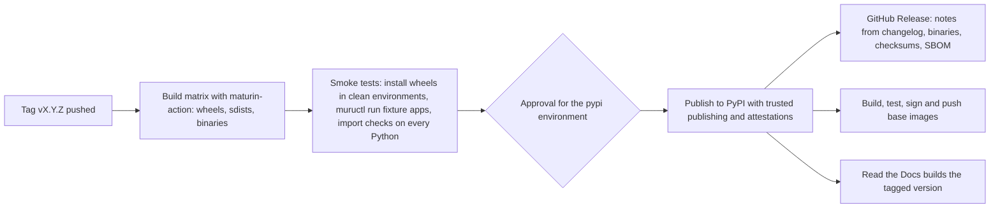

# 17. Packaging and release

```{admonition} Design specification
:class: note

This page is part of the Muru design specification and describes intended
design, for contributors. The user documentation is authoritative for released
behaviour. See the [specification index](index.md) for status and how the
specification is maintained.
```

Two distributions are published to PyPI from one tag, with the same version number: muructl carries the binary, and muru is the runtime library. Releases are built and published only by GitHub Actions using PyPI trusted publishing, with attestations, so no long-lived tokens exist.

## 17.1 Artifacts

| Artifact | Contents | Platforms and tags |
| --- | --- | --- |
| muructl wheels (PyPI) | The muructl executable (maturin, bindings = bin). Optional extra muructl[uv] adds a tested range of the uv package | py3-none for manylinux_2_28 x86_64 and aarch64, musllinux_1_2 x86_64 and aarch64, macOS arm64 and x86_64 |
| muru wheels (PyPI) | Python sources, stubs and the PyO3 extension | version-specific wheels for each supported CPython (cp311 to cp315, cp314t and cp315t, and newer versions as they are released) for the same platforms. The stable ABI (abi3) is not used: free-threaded builds cannot use it, so version-specific wheels keep one build path for both, and allow the full C API where it helps performance |
| sdists (PyPI) | Both distributions, buildable with a Rust toolchain | any |
| Standalone binaries (GitHub Releases) | muructl tarballs per platform, SHA-256 checksums, SBOM (CycloneDX) | Linux and macOS |
| Base images (GHCR) | ghcr.io/grahamdumpleton/muru-python:VERSION-pyX.Y variants (slim, free-threaded, distroless), signed with cosign keyless signatures | linux/amd64 and linux/arm64 |
| Documentation | Built by Read the Docs for each tag |  |

The source repository is github.com/GrahamDumpleton/muru, and images are published to the GitHub Container Registry under the same account (registry paths are lowercase). The PyPI names muru and muructl are registered, with the 0.1.0 pre-releases. The runtime library has no Python dependencies, which is what allows the daemon to install it by unpacking a wheel (section 8.3).

## 17.2 Versioning

- Semantic versioning, shared by muructl and muru. Before 1.0, minor versions may contain breaking changes, which are listed in the changelog.
- The worker protocol and admin API carry their own versions (muru.worker.v1, muru.admin.v1) and compatibility windows, independent of package versions.
- Configuration files carry schema_version. Older schema versions are accepted with deprecation warnings for at least one minor release.
- Pre-releases use PEP 440 suffixes (1.2.0rc1) and are published to PyPI as pre-releases.

## 17.3 Release workflow



- Wheels are built in manylinux and musllinux containers by maturin-action, with cross-compilation for aarch64 where native runners are not used.
- Publishing uses pypa/gh-action-pypi-publish with OpenID Connect trusted publishing from a protected GitHub environment that requires a maintainer's approval. Attestations (PEP 740) are generated during publishing.
- The changelog is assembled from towncrier fragments as part of preparing the tag, in a release pull request.
- If any smoke test fails, nothing is published. A broken release on PyPI is yanked, never deleted, and fixed with a new version.

## 17.4 Release checklist

1. Release pull request from develop to main: version bump in Cargo.toml (the only place the version is stated; the distributions, the Python package and the documentation take it from there), changelog built, documentation updated.
2. Merge, then tag vX.Y.Z on main.
3. Watch release.yml, approve the pypi environment once the builds and smoke tests have passed.
4. Check the GitHub Release, images and documentation version.
5. Announce, including protocol and configuration compatibility notes.
